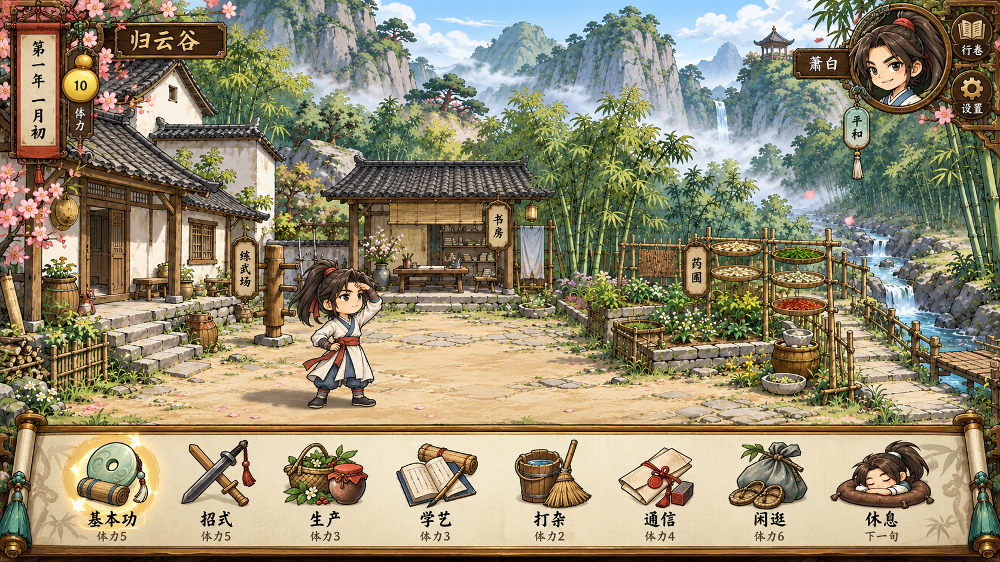

# 归云谷养成首页需求

状态：历史　最后核对：2026-10-19（2026-10-19 归档，只供追溯）

> 2026-10-05费用覆盖：用户已确认每个自由期12点、寄信1、送物2、当前正式人物活动4、W04和三场来客3；同人物每期各一信／一礼，通信熟练首次加2，W04之后免费复看。下文旧费用只描述对应设计版本，当前数值与旧档迁移以[体力规则](../../design/cultivation-energy-rebalance.md)为准。

> 2026-10-04：本文保留旧设计追溯；当前画面和操作以[已确认简化需求](../../design/cultivation-simple-approved.md)、[V5实现](../../design/cultivation-implementation.md)及[交付记录](../../../review/cultivation_v5_20261004/README.md)为准。设施入口、大详情页、整张头像动作与回信UI已经替代，不再作为开发标准。

2026-10-03。用户已确认下图为养成首页的开发基准，要求先形成需求，再实现并通过本地测试。本页取代早期首页线框和 V2 首页位置表；课程、体力、日历、人物与行程仍沿用现有养成规则。验收须查看实际运行截图，不能用生成预览代替运行结果。

## 布局和画面

采用 16∶9 游戏画面，在 1280×720、1920×1080 保持同一构图。四季归云谷背景铺满画面，底部卷轴覆盖前景空地，分界约在画面高度的 76%，菜单约占 24%。保留原背景的建筑与道具位置，不压扁背景，不把地名、日期、费用烧进图片。

| 元素 | 开发要求 | 交互 |
| --- | --- | --- |
| 左上日历 | 瘦长木框、红绸与纸面，竖排显示年、月、当前期 | 点击免费打开三年日历 |
| 左上体力 | 金色葫芦显示真实剩余 0—10，附小字「体力」 | 悬停或聚焦可读完整数值；独占行程显示占期状态 |
| 谷名 | 日历旁横向木牌「归云谷」，不占据场景中央 | 点击免费查看谷中近况，来信有小标记 |
| 右上心情 | 圆形木金框、萧白头像、短姓名牌与下挂心情签 | 平和、舒畅、低落取真实心情；保留眨眼和手势序列，点击查看近况 |
| 行卷与设置 | 右边角两个小彩绘图章，书本与齿轮 | 行卷免费查看记录；设置容纳声音与小游戏候选试玩入口 |
| 书房、练武场、药圃 | 在各自实际设施旁挂细竖牌，纸面墨字，不做大矩形按钮 | 分别定位学艺、基本功、普通药材辨识；只预览，不收费 |
| 场景萧白 | 练场旁使用原有透明 Q 版全身素材，约占画面高四分之一，鞋底接影子 | 未拜师时点击打开拜师说明并显示简短提示；拜师后点击近况，不自动执行课程 |
| 底栏 | 八个实际物件按一行陈列；物件、中文名、费用分三层，字体不压在物件上 | 七类入口与休息；切换类别不扣体力，选中有淡金晕、聚焦有清楚轮廓 |

底栏顺序为「基本功、招式、生产、学艺、打杂、通信、闲逛、休息」。费用依次为 5、5、3、3、2、4、6；末项显示「下一期」。确认图中的「下一旬」仅是美术示意，实际每月仍为月初、上旬、中旬、下旬、月底五期，不能因图片文案改变日历。每个物件与标签整体可点击，两个目标视口保持至少 44px 点击高度，费用至少 16px；详情正文至少 18px。

首页不常驻近况文字卡、横向工具条或数值面板。人物白底必须消除。声音浮钮在养成模式隐藏，声音操作放入设置；退出养成进入探索后恢复原声音入口。小游戏仍是待用户选择的候选，不因这一轮界面开发接入正式剧情。

## 活动和状态

类别展开后继续使用纸面项目列表与详情，保留前置、导师、自有材料、费用和禁用原因；场景、日历、心情和底栏位置稳定。关闭或 Esc 返回首页，Tab 焦点不进入弹层后方；数字 1—7 只选类别，R 只打开休息确认。设置、日历、行卷和近况皆免费。

每个活动保留对应约两秒的 Q 版动作演出，结束前不可跳过、重复执行或发放成果。首次教学仍要求选择；结果中刷新不重复扣费或领奖。三档心情使用真实序列帧，头像可局部取头肩，保持透明边缘；系统减少动态效果时静止，但收费、等待与结果规则相同。缺人物或装饰图时可读文字和操作仍可用。

日历维持三年 36 个月、每月五期、自由期 10 体力。整月大地图模式统一占满当月五期，不能用首页菜单继续修习；返回舆图不推进时间，确认返程才进入下月月初。未来正派、魔教、朝廷共用状态与界面合同，以路线配置替换据点素材和设施入口；本轮仅制作归云谷，不补写另外两线剧情。

## 素材合同

确认预览仅用于对照，原稿保存于 `art_sources/cultivation_layout_20261003/approved-preview.png`。运行时复用四季背景、八物件图集、底栏卷轴、三档心情与全身行动图。新增透明装饰图集提供日历、葫芦、谷名牌、头像圈、设施签、书本图章、齿轮图章、姓名牌；所有日期、姓名、心情、费用由界面绘制。

新素材登记用途、原稿、提示词、透明标记、实际尺寸、SHA-256、取帧区域和回退方式。图片不得覆盖旧稿。主角以萧白现有头发、衣服、红绸、腰带为准，未装备武器时不额外佩剑。

## 本地验收

| 编号 | 必须验证 |
| --- | --- |
| CU-L01 | 两个目标视口的首页全景与确认图对照：底栏比例、日期葫芦、右上圆头像、三个设施签、全身主角与八物件均存在且不裁切 |
| CU-L02 | 日期、真实体力和真实心情更新；三档头像切帧；背景四季一致；装饰不含写死数值 |
| CU-L03 | 八入口、设施签、日历、近况、行卷、设置实际点击可用，查看免费；设置可改声音并打开候选试玩，Tab 和 Esc 可用 |
| CU-L04 | 七类全部项目维持原映射；动作不少于两秒、一次扣费和结算、刷新恢复；首次教学不能跳过 |
| CU-L05 | 零体力仍可确认休息；独占剧情与整月历练暂停据点操作；返程保留所学与物品 |
| CU-L06 | 长详情滚动、字号、点击区域、选中/焦点/禁用可读；缺装饰或 Q 图仍可继续活动，无脚本错误和培养素材 HTTP 缺失 |

证据放入新的 `review/cultivation_layout_20261003/`，保留旧轮截图。自动化报告记录技术结果，截图初始状态为待目视检查；实施者逐张查看后单独记录观察结论。此轮为本地开发测试，不包含线上发布、完整三年剧情平衡或正式独立发布验收。
