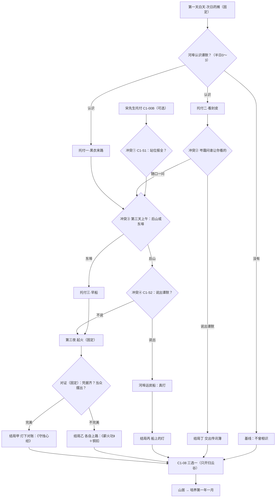

# 栖河·归烬堂暗哨支线（设计稿·第一版）

状态：历史　最后核对：2026-10-22（2026-10-22 用户给出新构思后由第二版取代，只供追溯；现行稿见 [第二版](../../design/qihe-mojiao-observer-sideline.md)）（原记：草稿，2026-10-21）

> **整页待用户拍板。** 本页只是设计稿：不写台词、不改 ink／JS／bible、不生成正式 CG。人物是候选（R-剧情-05），没有写进 `bible/` 和 `story-atlas.json`；凡标“新设定”的都要用户批准后才能进定稿事实表。工作区：设计在 `xiaojianghu`，以后实现在 `xiaojianghu-legacy-prologue`（R-工作区-01）。

用户原话（整改清单第 6 项）：「新增一个魔教的正面人物的支线，他隐隐感觉到不对劲，所以暗中观察，同时也给主角一些支线任务（和另外一条支线（帮助监督三派人士）形成冲突），需要有多条路线，如果处理完美则获得巨大收益（甲等心法），然后根据选择的不同有不同结局（需要重新设计cg和对应剧情）和路线，最终还是归并到三选一培养模式」

路线图：[qihe-mojiao-observer-sideline-routes-v1.png](qihe-mojiao-observer-sideline-routes-v1.png)（Mermaid 原稿见第五节）。

---

## 〇、先核对的事实（以 bible 与代码为准）

| 问题 | 结论 | 依据 |
| --- | --- | --- |
| 本作的“魔教”是谁 | **玄烛会**；归烬堂是它的分堂（上下级，不能把本堂等同全会）。开始部分在栖河出场的“魔教”只有归烬堂：岑霜（本次索匣主事）、乌魁（帮众头目）及其无名帮众 | `docs/design/factions.md`、`factions/guijintang.md`、`factions/xuanzhuhui.md`；`bible/人物/岑霜.md`、`乌魁.md`、`帮众.md` |
| 三派各是什么 | 正道盟·徐令仪（文议执事，要封存“医武谱”）；归烬堂·岑霜（讨“玄曜玉匣”）；巡江司·沈雁回（民间委办，扣药箱查续脉散）。三人各拿一张引“第十七号收货单”的伪附页 | F-0032、F-0033、F-0037 |
| “帮助监督三派人士”那条支线 | **宋先生（乔装的裴嵩）的托付**：替他记下进村的人——谁、几个、站在哪、开口要什么（C1-00B），可答应、问过再答应或拒绝；答应了才有第二、三天上午后山回话（C1-S1、C1-S2）、装卸路和对证里“在路口数人”的中分支、章末红绳。2026-10-21 起为可选、可拒绝 | F-0026、F-0027；`story/01-开始/风起-竹匾.ink`、`风起-后山回话一/二.ink`；`opening-pei-disguise.md`；`registry/story-hooks.json` 的 `c1-00b` |
| 另有三方跑腿 | 拜帖（徐，时限第一天傍晚前）、旧货账（岑，第二天傍晚前）、药单（沈，第二天傍晚前），是“替三方跑腿”，不是监督 | `js/qihe-outsiders.js`、`三方-跑腿-*.ink`、`opening-state.md` 2a |
| 开始部分主线 | 序章（遇狼、递水、进村）→ 第一夜（周婶托付、还碗、取布、送药、过夜）→ 风起栖河：第一天白天（半日 0，次日药摊、竹匾）→ 第一天傍晚（1，徐令仪上门）→ 第二天白天（2）→ 第二天傍晚（3，装卸路）→ 第三天上午（4，收拾药箱）→ 第三天下午（5）→ 第三夜（侧口对峙、起火、撤离、守路）→ 次日清晨邻村对证 → C1-08 商量去处（三选一）→ 道别、上山、红绳（答应过宋先生才有）→ 山居第一夜 → 培养 | `js/qihe-chapter.js`、`opening-state.md` |
| 三选一培养模式 | C1-08《先说清楚，再找去处》的三条去向：① 随周砚赴归云谷（**唯一开放**）② 岑霜·归烬堂（暂未开放，只回一句）③ 沈雁回·巡江司（暂未开放）。之后进入培养第一年一月（`QiheCultivationBridge.enter()`，培养存档 `route:'mountain'`） | `opening-routes.md`、`风起-商量去处.ink`、`js/qihe-cultivation-bridge.js` |
| 甲等心法 | 品阶丁丙乙甲绝，甲为“名家体系”。心法就是内功：一个主动、一个被动。现有甲级内功只有叶蘅家传《归藏息经》（只能请教，不出书）；归烬堂现有《薪火功》（丙）、《余烬息》（乙），**没有甲级**。甲级外派途径是“人物篇或深交”。学习门槛：甲级主属性 12、副属性 9、根骨 8；心法要进入培养才开放。开局五维都是 3 | `martial-structure.md`、`secret-manuals.md`、`martial-lineage.md` 3.2、`martial-review/hearts-numbers.md`、`manual-placement.md` |
| 平衡底线 | 开始部分奖励只放丁、丙级，“不给神功”；防初期无敌靠学习门槛，不靠章节锁；“走完某条大支线也可能拿到功法” | `qihe-hidden-rewards.md` 第 2 节、`martial-lineage.md` 3.2、`xiaojianghu-legacy-prologue/docs/design/qihe-map/expansion/grade-balance.md` |
| CG 流程 | 普通任务最多一张 CG；重要事件通常一张；出场人物要限预算、写清冻结瞬间、进入句与结束句；新图先进 `art_sources/<批次>/`，经制作方核对与用户确认才采用 | `story-presentation.md` 第 5 节、`xiaojianghu-legacy-prologue/docs/design/qihe-map/cg-direction.md`、`docs/updates/2026-10-06-cg-direction.md`、R-素材-01 |

**一个要用户确认的理解**：我把“帮助监督三派人士”理解为宋先生那条托付（他要萧白盯三派），而不是三方跑腿。如果用户指的是三方跑腿，冲突点要改挂到跑腿上，第四节需要重写。

---

## 一、人物卡（候选，三选一）

三个候选都满足：属玄烛会·归烬堂；是正面人物但不是圣人；“不对劲”有具体来由；**开始部分里谁也不知道宋先生是裴嵩**（F-0004），候选也不知道；不改动对证结论“是谁编的附页仍不知道”（F-0037）。

### 候选甲（推荐）：谭默

| 项 | 内容 |
| --- | --- |
| 姓名／性别／年龄 | 谭默，男，34 |
| 所属 | 玄烛会·归烬堂（烬渡堂口） |
| 身份 | 堂口**传讯执事**：收发、登记堂里的传讯，管印封。不是堂主（韩烬川）、不是刑务（邢守夜）、不是本次主事（岑霜） |
| 为何是正面 | 早年是船户，被归烬堂收留；把“说出去的话要兑现”当命。堂里干灰色营生他不否认，但他管的是信，最恨“拿堂里的名义说假话”。来栖河是自己告假，不为讨匣，为的是别让堂里背上“夜里抢村子”的名，也别让村里人替一张假纸受罪 |
| 为何隐隐觉得不对劲 | 让岑霜来栖河的那封传讯（“玉匣是堂里旧物、叶家愿还、正道盟要趁夜接走”）是他登记转出去的。事后对账，有三处别扭：① 这封讯不是从烬渡上游一站站递来的，是汉皋一家代转行送进来的；② 堂口印封是真的，但封口压过两回；③ 讯里引了“叶家旧药罐第十七号收货单”，归烬堂的传讯从不引别家的单号。印是真的，说明经手人可能就在堂里，所以他不敢直接去找岑霜，也不敢回堂里声张——只能自己来看 |
| 为何要暗中 | 他级别不如本次主事，又没有凭据；若说破而查无实据，等于指控堂里伪造传讯。他也不确定岑霜身边谁可靠（乌魁那边先一步就在村里说“叶家肯卖”，消息比人先到） |
| 他知道／不知道 | 知道：传讯的三处别扭、乌魁先到、岑霜后到。不知道：宋先生是谁（只知道萧白每天上午往后山跑）、裴嵩、另两家附页的内容、叶家实际有什么 |
| 外形要点 | 按归烬堂衣装合同（墨紫暗红、斜向衣缘、铜扣分段束腰；堂众简化铜件）。为了不被认出，外面罩一件船户的旧蓑衣、戴斗笠。左手指节有墨迹和火漆烫痕；腰上一只油布包着的传讯簿。瘦、背微驼、眼神慢、记性好 |
| 口吻（示例，非台词） | 话少、慢，先问清再说，常说“对一对”。如：“印是真的。可真印底下，压过两回。” |
| 落脚处 | 东埠河边（河埠）一条运炭船上；归烬堂靠货路谋生，他借的是熟识船户的船 |
| 与已有人物关系 | 岑霜：同堂，认得，她叫他“谭执事”；他敬她讲理，但这回也疑她身边。乌魁：瞧不起“拿笔的”。韩烬川：上司。戚铮：同堂熟人（培养以后可用，不在本支线出场）。与宋先生、三方其余人：无关系 |
| 和 bible 的核对 | 不与任何定稿事实冲突：F-0032“岑霜的附页是堂里传讯”——谭默就是转讯的人，正好接上；F-0037“是谁编的附页仍不知道”——他到最后也只查到“经手不在堂里正路、送信的是同一个受雇脚夫”，不知道是谁；F-0004 不受影响。**新设定**：传讯经汉皋代转、印封压过两回、谭默这个人本身——都需用户批准 |

### 候选乙：卓霁

| 项 | 内容 |
| --- | --- |
| 姓名／性别／年龄 | 卓霁，女，20 |
| 所属／身份 | 归烬堂年轻堂众，随乌魁来栖河的几个帮众之一（不是 bible 里第一夜客栈那个只会复述的无名帮众） |
| 为何是正面 | 船户女儿，十四岁随父投堂，父亲死后留在堂里跑腿；堂里人欺负船户时她会出头，心里有杆秤 |
| 为何觉得不对劲 | 她跟乌魁去过药商那儿——药商只卖过罐子；乌魁回头却说叶家肯卖玉匣。而岑霜带来的堂里传讯，比乌魁往堂里报信还早一天就说“叶家愿还匣”——“堂里怎么比我们先知道？” |
| 为何要暗中 | 级别最低，不能当面顶乌魁；也怕乌魁收了谁的钱 |
| 外形要点 | 墨紫束袖短打、只一枚铜扣，辫子盘起，手上有缆绳磨的茧 |
| 与已有人物 | 乌魁的手下；岑霜叫得出她名字 |
| 弱点 | 二十岁的低阶堂众手里有甲级心法，来由要另编（例如亡父留下、她自己读不懂的一函旧书），说服力弱于甲 |

### 候选丙（复用已有人物）：戚铮

| 项 | 内容 |
| --- | --- |
| 已有设定 | 归烬堂，男 28，冷硬务实，“护货是这个价。把人绑上船，可不是同一桩活。”可招募男同伴 |
| 为何觉得不对劲 | 他先算价：一只匣子出动本次主事，传讯里却没写酬、没写谁出的价；乌魁那边又冒出来路不明的“定钱” |
| 甲级心法的来由 | 很合他：不是送，是**付账**——“活是你干的，这是价”，书是他从别处抵账来的 |
| **冲突** | `story-atlas.json` 写他开始部分“不强占栖河主事位”“不强塞栖河主事戏”，初见在培养第一年（`qi-zheng-1`，地点待重新设计）；`companion-men.md` 要求“不把他替代为岑的无名随从”。用他要把初见挪到开始部分，并改招募线的起点，须用户批准 |
| 好处 | 现有参考立绘可复用（`portraits/qi-zheng-v1.png`，待评审） |

**推荐甲**：他的“不对劲”直接连着本作开始部分的核心谜团（伪造的附页），又不碰已有人物的弧线；甲级书的来由也最顺（见第五节）。下文以谭默写，换成乙或丙时，只改人物和书的来由，结构不变。

一致性检查：`python3 xiaojianghu/tools_docs/consistency_check.py --out <scratch>` 写稿前后各跑一次，结果见文末“检查记录”。

---

## 二、戏眼卡（第一关）

### 整条支线

- **一句话戏眼**：一个替“魔教”管信的人，发现自己经手的那封信是假的，只能躲在船上看；他需要一双能在村里走动的眼睛，偏偏这双眼睛也被另一个人借去数人头了。
- **谁想要什么**：谭默想在三家撞上之前，弄清那封传讯是谁塞进来的，好让堂里不背黑锅、村里不出事。
- **什么挡着他**：没凭据、不能露面、堂里人可能就是经手人；他能托的只有一个刚到村的外乡人——而这人每天上午去后山见一个账房。
- **散场时什么变了**：按萧白的选择，谭默带着凭据回堂、或带着伤离开、或被岑霜带走；萧白手里多了一函书、一枚铜扣，或者什么都没有，只多了一个再也不跟他说话的人。

### 在场人物知道什么、不知道什么

| 人物 | 知道 | 不知道 |
| --- | --- | --- |
| 谭默 | 传讯的三处别扭；乌魁先到；萧白每天上午上后山；凭据做到哪一步就知道到哪一步 | 宋先生是谁、他托萧白做什么（除非萧白说）；另两家附页内容（对证前）；叶家实际只有药签和空压痕 |
| 萧白 | 按实际经历：谭默托了什么、宋先生托了什么、自己对谁说了什么 | 宋先生是裴嵩；谭默的怀疑对不对；谁编的附页 |
| 宋先生（裴嵩） | 自己的全部算盘（作者层）；萧白告诉他的一切 | 谭默的存在（除非萧白在 C1-S2 说出）；遗产不在叶家 |
| 岑霜 | 自己那张堂里传讯；乌魁的做派 | 谭默在村里（除非萧白说出，或结局丙二被乌魁扣住）；传讯经汉皋代转、封口压过两回（对证前） |
| 乌魁及帮众 | 自己散的“叶家肯卖” | 谭默（除非宋先生借人递话，见结局丙） |
| 徐令仪、沈雁回 | 各自的附页 | 谭默；直到对证时萧白当众摆出凭据（结局甲）才知道“三家的补附页是同一个人送的” |
| 叶蘅 | 萧白肯跟她说的部分 | 谭默托付的细节（萧白不说就不知道）。谭默**不要求**萧白瞒着叶蘅——“那是她家的事”；这和宋先生“先别惊动她”恰好相反，是给玩家看的一处对照 |
| 河埠船家（普通 NPC，小头像） | 黑衣人坐的哪条船、从哪边来、给的什么钱 | 雇主是谁 |

各场的戏眼三行见第七节场次清单。

---

## 三、时间线与排期

### 落在哪几天

开始部分不走培养的 `mountain-events.json` 日历，用风起栖河的半日（`halfDay`）：活动不耗时、主线由玩家确认推进（R-时间-01、`opening-state.md` 2a）。本支线全部是**可选**的，跟三方跑腿一样设时限，过时关闭，任务栏标“错过”。

| 半日 | 主线（固定） | 宋先生线（可选，已有） | 谭默线（可选，本稿） | 谭默所在 |
| --- | --- | --- | --- | --- |
| 0 第一天白天 | 次日药摊（药商说递字条的是黑衣人） | C1-00B 竹匾，可答应／拒绝 | **认识谭默**（河埠运炭船旁）；接托付一 | 河埠运炭船 |
| 1 第一天傍晚 | 徐令仪上门 | — | 托付一可做 | 河埠运炭船 |
| 2 第二天白天 | 陪叶蘅去东埠 | C1-S1（只上午、只答应过的） | 托付一可做；接托付二 | 河埠运炭船 |
| 3 第二天傍晚 | 装卸路（岑霜、沈雁回首次露面） | （装卸路“数人”中分支） | 托付二可做；认识的最后时限 | 河埠运炭船（船上看装卸路） |
| 4 第三天上午 | 回叶家收拾药箱 | C1-S2（只上午、只答应过的） | **托付三·早船**（只上午）；托付二最后时限 | 东埠停船处 |
| 5 第三天下午 | 傍晚随药车离村 | — | 结局丙的河埠一场（只在说出过谭默时） | 河埠运炭船 |
| 第三夜 | 侧口对峙、起火、撤离（固定） | — | 不出场（远处看） | 不在任何固定场 |
| 次日清晨 | 邻村对证（固定） | （“路口那个人”中分支） | 对证中分支（见第五节） | 邻村院外柳树下 |
| 对证后 | C1-08 三选一 | — | **结局场**（在 C1-08 确认去向前） | 邻村 |
| 上山路上 | C1-10 红绳（只答应过宋先生的） | 同左 | 不出场 | 已离开 |

### 和人物在场、前置、行动预算的关系（按 `event-scheduling-system.md` 的口径）

- **在场**：谭默每个半日都只登记一个所在地（上表），不进任何固定场；固定场的出场人物一个不加。宋先生只在后山、周砚这两个上午在西田埂（`opening-pei-disguise.md`），三人不会同场。岑霜在第二天傍晚前位于南村口车道旁、之后在东埠装卸路（`qihe-outsiders.js` 的 `location`），托付二按这个去找她。
- **前置**：谭默线只以“认识谭默”为门槛（R-剧情-07，不一断全断）：托付一、二、三互不为前置；错过一个，后面的照常可做，只是凭据不齐。
- **行动预算**：开始部分活动不耗时，没有体力账；唯一的“占用”是**第三天上午二选一**（冲突③）：去后山回宋先生和去东埠守早船都只在这个上午，进了一个，另一个就关闭。选之前明说“这件事只能选一边”，不剧透奖励（同 `qihe-hidden-rewards.md` 规则 6）。
- **R-剧情-07 基线**：主线的触发一个都不读本支线的记录。没认识谭默的玩家，所有固定剧情一字不变（基线“不曾相识”）。固定剧情里受影响的只有**内容**：对证（中分支，多一问）、C1-08（小分支，岑霜那一句换说法）、培养开局（中分支，物品与来信），三处都有基线版本。
- **与其他整改项的依赖**：第 2 项（三个任务拆分）、第 4 项（第一天能否领任务）、第 5 项（客栈、杂货等新布置）可能改动半日时限或地图落点。本稿的时限按 2026-10-21 现行 `opening-state.md` 2a 写，实施前要和那几项的结果对一遍。

---

## 四、谭默给萧白的托付，以及与“监督三派”的冲突

### 三件托付（每件给一样凭据）

| 编号 | 名称 | 时限 | 萧白实际做什么 | 得到的凭据 |
| --- | --- | --- | --- | --- |
| 托付一 | 黑衣来路 | 半日 0～3 | 次日药摊时药商说过递字条的是黑衣人（F-0025）。谭默托萧白去河埠问船家：那人坐哪条船、从哪边来、给的什么钱 | ① 黑衣人是坐下水船从汉皋方向来的受雇脚夫，付的是汉皋的银票（雇主没露面） |
| 托付二 | 看一眼封皮 | 半日 2～4 | 设法看一眼岑霜手里那封传讯的**封皮**（不是内页）。两条路：接了岑霜跑腿的，在“旧罐与玉匣”回话时多一个问法；没接的，装卸路之后在车道旁／东埠找她说话时多一个问法 | ② 封口火漆压过两回，外封是汉皋代转行的纸 |
| 托付三 | 早船 | 只在半日 4（第三天上午） | 在东埠停船处守早船，看谁带信下船、交给谁 | ③ 同一个黑衣脚夫，三封信分别交给正道盟护院、乌魁的帮众、采办随从——三家下午收到的“补来的附页”（F-0033）是一个人送的 |

谭默另有一句叮嘱，接托付一时就说：**“你在路口看见的站位，谁问都别给。”**（他并不知道宋先生，只是看见萧白在数人。）

### 与宋先生“监督三派”的冲突点

| 冲突 | 什么时候 | 两边各要什么 | 萧白的选择 | 后果 |
| --- | --- | --- | --- | --- |
| ① 情报给谁 | 第二天上午 C1-S1（只答应过宋先生的） | 宋先生要徐令仪带了几个护院、站在哪；谭默叮嘱站位谁也别给 | 原有选项不变：“我都看清了”（报全）／“没太看清” | 报全的，凭据再齐也进不了“完美”；谭默在托付二交接时问“那账房问了你什么”，萧白如实说就当场掉一层信任，撒谎则不掉但记 `lied_to_tan` |
| ② 封皮的代价 | 托付二 | 谭默要看封皮；岑霜会反问“谁让你看的？” | 随口一问（她给看一眼，记下萧白“眼睛长得太自在”）／说出有人托我（追问下说出谭默） | 说出谭默 → 走路线四“交给主事” |
| ③ 同一个上午只能选一边 | 第三天上午 | 宋先生在后山等回话（C1-S2）；谭默要萧白守早船 | 去后山／去东埠 | 去东埠：得凭据③，宋先生那段回话就错过了（他本来就只等一个上午，不以 C1-S1 为前置，与现有规则一致）。去后山：缺凭据③，进不了“完美” |
| ④ 谁的事告诉谁 | C1-S2 里（只在认识谭默且去了后山时） | 宋先生多问一句“村里除了你，还有谁在看？” | 不说／说出谭默 | 说出 → 路线三“替宋先生看”，结局丙。作者层：裴嵩不想有人查传讯，借黑衣脚夫把话递给乌魁“堂里来了个查你的”。**剧本里没人点破是谁递的话**，谭默只知道“我只跟你一个人说过” |

强度说明：冲突①是“扣分”，冲突②③是“二选一”，冲突④是“出卖”。用户若嫌太硬，可去掉④，结局丙改由“岑霜那边走漏”触发，见第八节问题 4。

---

## 五、路线与结局

### 路线

| 路线 | 怎么走上来 | 可能的结局 |
| --- | --- | --- |
| 路线一「替谭默对账」 | 认识谭默，**没答应**宋先生（或答应了但第三天去了东埠） | 甲、乙、丁 |
| 路线二「两头传话」 | 同时答应宋先生、接了谭默的托付，两边都不说破 | 甲（最难）、乙、丙、丁 |
| 路线三「替宋先生看」 | 答应宋先生，在 C1-S2 说出谭默 | 丙 |
| 路线四「交给主事」 | 托付二里或第二天傍晚后找岑霜说话时，说出谭默 | 丁 |
| 基线「不曾相识」 | 没在半日 0～3 去河埠，或不接他的托付 | 无结局场 |

同一存档同时满足多条时的优先次序：丙 ＞ 丁 ＞ 甲 ＞ 乙（出卖先于一切）。

### 完美条件（结局甲）

全部满足：
1. 认识谭默并接下托付；
2. 三样凭据齐（托付一、二、三都做了）；
3. 谭默的事没告诉宋先生，也没告诉岑霜；
4. 答应过宋先生的：C1-S1 没把站位报全（`stranger_report≠full`）；
5. 对证时选“当众摆出来”（见下），而不是“私下只给岑霜”。

完美在两条路线上都可达：路线一较容易，路线二要在冲突①③都站到谭默这边，是“处理完美”的难版本。

### 对证里的中分支

固定场《对证》（`qihe_reps_evidence`）在岑霜说“三张纸，一人喂一口”、徐令仪说“是谁改的，眼下还说不准”之后，**只在凭据②③都在手时**多一问：

- 当众摆出：萧白拿出封皮的样子、说出早船上同一个脚夫——三人对一对各自补附页的外封，都是汉皋代转行的纸。结论只多一句“送附页的是同一个受雇的人，雇主没露面”；`mastermindKnown` 仍为 false（F-0037 不变）。若玩家同时说出过宋先生，三人会把“客气的先生”和“后山账房”放在一起想，但没有人说出是谁（F-0004 不变）。
- 私下给岑霜：对证照基线走；散场后岑霜单独收下，记 `cen_seal_private`，导向结局乙。
- 基线：没有这一问。

### 各结局

表里引号中的话只是“这一句要表达什么”的意思要点，不是台词；正式台词按三道关另写（R-剧情-01）。

| 结局 | 条件 | 发生在哪 | 内容（不写台词，只写事） | 奖励／代价 | 对主线的回扣 |
| --- | --- | --- | --- | --- | --- |
| **甲「灯下对账」**（完美） | 见上 | 对证后，邻村院外柳树下 | 谭默第一次在人前露面，岑霜认出他。他要带着封皮回烬渡，一站站往上查是谁压的第二道印——查到谁头上都不好说。临走把一函锦缎函套的书交给萧白：师父留下的，他练了十几年；放在一个“堂外、靠得住”的人手里，比放他身上稳当。他回不来，书就归萧白 | **《守烛心经》（甲级内功秘籍，开始部分学不了）**；经验；事实 `tan.ending=lamp`、`tan.trust=托付` | 中：对证多一问；小：C1-08 岑霜那句改成“传讯的事，谭执事已经回堂里查了”；中：培养开局（下表）；大（以后）：归烬堂去向开放时，谭默是第二条去向的引荐人 |
| **乙「各自上路」** | 认识且没出卖，但不完美（凭据不齐，或报全了站位，或私下给了岑霜） | 对证后，邻村渡口（运炭船顺水停在那儿） | 谭默说凭据不够，他先回堂里，把能对的对一对。给萧白一枚归烬铜扣：“以后在烬渡、汉皋，拿这个找船户，说是我欠的情。”顺手把一本堂里人人发的薄册子给他 | **《薪火功》（丙级内功秘籍）**＋归烬铜扣（信物，无数值）；事实 `tan.ending=parted` | 小：C1-08 岑霜那句基线；中：培养开局 |
| **丙「船上的灯」** | 在 C1-S2 向宋先生说出谭默 | 第三天下午，河埠运炭船 | 乌魁的两个帮众去船上堵谭默。萧白若去：真打（`fight`，复用帮众战斗表）。**丙一 救下**：胜，谭默带伤撑船走，只说一句“我只跟你一个人说过”，再不回头。**丙二 没救下**（败、逃或没去）：谭默被乌魁扣在船上；火后岑霜看管乌魁时才发现他，对证后萧白在邻村远远看见他被岑霜的人押着，他不看萧白 | 无奖励；丙一只有普通战斗经验；记 `tan.ending=betrayed_saved／betrayed_taken`、`tan.trust=断` | 中：培养开局；以后岑霜人物事件“查乌魁处置与账目”（`cen-shuang-4`）可读到乌魁扣过自己人；失火因果链不变（乌魁这天下午在河埠，晚上照样在侧口） |
| **丁「交出传讯簿」** | 向岑霜说出谭默 | 对证后，邻村院门外 | 岑霜那天就去河埠找到了他，两人谈到半夜（不演）。对证后萧白看见：谭默把传讯簿交给岑霜，由她带回堂里查。岑霜谢萧白“替堂里省了一桩丑事”，谭默只说“你该先问我一声” | 岑霜信任（`cen_trust_tan`）＋路费 10 文；谭默信任断 | 小：C1-08 岑霜那句改成“传讯的事我自己会查”；中：岑霜培养再会多一个选项（再会剧情待重新设计，先登记事实） |
| 基线「不曾相识」 | 没认识 | — | 无结局场，固定剧情不变 | 无 | 无 |

结局场都在 **C1-08 确认去向之前**：玩家在邻村自己去找谭默就播；没去找、直接确认去向的，确认时先插一段很短的“他追上来”版本，奖励照发（实物奖励不因漏一步就丢，同 `qihe-hidden-rewards.md` 规则 3）。之后一律进 C1-08 三选一。

### 甲等心法（提案，待拍板）

现有归烬两门是一对：《薪火功》（丙）“暴露换攻击”，《余烬息》（乙）“收身留路”。甲级补成第三门——“火收得住”。两个方案，数值只是方向，要跑战斗模拟才能定。

| 方案 | 名称 | 主动（内力／冷却） | 被动 | 定位 |
| --- | --- | --- | --- | --- |
| **一（推荐）** | 《守烛心经》（玄烛会·甲） | 守烛（6／3）：解除自身暴露，卸力一次（30%），下一次主动攻击伤害 +20% | 气血上限每层 +2%；自身未带暴露时所受伤害每层 −2%（五层 −10%）；五层：每战第一次解除暴露时回复 8% 内力 | 防守转反击，和归云谷的守势路线不重叠，主角学了也不直接加强本门 |
| 二 | 《续焰诀》（玄烛会·甲） | 续焰（10／3）：3 次行动内攻击 +30%，不附带暴露 | 攻击每层 +1.5%；三层：击倒敌人回复 5% 内力 | 纯进攻；风险是开局拿到后，培养中后期强度跳得太高 |

对照现有甲级《归藏息经》（主动解两项异常＋回 10% 气血、8% 内力；被动内力上限每层 +4%、治疗每层 +2%）与绝级《万壑归元诀》，方案一的总收益落在两者之间。

**不破坏平衡的做法**：
1. **拿到书 ≠ 学会**（`secret-manuals.md`）：开始部分心法根本不开放（要进入培养）；甲级门槛主属性 12、副属性 9、根骨 8（`martial-lineage.md` 3.2，内功的主副属性取哪两项待拍板，暂按定力／悟性），开局五维 3。验收要用 `xiaojianghu-legacy-prologue/tools_balance/progression_sim.cjs` 算最早可学月份，**目标不早于培养第二年**；早于这个就抬门槛或加前置（例如要求任一内功练到七层）。
2. 一周目只此一本，完美才给；不能重复领。
3. 书不消失、同伴可借读是现行规则（`secret-manuals.md` 第 1 节第 3 条）；要不要对这本破例“只许本人学”，待拍板。
4. 接入前补：`martial-review/catalog.json`、`hearts-numbers.md` 由 `tools_docs/build_hearts_numbers.py` 生成、运行时 `XINFA`、秘籍道具 `mj_xf_<id>`、`manual-placement` 来源说明（“开始部分·暗哨支线完美结局，谭默寄存”），并跑 `tools_balance/combat_sim.cjs` 与 `tests/martial-manuals.test.cjs`。
5. 甲级图标走锦缎函套样式（`secret-manuals.md` 第 5 节）；招式特效走 R-特效-01、02。

### 各路线对培养开局的影响（全部汇入山居 → 培养第一年一月）

| 结局 | 开局物品 | 事实记录（迁入 `S.cultivation.qhOrigin.tan`） | 培养里的后续（只登记计划） |
| --- | --- | --- | --- |
| 甲 | 《守烛心经》秘籍（行囊里显示还差哪些属性） | ending、proofs=3、trust=托付 | 第一年某月一封谭默来信（notice，不占体力），说查到哪一站；游历时他来取书或让萧白留着（大分支，等归烬堂去向开放再排期） |
| 乙 | 《薪火功》秘籍、归烬铜扣 | ending、proofs=0～3 | 一封短信；铜扣在烬渡、汉皋的船户处能换一次免费搭船（小） |
| 丙一／丙二 | 无 | ending、trust=断 | 谭默不来信；岑霜线读到“乌魁扣过自己人”（中） |
| 丁 | 路费已结 | ending、cen_trust_tan | 岑霜再会多一个选项（中） |
| 基线 | 无 | 无 | 无 |

去向三选一本身不变：只有归云谷可选，岑霜、沈雁回两项照旧“暂未开放”，不因本支线开放、也不伪装成“好感不足”（`opening-routes.md` 选择页行为第 2 条）。

### 回扣登记计划（本轮只写计划，不改 `registry/story-hooks.json`）

| 登记 | 内容 |
| --- | --- |
| 新 hook `qh_tan_meet` | name「河埠运炭船上的人（开始部分·谭默）」；kind「闲逛」；plants：认识谭默、他托的三件事、“站位别给”的叮嘱；关键词只挑独有说法：「压过两回」「汉皋代转」「运炭船」「谭执事」 |
| consumers | `qh_tan_t1`、`qh_tan_t2`、`qh_tan_t3`：gate（以认识为前置，互不为前置）；`fq_song_departure`（C1-S2）：medium（多一问、可导向结局丙；与托付三同一上午互斥）；`qihe_errand_account_turnin`、`qihe_reps_talk_censhuang`：medium（封皮一问、可导向结局丁）；`qihe_reps_evidence`：medium（当众摆出／私下给）；`fq_routes`（C1-08）：small（岑霜那句）；培养开局迁移：medium；归烬堂去向：large（等开放时在事件排期里建情景） |
| 既有 hook `c1-00b` 增补 | consumers 加 `qh_tan_t2`（交接时“那账房问了你什么”，small）与结局判定（medium） |
| 检查 | 实施后在 `xiaojianghu-legacy-prologue` 跑 `node tools_scene/qihe/check_story_hooks.cjs`（错误 0），并用 `dump_route.cjs` 导出“只看固定”“全看”“部分看（认识谭默但跳过托付二）”“部分看（两头传话、第三天去后山）”四条路线冷读 |

### Mermaid 原稿

---

## 六、CG 需求（只列需求，不生成）

按 `story-presentation.md` 第 5 节与 `cg-direction.md`：一张 CG 只冻结一个瞬间，出场 2～3 人，手部与物件关系画清，字幕安全区留在下方；写清进入句与结束句，结束句一到就收图。立绘与 CG 都等人设拍板后再出。

| 编号 | 结局 | 冻结瞬间与构图 | 人物（预算） | 情绪 | 进入／结束 |
| --- | --- | --- | --- | --- | --- |
| CG-甲 | 灯下对账 | 邻村院外清晨，柳树下一张矮木桌，桌上一盏刚吹灭、还冒一缕烟的油灯；谭默双手把锦缎函套推过桌面，萧白的手刚碰到函套边。远景虚化的院门 | 谭默、萧白（2） | 托付：谭默郑重而疲惫，萧白意外 | 进入：谭默说出“书放你那儿”那句；结束：萧白应下 |
| CG-乙 | 各自上路 | 邻村渡口晨雾，运炭船离岸一丈，谭默背身撑篙；岸上萧白低头看掌心里一枚归烬铜扣 | 谭默、萧白（2） | 未竟、互相留着余地 | 进入：船离岸；结束：铜扣的说明那句 |
| CG-丙一 | 船上的灯（救下） | 战后，河埠运炭船舱口，翻倒的船灯滚在甲板上（**不着火**，避免和村火混淆）；谭默靠舱壁按着左臂，不看萧白 | 谭默、萧白（2） | 冷：被出卖后的失望，不吼不骂 | 进入：战斗结束回到探索；结束：“我只跟你一个人说过” |
| CG-丁 | 交出传讯簿 | 邻村院门外清晨，岑霜合着折扇，一只手接过油布包的传讯簿；谭默递出时眼睛看着萧白的方向；萧白在画面一侧远处 | 岑霜、谭默、萧白（3） | 岑霜从容收下，谭默失望而克制 | 进入：谭默递簿；结束：“你该先问我一声” |
| — | 丙二、基线 | 不出 CG：丙二用对白与站位交代（他被押着、不看萧白），基线无结局场 | — | — | — |

道具图（不是 CG）：重封的封皮特写、归烬铜扣、《守烛心经》锦缎函套封面。
人物素材：谭默按 important_npc 配置——对话立绘 960×1280 透明（R-画风-03），表情 firm／worry／hurt 三种；探索站立精灵（运炭船旁坐姿或站姿）、小头像。河埠船家用普通 NPC 小头像。

**概念草图**：本轮**没有出**。人设还没选，先画人会替用户定外形；拍板后若需要构图示意，再按 R-生图-01～04 出最多两张，放 `xiaojianghu-legacy-prologue/art_sources/<批次>/` 并写 README 标“概念草图，未采用”。

---

## 七、开发拆分与后续流程

### ink 场次（`story/01-开始/`，新增文件前缀“暗哨-”）

| 场次（暂名 knot） | 文件 | 戏眼三行（谁想要什么／什么挡着他／散场时什么变了） |
| --- | --- | --- |
| `qh_tan_meet` | 暗哨-运炭船.ink | 谭默想找个能在村里走动的人；萧白是生人，他也不知道萧白是谁的人；散场时萧白接下“黑衣来路”，听到“站位谁问都别给” |
| `qh_tan_t1_boatman` | 暗哨-问船家.ink | 萧白想问出黑衣人的来路；船家怕惹事；散场时知道那人从汉皋方向来、给的是银票 |
| `qh_tan_t1_return` | 暗哨-回话一.ink | 谭默要知道来路；他也要知道萧白可不可靠（问“那账房问了你什么”）；散场时托付二交出去，信任或升或降 |
| `qh_tan_t2_*` | 改 三方-跑腿-旧货账.ink、三方-找人交谈.ink（加一问） | 萧白想看封皮；岑霜疑心“谁让你看的”；散场时要么看到压了两回的火漆，要么说出谭默 |
| `qh_tan_t3_boat` | 暗哨-早船.ink | 萧白想看清谁送信；人多、不能跟；散场时看见一个人把三封信交到三处 |
| `qh_tan_ambush` | 暗哨-船上的灯.ink | 帮众要带走谭默；萧白来不来、打不打得过；散场时谭默带伤走或被扣 |
| `qh_tan_end_lamp`／`_parted`／`_betrayed`／`_handed` | 暗哨-结局-*.ink | 见第五节结局表 |
| 改 `fq_song_departure` | 风起-后山回话二.ink（加“村里还有谁在看”） | 宋先生想知道还有没有别的眼睛；萧白护不护谭默；散场时路线三成立或不成立 |
| 改 `qihe_reps_evidence` | 三方-对证.ink（加凭据一问） | 见第五节 |
| 改 `fq_routes` | 风起-商量去处.ink（岑霜那句分版本） | 小分支 |

改动已批准的剧本（后山回话二、对证、旧货账、找人交谈、商量去处），构建会停下，**须用户确认后才能 `--approve`**；子代理不得 approve（R-剧情-04）。

### JS 与存档

- 新文件 `js/qihe-observer.js`（仿 `qihe-outsiders.js`）：托付定义、时限（`halfDay` 0～3／2～4／4）、第三天上午二选一锁、任务栏条目（`mnQuests`）、结局判定与优先次序。
- `js/qihe-representatives.js`：`evidence()` 传入 `has_seal`、`has_porter`，接 `reps_tan_public`／`reps_tan_private`。
- `js/qihe-chapter.js`：C1-08 确认前插结局场（没去找时的“追上来”版本）；`fq_song_departure` 的 `tan_known` 参数。
- 地图：河埠运炭船旁谭默站位、船家站位、东埠停船处交互点；邻村柳树下站位。涉及共享文件 `js/qihe-map-data.js`／`qihe-expansion-data.js`，实施时与第 5 项（地图布置）协调。
- 存档字段（`S.qiheChapter.records.tan`）：`{met, tasks:{t1,t2,t3}, proofs:[], warned, lied_to_tan, slot4:'song'|'dock'|null, sold:'none'|'song'|'cen', evidence:'public'|'private'|null, ending, trust}`；`qihe-cultivation-bridge.js` 的 `migrate()` 把它抄进 `qhOrigin.tan`。旧存档没有这个字段一律按基线。
- 战斗：丙线复用帮众战斗表，胜／败／逃都有出口，不加护送血条（同 `story-presentation.md`）。
- 测试：基线（全不碰）、完美（两条路线各一）、丙一、丙二、丁、第三天上午二选一互斥、旧存档迁移、刷新恢复不重复发奖；`verify_chapter.cjs`、`check_story_hooks.cjs`、`story_lint.py`。

### 素材

谭默立绘＋三表情、探索精灵、小头像；道具图三张；CG 四张（第六节）；《守烛心经》秘籍封面与心法图标。全部先进 `art_sources/<批次>/`，登记 `production-assets` 后才接入（R-素材-01）。

### 后续流程

1. **用户拍板**人设、路线数量、冲突强度、甲等心法（第八节）。
2. 定下的新设定写进 `bible/定稿事实.md` 与人物卡、`story-atlas.json`（用户批准后）。
3. 按三道关写台词：戏眼卡 json → 演员法起草 → `story_lint` → 冷读（另开子代理，只看路线全文）。
4. 用户批准剧本（`--approve`）。
5. 开发：ink、JS、存档、地图落点；登记回扣；跑测试与路线导出。
6. CG 与立绘：出构图 → 用户确认 → 生成 → 评审页对照 → 采用。
7. 心法数值：战斗模拟与成长模拟通过后再接入。

---

## 八、待用户拍板

1. **人设**：甲谭默（推荐）／乙卓霁／丙戚铮（要改他的初见时点）。
2. **“监督三派”指的是宋先生托付吗？** 若指三方跑腿，冲突点要改。
3. **甲等心法**：方案一《守烛心经》（推荐）／方案二《续焰诀》；名字可另取；内功门槛的主副属性取哪两项；这本书是否破例“只许本人学”。
4. **冲突强度**：冲突④（向宋先生说出谭默→他借人递话给乌魁）要不要保留？保留则宋先生在作者层多了一桩事（间接害人），剧本里不点破；去掉则结局丙改由别的方式触发。
5. **结局数量**：四个结局＋基线（甲乙丙丁），还是精简为三个（合并乙丁）？
6. **新设定**：岑霜那封传讯经汉皋代转、封口压过两回；三家的补附页由同一个受雇黑衣脚夫送达；这会让开始部分对“第四方”的怀疑更实（但仍不知道是谁）——是否和培养部分（待重新设计）的追查节奏合得上？
7. **结局丙的战斗**：要真打，还是只做对白选择？
8. **概念草图**：人设定了以后，要不要先出 1～2 张构图草图再做 CG 评审？

---

## 检查记录

- 一致性检查（2026-10-21，只读报告，没改任何文件）：写稿前后各跑一次 `python3 tools_docs/consistency_check.py --out <scratch>`，两次结果相同——警告 0，提示 27（年龄 3、四部分用语 8、游戏用语 16，均为既有文档，本页未被列出）。
- 与定稿事实逐条核对：F-0004、F-0025、F-0026、F-0027、F-0032、F-0033、F-0037、F-0038 均不改动；本页新增的设定都列在第八节第 6 条，未写入 bible。
