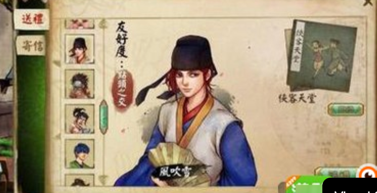

# 送物人物选择：头像名单与选中人物立绘

状态：现行　最后核对：2026-10-19

2026-10-05。状态：**用户已通过古典纸面整套预览，已接入本地游戏；46项逻辑及独立DOM检查通过，浏览器视觉验收待完成**。本方案取代通信V7的“多人Q版图卡→物品页”与后续列表式网页布局。仅调整邮箱的选择与展示方式；剧情Q版继续按[姿态差异方案](cultivation-q-pose-diversity.md)制作。

## 用户指定的交互与形象

点击送物后列出所有当前可交互人物，列表采用小头像与姓名。选择谁，主区域才显示谁的**正常成人比例、带情境背景的完整菜单立绘**。首次进入未选择人物时，不默认铺出多人大图，也不自动认定收礼人。

2026-10-05用户再次明确：主图必须是带背景的菜单立绘，不能使用透明动作立绘。预览须覆盖从谷中调用邮箱到送物／送信结果的完整功能流程。上一套四张透明人物页面预览未通过，不再作为开发验收依据。

最新纠正：立绘被压扁，右侧物品／写信区域占用过多。主图使用统一缩放系数维持原始2:3比例；选人页只有紧凑操作，点击送物后单独弹出包裹选择物品。上一轮18张“三列布局”未通过。

随后用户明确：缺少默认游戏UI背景，板块都按列表设计，需要更像游戏。上一轮23状态的普通纸面＋列表方案也未通过。当前方案先生成统一的全屏游戏UI底板，再把动态内容放进底板的绘制锚点；选人、选物和回执必须共用这套视觉系统。

最新风格纠正：厚木框与鲜亮装饰未通过。以用户提供的江湖菜单为基准，改成浅纸色、低饱和灰青水墨、细边线；包裹每行12格，并保留真实搜索框和分类筛选框。本轮仍先做完整预览，现版游戏不变。

最新纠正：全屏淡彩山景上的人物海报布局仍未通过。用户再次给出古典游戏菜单，要求按其风格重新设计。本轮采用暖纸色统一主面板、窄方形头像名册、竖排姓名、人物主画位和右侧小操作；选人、包裹及结果均收在同一视觉体系。旧水墨稿保留，不能作为当前开发验收依据。

用户给图用于参考“统一纸面游戏面板、左侧头像名单、选中人物大立绘”的交互和主次关系；不复制其中人物、功能页签或关系系统。

## 送信流程纠正（2026-10-05）

用户在游戏中明确要求：点击左侧送信，先展示可接信人物，选中后决定寄出。此要求取代此前一键托陆衡寄出的规则。移除右下重复送信入口，左侧送物／送信页签只切换视图，不按体力禁用。送信沿用当前已开放的往来人物范围；选中谁才显示谁的完整背景立绘，未选人不能寄出，右侧仅保留当前对象的确认操作。实际确认寄出才扣1点体力，浏览、改选、切换与取消免费；不足费用仍可选人，确认按钮显示禁用原因。回执、下一期信件与恢复都保留实际收件人。

## 页面布局

- 默认底板：明确的暖米白纸面主面板、细棕边、少量四角云纹与右下淡竹影；谷中背景压暗留在面板后方。界面按固定横版游戏画布组织，文字和控件用原生UI承接。
- 人物切换：左侧窄名册的小方形头像与姓名，仅展示当前可交互人物。选中用灰绿细边表示；头像取本人原画头部，未选人物不显示大图。
- 主画位：只显示当前选中者的完整背景菜单立绘。原图1024×1536，以统一系数缩放，图框保持2:3，`object-fit:contain`。画面边缘轻微淡入纸色，保留人物所在场景、头发、手与鞋；姓名在画面左侧竖排。
- 操作：左侧送物／送信切换对应人物名册。送物页右侧为小布包及“选择物品”；送信页右侧为当前对象的“确认寄出”。未选人时不能打开包裹或寄信，关闭在标题区；无右下重复送信入口、常驻物品清单或写信表单。
- 包裹：点击送物弹出浅纸面细边线面板，每行12格、每页36格；上方保留搜索框与分类框，条件取交集。控件和格子不烘焙成贴图。点击有效物品直接赠送一份；关闭、取消、遮罩或Esc回原人物，浏览不扣费。
- 动画与结果：在同款纸面游戏面板中播放既有C01／C02并展示结果，沿用现有动作素材；本轮没有新动作帧。
- 窄窗口：保持横版游戏画布整体等比缩放，不改成纵向网页卡片。底板与立绘分别保持各自比例；包裹按同一坐标系统显示。
- 邮箱入口：纸面主面板中展示通过稿的毛笔V3静态书案场景，承接送信／送物。谷中入口保留现版，页面不新增其它功能模块。本轮未生成写信帧；后续新动作仍按动作流程单独评审。

## 操作状态

| 状态 | 人物名单 | 主立绘 | 物品与操作 |
| --- | --- | --- | --- |
| 刚进入送物 | 所有当前可交互者的小头像和姓名，无选中项 | 无人物大图，提示选择人物 | 尚不可赠送 |
| 选中叶蘅 | 叶蘅头像高亮，其余为小头像 | 仅叶蘅的完整背景立绘 | 送物页显示选择物品；送信页显示确认寄出 |
| 改选陆衡 | 陆衡头像高亮 | 替换为陆衡的正常比例立绘 | 取消旧物品焦点，后续赠送收件人为陆衡 |
| 点击送物 | 背景名单锁定 | 完整立绘保留在弹层背后 | 打开包裹，显示收礼人、可赠送物品与库存 |
| 包裹内点击有库存物品 | 选中人物保持 | 收起包裹，开始既有赠送演出 | 扣该物品1份与2点体力，只提交一次结果 |
| 关闭／取消／Esc | 原选中人物保持 | 回到同一完整立绘 | 无赠送，体力与库存不变 |
| 库存或体力不足 | 关闭包裹后可浏览、可切换 | 按选中人物展示 | 包裹内禁用赠送项并显示原因；全无库存时展示空状态 |

选人、切换、打开／关闭包裹和返回不扣费。选好人物→点送物→包裹选物即赠送，没有额外“送给xx／寄出”表单。送信为左侧送信→可接信名册→选中人物→确认寄出，不再直接寄给固定对象。

返回／Esc优先关闭包裹，再由人物页回邮箱，最后回谷中。包裹使用模态对话框，锁定背景交互，焦点在弹层内循环；关闭后焦点回到送物按钮。实际赠送后沿用已有结果确认与唯一回执机制。

包裹沿用现有赠送规则：干粮、草木药材、素布行囊。密集布局预览加入既有目录样例，不能赠送，不表示玩家真实库存。正式实现从真实包裹读取，筛选条件与赠送权限分开，不能增加无对应规则的物品。无库存和低体力都在弹层内显示禁用原因，不能扣费或启动演出。

## 素材要求

这里的“立绘”明确指正常成人身体比例、符合当前角色身份、带完整情境背景的菜单人物画，不能把Q版图放大或采用透明动作立绘。画风沿[已批准人物立绘标准](character-portrait-style.md)的自然比例与淡彩白描；优先复用同阶段的完整背景菜单原画，不去背。场景背景属于人物画本身，页面外的书案与纸面不能代替这一要求。

头像取本人正常比例立绘或已有同阶段头像。主立绘与头像必须是同一身份、同一阶段。优先检查已存的周砚、叶蘅、陆衡、乡邻素材；文件存在不表示已经通过此页面验收，需要确认脸、衣装、裁切、透明与清晰度。缺少合适素材时单独列出缺口，按身份参考和姿态原型制作正常比例立绘，不能用Q版代替，也不把其它人的图换衣服后套用。

本轮叶蘅复用开篇山村背景菜单画`assets/p_opening_menu_ye.webp`，避免误用后续襄阳背景。周砚、陆衡、乡邻的既有正常比例图只作为本人身份与衣装参考，单独生成完整场景菜单画。新图先用于评审，不自动接入游戏；乡邻仍是现有通信对象的代表，不新增具名NPC。

[姿态差异方案](cultivation-q-pose-diversity.md)的本人身份、独立动作设计与单人／整组验收原则继续适用于人物生图；其中Q版比例及Q版姿态素材只用于剧情，不移用到此页。这里即使一次只显示一人，也要逐个切换比较原画，避免每人都是同一摊掌模板。

## 下一轮预览与验收

本轮制作29状态：保留完整调用路径及包裹5状态，再补密集12列、搜索、无结果、分类、搜索与分类交集、可赠送筛选6状态。每张图附上来源操作、触发点、下一状态、费用说明，另提供独立可点击原型及调用对照表。通过评审后再接入。

验收分别检查：首次进入没有自动收礼人；点击每个人的头像只显示本人背景立绘；原图与图框的宽高比一致且没有裁头脚；物品只在单独包裹中出现；关闭包裹保持人物且不扣费；模态锁定背景、Esc与焦点回退正确；库存和费用正确；实际演出与回执只提交一次。旧图卡版和上一轮三列布局的浏览器检查不作为本轮通过证明。

上一轮四状态评审页（已移入 _attic，不作参考）保留为历史稿，用户指出立绘类型错误与流程缺失，未通过。

上一轮18状态三列布局（已移入 _attic，不作参考）保留为历史稿，用户指出立绘比例和右侧交互占位问题，未通过。

上一轮普通纸面与列表布局（已移入 _attic，不作参考）保留为历史稿，用户明确指出网页感，未通过。

上一轮厚木框游戏UI原型（已移入 _attic，不作参考）保留为历史稿，用户指出太艳丽，未通过。

上一轮全屏水墨人物页（已移入 _attic，不作参考）保留为历史稿，用户再次提供古典游戏菜单要求重新设计，未通过。

当前[古典纸面人物页](../../art_sources/cultivation_mail_classic_previews_20261005/index.html)、[12列包裹原型](../../art_sources/cultivation_mail_classic_previews_20261005/index.html)和[整套29状态图](../../art_sources/cultivation_mail_classic_previews_20261005/overview.html)已获用户确认“可以，就按照这个去整改”，作为本轮实现依据。通过稿保留不重绘。主面板底板由内置imagegen生成，人物原图逐字节复用，头像／文字／控件由原生UI承接。完整提示词、素材来源和约束见[制作说明](../../art_sources/cultivation_mail_classic_previews_20261005/art-brief.md)。

编号PNG是离线设计渲染，不是浏览器截图。通过稿的39项隔离原型检查保留为设计阶段证据。本轮游戏已接真实人物、养成库存和只读行囊，新添`js/cultivation-mail.js`及独立样式；42项核心回归、库存适配、原字节和独立DOM检查通过。没有改变存档格式或赠送规则，未操作玩家存档；真实浏览器点击和CSS视觉验收尚未完成。不能用离线图、DOM或逻辑检查代替正式验收。详见[游戏接入记录](../../review/cultivation_mail_classic_20261005/README.md)。

2026-10-05用户确认体力重设后，本面板沿用已通过布局与素材，动态费用改为寄信1／送物2；同人物每期各一信／一礼，通信熟练只结算首次有效投递，具体回归见体力接入（已移入 _attic，不作参考）。旧预览文字和旧42／46项记录保留对应版本，不作为当前费用验证证据。
