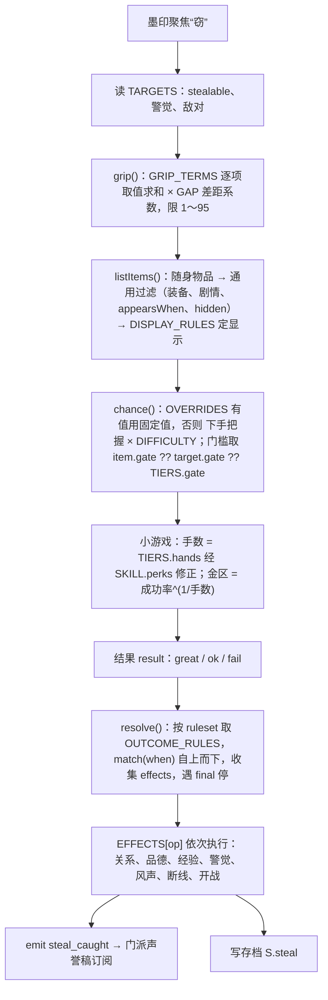

# 偷窃（窃）：小耗子（阿七）引路、先看下手把握、袖里一按

状态：草稿　最后核对：2026-10-23（**第十三轮拍板已写入**（用户第 8 条交主会话代定）：走镖手札名称保留，历练数额按[江湖历练](shared-insight-pool.md)投放表核定为 **360**（＝开始部分＋拜师全部历练的一倍，不超过它）；《寒魄符》两条来源都留，先从宋先生身上偷到的，西行商队那一步改给等值银两 600 两；**防读档**：对宋先生每件东西的结果按存档种子固定，读档重来结果不变，不强制自动存档（宋先生这一个对象因此不弹袖里一按，一次定局）；**记人笺对证回扣做**，已写进[对证断线版改写稿](scripts/drafts/三方-对证-断线版-草稿.md)第 3.5 节，交用户过目后才改 ink、才 `--approve`。第十三轮拍板记录见第 14.1 节，第 8.4 节已改。此前**第十轮拍板**：伏笔点 3“回火救孩子”**删掉**（后面可能都不会起火），《风起-起火》不再加句，只剩两个伏笔点（第十轮 1，第 3.4 节）；宋先生身上除支线道具“后山记人笺”外，其余五件**全部换成甲级价值的东西**——银铤（600 两）、甲级秘籍《寒魄符》、甲级佩饰行商牙牌、甲级佩饰指南鱼坠、甲级成长资源走镖手札（新提），是开始部分丙级上限的又一例外（第十轮 2，第 8.4 节）。第十轮拍板记录见第 14.2 节，新问题见第 15 节。此前**第九轮拍板**：名字照稿（名条“小耗子”，第一单后报本名阿七，离村只用阿七）；三条定稿事实已由主会话加进 `bible/定稿事实.md` F-0060～F-0062；**第一单重新设计**为“摸采办随从的钱袋、换成一包药、挂到村南老人家门上”（第九轮 9、12，第 3.3 节），撤销对《风起-随口一句》的修改建议；三条小剧情**压成三个伏笔点**（第九轮 13，第 3.4 节）；宋先生可偷物按大侠立志传高等人物的思路**加到六件**（第九轮 10，第 8.4 节）；草台演侠不接（第九轮 11）。第九轮拍板记录见第 14.3 节。此前**第八轮拍板**：开始部分保留乞丐少年“小耗子”，与阿七是同一人（第八轮 6、12：用户批准合并，已改 `story-atlas.json`、新建 `bible/人物/阿七.md`、改全流程人物页与赠礼稿“乞丐”节，见第 3.6 节）；认识小耗子、学会“窃”改为**主线必经的固定剧情**（第八轮 8，第 3.3 节）；三处回扣都做（第八轮 9，第 3.5 节）；宋先生身上改放乙等秘籍、乙等装备和支线道具（第八轮 11，第 8.4 节）；界面流程大白话（第八轮 14，第 4.5 节）；图 03 重出。第八轮拍板记录见第 14.4 节。此前**第七轮拍板**：难六系数 0.1 改 0.2、难六不再额外加难、蜻蜓翠簪与《归云剑诀》开始部分可以试、宋先生身上改放剧情道具和有用的东西（F-0027 不改）、队友“换”“讨”、教学第二步固定 100%、牵连照稿并写数据驱动的代码架构（第 11 节）、**乞丐小耗子并入阿七**（第 3 节）。只改设计稿、渲染图与第 3.6 节列出的设定文件，未改运行代码、ink、changelist。工作区：设计在 `xiaojianghu`，实现将在 `xiaojianghu-legacy-prologue`（栖河试玩版）。）

用户原话（2026-10-22，[人物交互 v2](npc-interaction-v2.md) 第 10 节第 9 项）：「做，然后在客栈门口多加一个乞丐 npc 有任务去获得这个能力后续碰到类似的角色（侠盗，小偷，混混请教后可以获得经验，或者偷多了也会增加成功率）偷东西的交互参考八方旅人（直接显示成功率然后去交互，然后触发小游戏大侠立志传的那个小游戏），然后实际能偷什么内容也是参考大侠立志传」

相关拍板：第 7 项「贵重物品显示未知物品」；第 15 项管事、采办使「改成可以切磋可以被偷的 npc」；第 14 项「不要让玩家去阅读这么多细节的字，更多地去体验剧情」。第五、六、七轮的逐项决定见第 14 节。

**编号写法**：本稿只用数字。“第五轮 9”指第五轮偷窃稿第 9 项；“赠礼 7”指第五轮赠礼稿第 7 项；“切磋 2”指第五轮切磋稿第 2 项；“第六轮 10”“第七轮 14”指那一轮主会话统一编号的第 10、14 项。

一句话方案：**萧白出门，客栈门口的小耗子（阿七）把他叫过去教会“窃”（主线必经）→ 墨印菜单多一枚“窃”→ 聚焦“窃”时先报对这个人的“下手把握”（只看人，不看东西）→ 选进去，人物身旁列出可窃的东西，每件写难度和成功率（单件＝下手把握 × 物品难度）→ 选一件，袖里一按（金线刻度弧上落针）→ 得手、妙手或失手。** 规则、数值、特例全部写在数据表里，由一条统一的结算管线读表执行，不写 if-else 链（第 11 节）。

## 渲染图（概念，待确认）

目录 `xiaojianghu/review/npc-steal/`，源在 `src/`（`cd src && node render.cjs <文件>` 重出）。视觉沿用[人物交互 v2 第 2.1 节](npc-interaction-v2.md)已定的甲「金石朱印」：方形石印、细金线刻度弧、宣纸小签、地图不虚化、不出大方框。第四轮旧图在 `_v1/`，第五轮旧图（01、01b）在 `_v2/`，第六轮旧图 01b 在 `_v3/`，第五轮旧图 03 在 `_v4/`，都没删。

| 图 | 内容 |
| --- | --- |
| [01-选物](../../review/npc-steal/01-steal-pick.png) | 第六轮图，第七轮核过数字不变（只涉及难一～难三）。南村口，萧白（2 级、窃术二级、身法 4）对管事（10 级）选“窃”：左下小图是上一步，墨印聚焦“窃”，小签写“下手把握 18% · 四件可窃”；主画面人物左侧绕出可窃的东西，每件一枚朱底小签“难二／难三”：金疮药、厌胜钱 15%，钱袋、檀木手串（丙）13%；扇尾写“下手把握 18%　窃术二级　身法 4　他高你 8 级” |
| [01b-对岑霜下手](../../review/npc-steal/01b-steal-pick-cen.png) | **第七轮重出**。同一个萧白对岑霜（38 级，高他 36 级）：下手把握 1%（下限），钱袋、竹叶青、燃隙刀（丙）都是 1%；第四件“未知物品 · 难六 · 贴身”（蜻蜓翠簪，甲）**开始部分也能试，写 1%**（第七轮 16），墨印小签改为“四件可窃”；说明写难六系数 0.2、甲级两手每手金区约一成宽、游历时约 13% |
| [02-小游戏](../../review/npc-steal/02-steal-minigame.png) | 第五轮图，本轮未改（仍对：甲级以上两手）。金线刻度弧上金区、朱心，墨针从左扫到右；第一手“伸手”已妙手，现在是第二手“收手” |
| [03-客栈门口](../../review/npc-steal/03-beggar-inn.png) | **第八轮重出**（第八轮 13）。次日药摊散场、萧白刚走开，客栈门台阶上的小耗子（就是阿七）举手把他叫住；概念小人按合并后的样子重画（乞丐少年、稍长脸、左眉短缺口、草绳扎发、赤脚、手里细竹杖、脚边豁口碗）。右侧是固定剧情“小耗子的一课”两段梗概。第五轮旧图移到 `_v4/` |

管事、岑霜、萧白用现有正式精灵；数字按第 4 节公式算出，随身物品照[赠礼稿](npc-gifts-and-inventory.md)逐人表，难度按第 4.3 节的建议值。

## 1. 参考对照

调研只用公开攻略能说清的部分（出处见 两末）；数值只当手法参考。

| 点 | 《八方旅人》偷盗（特里昂、二代特罗内） | 《大侠立志传》暗取 | 本作“窃” |
| --- | --- | --- | --- |
| 怎么学会 | 盗贼主角自带的地图指令 | 无名小村村口遇小乞丐洪小七：带 500 两触发事件，击败或选项后，送食物到好感 59 触发任务，送到 100 学会暗取；另可入燕子窝 | **萧白出门就被客栈门口的小耗子（阿七）叫过去教**，主线必经的固定剧情，两段（第 3.3 节） |
| 先看什么 | 对人物用“偷盗”，直接列出对方身上可偷的几件东西，每件旁写成功率 | 先潜行（按 Q）选暗取，再对人物出判定条；公开资料未见“预先显示成功率” | **照八方旅人**：墨印“窃”聚焦时先报对这个人的下手把握；选进去每件写难度和成功率 |
| 成功率由什么定 | 角色等级对物品的“偷盗等级”：等级不低于物品即 100%，差得越多越低（差 21 级以上约 3%）；从镇民打听到“偷盗诀窍”可加成 | 公开资料只见“暗取能力等级”，偷高品级物品给的经验多 | **两层叠加**：下手把握（窃术、身法、等级差、风声、场合）× 物品难度（每件东西自己的难度）（第 4 节） |
| 动手方式 | 选物即掷骰，无操作 | 判定条：在黄（或橙）色区域内按空格 | **一按小游戏**：金线弧上落针；金区宽度就是成功率（第 6 节） |
| 能偷什么 | 不在店里卖的东西、稀有道具；部分物品 0% 偷不了；每件只能偷一次 | 攻略常提：金元宝、实战心得、武道感悟、武道汇宗、通慧丹、天泽丹、天机丹匣、皇族玉珮；贴身装备、任务物能否偷，公开资料未说清 | 只偷对方“随身物品”里的东西；装备、剧情物不偷；甲级以上的贵重东西显示“未知物品”（第 7 节） |
| 失手后果 | 该镇声望降一级；失手多次后镇上地图指令不能用，要到酒馆花一大笔钱恢复 | 好感下降，可能挨打（部分商贩不动手）；成功也扣体力 2、仁德 2；被发现扣好感，**好感很低时对方动手** | 当场被发现：此人这段时间不再理你、关系下降；关系跌到敌对线时对方直接动手（第五轮 10 选 C）；同一地图失手多了起“风声”（第 8 节） |
| 熟练 | 无熟练度，只看等级 | 暗取能力有等级，经验来自偷东西，品级越高经验越多；玩家常读档练判定条 | 窃术 1～10 级：每级加成功率，并解锁手感项；向混混、小偷、侠盗请教给经验并把关升段（第 5 节） |
| 队友的东西 | — | 好感够了可以以物易物，换来对方的随身至宝（机核介绍）；入队后能否直接拿队友的东西，公开资料没说清 | 入队后不出“窃”，改用“换”“讨”付代价拿（第 8.6 节，第七轮 18 已定） |

## 2. 和现有设计的关系

- [生活技能](life-skills.md)已有“窃取”（`steal`）的规则，目前**暂缓发布**。本稿沿用它的骨架：必须有人教、成功率与可窃物执行前显示、可取消、失手警觉与品德下降、持物由内容配置声明、关键证物不进偷窃池。本稿替换其中窃取的三处：掌握阶段（三段改十级，第 5 节）、成功率公式（第 4 节）、导师（开始部分改由阿七教，第 3 节）。**第五轮 13 已定替换；life-skills.md 由主会话另改，本稿不动它。**
- [人物交互 v2](npc-interaction-v2.md)：墨印菜单从七枚加到八枚，多一枚墨印“窃”（学会后、对可窃的人才出现，排在“易”后面）；随身物品第 4.3 节是“窃”的物品来源。可见度第 3 节的“看不透”档**不禁止下手**（第五轮 9），只是成功率极低。
- [赠礼与随身物品](npc-gifts-and-inventory.md)：逐人随身物品表、关系值（含负向一侧与敌对线）、贵重物品认不认得出，都以赠礼稿为准；**每件东西的“偷”栏是本稿的物品难度来源**（第 4.3 节、第 10 节）。
- [门派关系与声誉](faction-reputation.md)：偷窃这边只发出“失手”事件，门派关系、声誉怎么扣由那份稿定（第 8.3 节、第 10 节）。第七轮 1、3 定了门派敌对线照大侠立志传 −10、声誉改一条正负轴，数值以那份稿为准。
- [归烬堂支线](qihe-mojiao-observer-sideline.md)：宋先生能偷，失手＝宋先生线断（赠礼 7，第 8.4 节）。
- 阿七的全流程设计（[全流程主线](fullflow-story-20261016/story.md)、[全流程人物页](fullflow-story-20261016/characters.md)、`bible/人物/阿七.md`）：第七轮 19、第八轮 12 把教窃的乞丐小耗子并入阿七，开始部分他就是小耗子（第 3 节）；往后的借名线不在本稿改，只写怎么接上、三处回扣（第 3.5 节）。
- 时间方案 A（R-时间-01）：窃与小游戏都**不耗时**；“警觉”与“风声”按主线段落计，不按时辰。

## 3. 小耗子（阿七）：教萧白“窃”的人（第七轮 19、20；第八轮 6～10、12）

用户原话（第七轮）：

- 19：「合成一个人，刚好说明他和主角的不一样，教了主角盗窃技能，但也和他说明了底线，说明他内心本善，然后后面再盗用主角名号去做好事后日渐沉溺于名利」
- 20：「之前有一个阿七的故事，说的是离开村后，他盗用主角的名声去做好事，然后慢慢被人沦为把柄等等的完整故事，找一下」

用户原话（第八轮）：

- 6：「还是小耗子吧，我认为更可以体现他人本善的性格，不然很难讲得过去他教主角盗窃，本来阿七看主角刚来，想抱团一起的，所以才教的，他管自己的小偷小取行为看作是自己做好事的报酬，后面他教了主角后的剧情一开始的走向也是让他偷某样东西去做好事，这样就说得通了」
- 8：「这部分应该算是主线必经的，就让主角出门后就被小七叫过去了，不然获取不了盗窃技能」
- 9：「都做」；10：「虽然剧情作废，但出名是肯定的」；12：「合并」

**R-剧情-05 的批准**：合并的批准来自用户第八轮原话「12，合并」。据此已改 `story-atlas.json` 的 `a-qi`、新建 `bible/人物/阿七.md`、改全流程人物页“阿七”一节、赠礼稿第 6.2 节“乞丐”一节（第 3.6 节）。定稿事实：第九轮 8 用户「都加」，主会话已写入 `bible/定稿事实.md` **F-0060**（阿七＝小耗子与两条规矩）、**F-0061**（风起第一天固定的一课）、**F-0062**（萧白培养部分必出名，不锁）。本稿不改定稿事实表。

### 3.1 阿七原有故事（找齐了，逐条注明出处）

用户记得的“小七”，在本项目文档里叫**阿七**（ID `a-qi`）。用户 2026-10-16 在 codex 会话里的原话：「让小七盗用萧白名号更具有合理性（不然一个突然出现的人，从未出谷谁认识你）」（`~/.codex/sessions/2026/10/14/rollout-2026-10-14T17-38-02-01a139c6-a6e8-7821-ab1e-93fe0589a9f9.jsonl`，会话 10-14 开、这条消息时间 2026-10-16 09:47 UTC；压缩后又出现在 `~/.codex/sessions/2026/10/16/rollout-2026-10-16T17-56-56-01a14424-aaa0-7101-bb6e-a0633bf7ed3c.jsonl`）。这句话直接促成了全流程稿里“二年正月汉皋扬名，再让阿七借名”的安排（[剧情决定](story-decisions.md)第 130、132 行）。另：大侠立志传里教暗取的小乞丐叫洪小七，与本作的阿七无关，只是巧合。

**人设**（[全流程人物页](fullflow-story-20261016/characters.md)“阿七”一节；[人物形象表](cast-visuals.md)“阿七 · 爱演大侠的栖河杂工”；`story-atlas.json` 的 `a-qi`）：男，开篇 18 岁，无门派，栖河杂工，爱听说书、给孩子演大侠；稍长脸、左眉短缺口、笑时一侧嘴角先扬，随意束发、挽袖旧短褂，扬名后换青蓝行衣但脸不变，紧张时先拢衣领；爱抢话、把经历讲得热闹，真害怕时笑话变少。**欲望**：想被当作有用的人记住，确实敢救人，却害怕回到没人认识的生活。非可入队人物；普通刀攻击、守势，不会归云秘传。

**故事经过**（未标注的都出自[全流程主线](fullflow-story-20261016/story.md)，按场次编号）：

| 部分 | 场次 | 发生的事 | 现行与否 |
| --- | --- | --- | --- |
| 开始 | P1-02 草台上的大侠 | 阿七拿竹刀给孩子演“大侠独闯山寨”，竹刀断了；萧白陪他演完或教孩子用布结当暗器；散场后他承认没真正学过武。两人从一起把药包送回叶家认识 | 现行设计，**未接入**栖河试玩版（现行开始部分的 ink 里没有阿七） |
| 开始 | P1-04 借过一次名字 | 萧白借三方的名头互相牵制，护叶蘅收拾药箱；阿七在外帮忙带人绕路，**第一次看见一个名字和一层关系就能让横人迟疑，记住了这种办法**，却没看见萧白心里的害怕 | 同上；这是借名的种子 |
| 开始 | P1-05 火里走散 | 阿七回货棚救出躲在竹凳下的孩子；活着出来，另走商路 | 同上 |
| 开始 | P1-06 归云第一夜 | 周砚转述阿七口信：跟商队找活去了，下回见面想让萧白看见自己也会些真本事 | 同上 |
| 培养 | P2-03 阿七来访（第一年六月） | 他说自己曾借“归云谷朋友”的名头吓退欺负工匠的人；练剑连脚跟都站不稳；知道留谷要从杂事做起，仍回去谋生，临走摸了摸借来的剑又还了回去 | 现行设计，未接入 |
| 培养 | P2-05（第二年正月汉皋） | 阿七在汉皋做演出杂工，亲见萧白试艺与替输家解围、被人记住，也看到“归云萧白”四个字能让人停下（另见 [汉皋二年正月](fullflow-story-20261016/hangao-year2.md)） | **已作废**（2026-10-19 汉皋城内剧情作废，见[汉皋剧情作废记录](../updates/2026-10-19-hangao-story-void.md)） |
| 培养 | P2-06 名声之后 | 阿七从商路听到萧白再赴比试的消息，更清楚借这个名字会得到怎样的信任 | 现行设计（依赖 P2-05 的扬名，见下“矛盾”） |
| 培养 | P2-08 两封不一样的信（第三年五至八月） | 阿七的信越来越热闹，说结识了许多江湖朋友，偶尔故意略过用了谁的名字；萧白可回信提醒或追问 | 现行设计 |
| 游历 | 总述（主线“这一次要讲什么”第 2 段） | **起初是为了让恶人忌惮归云谷，后来真的帮了人，也越来越舍不得那个受人敬仰的身份。正道盟的谢承岳看中了这个少年，开始替他安排胜仗，并借他的名望吸引各派年轻弟子追随** | 现行设计 |
| 游历 | P3-01、P3-02 | 萧白发现有人冒他的名；宴席上阿七讲到一半看见萧白，筷子掉了。私下承认：第一次冒用完整姓名是想叫开关人的私牢，后来真救了人，也挨了刀；为了不穿帮，一次次把谎补大 | 事件现行；地点写在汉皋客店，**地点作废**，待改 |
| 游历 | P3-03 一场真的夜行 | 阿七独自去救被扣的脚夫，只救出两人；萧白接应。被追捧的并不全是假事 | 同上（汉皋近郊货院，地点待改） |
| 游历 | P3-04 谁输掉了武馆 | 谢承岳的人给老拳师送银子，安排一场“给年轻人留脸面”的败仗；老拳师赛后名声扫地、弟子生计流失。阿七第一次看见自己赢来的掌声落在别人身上是什么 | 现行设计（合川） |
| 游历 | P3-05 送棺的请帖 | 阿七早已借萧白的名义答应替姚安护棺，谢承岳趁势发请帖，要在白石办“断怨会”让阿七公开行一件大义之事；姚安被称作“归正的魔教孽子”，带棺离开 | 现行设计 |
| 终局 | P4-03 把名字拿回去 | 阿七要求与萧白正面比一次；争的是“自己做成的事值不值得被记住” | 现行设计 |
| 终局 | P4-04 谢承岳递来的刀 | 谢扣下姚安认罪的一句，逼阿七当众斩他，让被捧起来的少年替正道“讨第一笔债”；放不放下刀是阿七自己的决定 | 现行设计 |
| 终局 | P4-05～07、N-01 | 是否当众拒绝谢、当着拥趸承认假赛与借名；活着回来时**第一次向陌生人报自己的名字**；若仍不肯承认，独自离开，友情留裂口 | 现行设计 |

**“被人拿住把柄”**：原稿没有“把柄”两个字，最接近的是谢承岳那条——替他安排胜仗、借他的名望招人（总述）、把送棺办成扬名（P3-05）、在白石逼他当众行刑（P4-04）。实质就是：阿七一旦接受了买来的胜仗、又用萧白的名字许了送棺，谢手里就同时攥着“名字是借的”“胜仗是买的”两件事，阿七不敢不听。合并方案按这个理解接（第 3.5 节）。

**矛盾与现行版本**：

1. **借名的由来**：原稿让阿七在二年正月汉皋亲见萧白扬名，才有人认“萧白”这个名字（也正是用户 10-16 那句话的用意）；汉皋城内剧情 2026-10-19 作废。**第八轮 10 定为前提**：萧白在培养部分一定会出名，汉皋城内剧情作废也照样出名；是哪件事让他出名，留待汉皋剧情重新设计时补具体事件。阿七借名的线以“萧白已经出名”为前提往下接，不再算缺口。人物页、主线页仍是现行，凡写在汉皋城内的场次只作旧稿记录（主线页页首说明）。
2. **第六轮本稿第 3.1 节写错了一处**：说阿七“在培养部分才和萧白真正认识（P1-02）”——P1 是开始部分。已更正。
3. **小耗子与阿七的人设冲突**：第八轮 6、12 定为同一人，开始部分保留小耗子那一版身份（乞丐少年），见第 3.2 节。
4. **开始部分怎么接入**：全流程稿的 P1-02、P1-04、P1-05 是设计，现行栖河试玩版的开始部分里没有阿七。第八轮 8 定：认识小耗子是主线必经的固定剧情（第 3.3 节）；P1-02 草台演侠的建议见第 3.3 节末。

### 3.2 合并后的人：开始部分是小耗子，离村以后叫阿七

戏眼（整条线）：**他教萧白的第一单，是偷来的钱换成一包药挂在别人门上、不留名，只拿找回的二两当“工钱”；后来他借了萧白的名字去做好事，要的“工钱”从两文变成掌声和名字，终局他要“把名字拿回去”（P4-03）——拿回的是他自己的。**

为什么合得上（用户：“刚好说明他和主角的不一样”“更可以体现他人本善的性格”）：

- **为什么教萧白偷**：他自己也是流落到栖河的外乡人，看萧白刚来、两手空空，想跟他抱团——外乡人在村里没人帮，手艺是他唯一能拿出来分给人的东西（第八轮 6）。
- **他怎么看自己的手**：他管自己的小偷小摸叫“做好事的工钱”——替店家出口气、替孩子讨回东西，顺手拿一个饼、两 两，他觉得天经地义（第八轮 6）。这正是他后来走偏的路子：借名做好事，拿的工钱从一个饼变成掌声、拥趸和被人记住。
- **内心本善**：他立的两条规矩——**不偷穷人，不偷救命的东西**——是说书人嘴里大侠的规矩（第七轮 19）。
- **和萧白的不同**：萧白是外乡来的、不懂江湖规矩，后来的名声是一件件做出来的；小耗子有手艺、有规矩，缺的是一个被人叫对的名字。

**名字（第九轮 7「就这样」定）**：“阿七”是他的本名（家里排行第七）；“小耗子”是栖河人给他起的外号（瘦、手快、睡客栈柴房，偷吃被追过）。开始部分名条写“**小耗子**”，村里人都这么叫他；第一单做完，他头一回跟人报本名：“我叫阿七。”离村以后他只用“阿七”。外号是别人给的、名字是自己的——正好接上他后来想被人记住名字，最后（N-01）第一次向陌生人报自己的名字。

| 项 | 合并后（第八轮 6、12） | 依据 |
| --- | --- | --- |
| 名字 | 开始部分名条“小耗子”；本名阿七（见上） | 第八轮 6；第九轮 7 |
| 年龄 | 开篇 18（少年乞丐） | `story-atlas.json` 原值不改 |
| 身份 | **乞丐少年**：前两年流落到栖河，店家让他睡客栈柴房、给剩饭；替人跑腿、搬货换口饭，爱听说书、给孩子演大侠。不再改成客栈杂工 | 第八轮 6“还是小耗子吧” |
| 外形（开始部分） | 阿七的脸（稍长脸、左眉短缺口、笑时一侧嘴角先扬、紧张时先拢衣领）＋小耗子的穿戴（乱发草绳扎、脸上带灰、补丁短褂挽一边袖、赤脚、手边细竹杖——给孩子演大侠时当刀使、脚边豁口碗） | atlas 原外形＋第五轮小耗子 |
| 外形（离村后） | 随意束发、挽袖旧短褂；扬名后换青蓝行衣，同一张脸 | atlas 原外形 |
| 口吻 | 贫嘴、爱打赌、爱抢话，把事讲得热闹；讲规矩那两句不贫嘴；真害怕时笑话变少 | 两边合并 |
| 站位 | 客栈门台阶右侧（第五轮 2），坐着；第一夜在柴房睡，不出场 | 第五轮 2 |
| 能不能偷他 | 暂时不能（第六轮 17） | 第六轮 17 |

### 3.3 小耗子的一课：固定剧情，主线必经（第八轮 8；第五轮 1～3；第七轮 21）

用户（第八轮 8）：「这部分应该算是主线必经的，就让主角出门后就被小七叫过去了，不然获取不了盗窃技能」。

**落在哪**：风起第一天白天（halfDay 0），固定剧情《次日药摊》（C1-00）**散场之后**、主线“去药棚见来客”（第一天傍晚《徐令仪上门》）**之前**。C1-00 是萧白这天头一回出门，散场时周婶走开、萧白第一次能在村里自己走——客栈就在南村口（F-0047），小耗子在台阶上一喊，正是“出门就被叫过去”。

**怎么推进（R-主线-01：找对应的人、对方先开口）**：

1. C1-00 散场后，小耗子在客栈门口喊一声（一句台词，他先开口）；任务栏的主线换成“客栈门口的小耗子在喊你”。
2. 萧白走到客栈门口，他再开口，进入第一段；两段做完才学会“窃”。
3. 两段没做完之前，走进药棚**不弹**“进入下一时段”；做完后主线换回“去药棚见来客”，照 [opening-state.md](opening-state.md) 第 2a 节原样推进。确认框照旧不列还有什么没做。
4. 教窃不耗时（R-时间-01），第一天白天的可选事（周婶托竹匾、宋先生第一段）照常能做，时限不变。

**固定剧情不依赖可选剧情（R-剧情-07）**：这两段不读任何可选剧情的标记——第一夜三件小事（取布就在客栈）做没做、竹匾接没接、Q3“三天酒钱”（[地图可交互点](qihe-map-interactables.md)，可选、未实装）做没做，都不影响它触发和内容。反过来它可以给可选剧情做回扣（Q3 店家多一句，第 3.5 节）。

**两段（每段台词不超过三四句，不出 两书、封条这类要读的东西；第 14 项）**

- **一、门口打赌**：他看萧白面生，问是不是刚来的，说自己也是外乡人，“外乡人得凑一块”——想抱团。打赌：“你要能从我身上摸走一枚铜钱，我就教你。”教学版小游戏（成功率固定 70%，不扣不罚，失手再来）。摸到了，他教会“窃”（窃术一级），并立两条规矩：**不偷穷人，不偷救命的东西**。
- **二、第一单：偷一样东西去接济一个人**（第八轮 6；**第九轮 9、12 重新设计**：用户「换一件就你说的这个」「不然你刚从那边偷，这边就立马多出一壶酒，是个人都知道怎么回事」）
  - 戏眼：**征药的随从丢了钱袋，药商卖出一包药，村南老人家门上多了一包药——三个人谁也不知道这是一件事；小耗子只拿找回的二两，说是“工钱”。**
  - 接济谁：**村南的村口老人**（现有人物）。腿脚不便，全指着药棚那点药，又怕验过的药被装车拉走（现有《第一夜-送药》P-S3-09、09a 里他自己说的处境；本段不读萧白第一夜送没送过药，R-剧情-07）。
  - 偷谁：**采办随从**（现有人物，东埠）。征药一方的人，仗着“有公事”催人让路，钱袋挂在腰上（第 9 节：钱 20 两）。不是穷人，偷他不犯第一条规矩。
  - 为什么不偷药：小耗子一句话交代——征来的药是救命的东西，偷了就犯第二条规矩，拿到老人手里也一眼认得出是哪来的；**偷钱，换一包新药**。
  - 梗概（四步，每步一两句台词，不出 两书、账目）：
    1. **门口交代**：小耗子说村南老人家怕药被拉走，东埠那个随从腰上挂着钱袋——“去摸他的钱，别碰他的药。”
    2. **东埠摸钱袋**：对采办随从下手，**固定 100%**（第七轮 21：金区占满整趟，落在朱心算妙手；不扣关系、品德，不发失手事件）。随从只顾催人，没发觉。
    3. **药摊买药**：萧白拿这钱在南村口药摊（药商）买一包药；药商只当做了笔买卖。
    4. **挂到门上**：把药包挂在老人家门环上就走，不敲门、不留名（不需要小游戏）。回到客栈门口，小耗子把找回的二两揣进自己怀里，说是“工钱”。萧白可以点破一句，也可以不说（小选项，只记 `S.aqiTeach.wage`：`said`／`quiet`，给第 3.5 节回扣用）。最后他报本名：“我叫阿七。别人叫我小耗子。”
  - **为什么看不穿**：钱换了样子（银两 → 药），三处各隔一段路；随从在东埠丢钱、老人在村南收药、药商在南村口卖药，各自只看见自己那一截。老人不知道是谁送的，也不需要后续剧情解释。
- 原第五轮“第三天帮众离开后改摸钥匙串”的替补**删去**；第八轮的“摸回帮众赊的竹叶青放回柜台、自取半个笼饼”**作废**（第九轮 9、12）。采办随从、药商、村口老人第一天白天都在原处（东埠、南村口药摊、村南），不需要替补。

台词按 R-剧情-01 三道关写进 ink（新文件 `story/01-开始/风起-小耗子.ink`，knot `fq_aqi_*`；戏眼卡另写），本稿不写台词。

奖励：学会“窃”（窃术一级）＋窃术经验 3（两次小游戏各 1、第一单 1）。不给物品，避免和偷来的东西混；随从的钱袋花在药上，找回的二两归小耗子，萧白身上不多也不少。做完就能向帮众请教（第五轮 12）。

**要改的已批准剧本（改前给用户过目，确认后才 `--approve`；子代理不改、不批）**：

| 剧本 | 要不要改 | 改什么 |
| --- | --- | --- |
| 《风起-次日药摊》（C1-00） | **不改** | 喊声放在新剧本里，由 C1-00 散场后接上（衔接在 JS 主线步骤里） |
| 《风起-主线找人》 | **不改** | `fq_rest_hint` 本来就按参数说“得去{where}找{who}”，新步骤只换参数 |
| 《风起-随口一句》 | **不改**（第九轮撤销第八轮的修改建议） | 第一单不再碰帮众的酒、店家的柜台，随从、药商、老人也都不需要事后多一句 |
| 《第一夜-送药》 | **不改** | 只借用老人已有的处境（怕药被拉走），不读它的标记 |
| 《风起-起火》 | **不改**（第十轮 1 撤销加句） | 原伏笔点 3“回火救孩子”已删（用户：后面可能都不会起火） |
| 《风起-商量去处》《风起-山居》 | **不改** | 周砚转述阿七口信（P1-06）不加；伏笔已由第 3.4 节两处承担 |
| 新剧本《风起-小耗子》 | 新写 | 喊声＋两段（第一单四步，含药商、随从各一两句）；第 3.4 节伏笔点 1、2 的随口话也放这里；写完给用户过目 |

运行侧（实现时，不在本稿改）：`js/qihe-chapter.js` 的 `MAIN_STEPS` 在第一天白天加一步 `aqi`（地点客栈门口，找小耗子）；药棚的确认读这一步是否完成。

**P1-02 草台演侠（原可选场）——不接（第九轮 11「不接」）**：认识小耗子已经由固定的“一课”承担，P1-02 原本“两人从一起把药包送回叶家认识”的作用没了；开始部分可选的事已经很多，用户也说剧情要简单。“爱演大侠”只留在他手边那根竹杖和一两句随口话里（给路过的孩子比划“大侠独闯山寨”）。

### 3.4 两个伏笔点（第九轮 13 精简；第十轮 1 删去“回火救孩子”）

用户（第九轮 13）：「要改，这里面只是一个小剧情而已，为后面埋下伏笔，所以不需要多这么多描写」。原三段可选小戏（师父考你、头一回被冤、火后还东西）压成伏笔点，每个只有一两句，不单独成场、不加新剧情；都是可选（随口话或一句旁人台词），不做任何固定剧情的前提（R-剧情-07）。

用户（第十轮 1）：「回火救孩子……这个不需要，因为后面可能都不会起火」。原点 3“回火救孩子”**删掉**，《风起-起火》不加句；剩下两个点。原点 3 想埋的“做好事不让人知道”，第一单本身已经有（药挂在门上、不留名，第 3.3 节），终局回扣三照旧引它（第 3.5 节），不另补。

| 点 | 在哪 | 发生了什么（一句） | 埋下什么 |
| --- | --- | --- | --- |
| 1 拿了能还 | 第二天，客栈门口 | 小耗子摸走萧白身上一样小东西又递回来：“拿了还能还回去。” | 他以为什么都能“借了再还”——P2-03 借名头“回头就还”，后来**盗用萧白名号**，名字借出去就还不回来 |
| 2 一个外号 | 第二天，客栈里 | 柜上少了钱，店家头一个看向小耗子；萧白可以替他说一句。 | 一个外号就能让人先疑他——他从此在意别人怎么叫他（**沉溺名利**）；名声长在别人嘴里，后来谢承岳也正拿名声**捏住他** |

两个点的台词都放进新剧本《风起-小耗子》（随口话，不改任何已批准剧本）。

### 3.5 往后的线与三处回扣（第八轮 9「都做」）

合并只改开始部分的身份与教窃戏，后面的场次照全流程稿；第八轮 9 定三处回扣都做。

| 部分 | 场次 | 合并后多了什么 | 基线 |
| --- | --- | --- | --- |
| 开始 | 小耗子的一课（第 3.3 节） | 两条规矩；第一单“换成药、挂门上、不留名”和“工钱”二两 | 固定剧情，人人都有 |
| 开始 | P1-04 | 他看见一个名字能让横人迟疑——会偷东西的人第一次发现“名字”也能拿来用 | 照原稿（是否接入现行开始部分另定） |
| 培养 | P2-03 来访 | 他说借“归云谷朋友”的名头吓退欺负工匠的人，管这叫“借”，不叫“偷”，“回头就还”。**回扣一**：萧白可以问一句“还得回去吗” | 照原稿的看待借名选择 |
| 培养 | P2-08 来信 | 信里故意略过用了谁的名字 | 照原稿 |
| 游历 | P3-01～03 | **做好事**：第一次冒用完整姓名是为了叫开关人的私牢、真救了人（原稿） | 照原稿 |
| 游历 | 总述、P3-02 | **沉溺名利**：掌声、拥趸、青蓝行衣，“工钱”越拿越大；为了不穿帮把谎越补越大 | 照原稿 |
| 游历 | P3-04 假赛 | **违背自己的规矩**：买来的胜仗砸了老拳师的饭碗——偷了穷人。**回扣二**：萧白可以把“不偷穷人”原话还给他 | 萧白照原稿阻止或拆穿 |
| 游历 | P3-05 | **被人拿住**：用萧白的名字许了送棺，谢承岳手里攥着“名字是借的”“胜仗是买的”两件事 | 照原稿 |
| 终局 | P4-03 把名字拿回去 | **回扣三**：萧白可以说“你教我的第一单，是把药挂在门上、不留名字”；比试本身照原稿 | 照原稿 |
| 终局 | P4-04、P4-07 | 放不放下谢递来的刀、能不能第一次报自己的名字，照原稿由阿七此前的事件决定 | 照原稿 |

**回扣登记计划**（实现对应场次时登记进 `registry/story-hooks.json`；本稿不改登记表）：

| 拟登记 | 种下（plants） | 消费（consumers） | 大小 | 基线 |
| --- | --- | --- | --- | --- |
| `qh_aqi_lesson`（小耗子的一课，固定剧情） | 两条规矩“不偷穷人、不偷救命的东西”；“不留名”；“工钱”；`S.aqiTeach.wage` | P2-03“还得回去吗”；P3-04“不偷穷人”；P4-03“第一单是把药挂在门上、不留名字” | 三处都是 small（回扣台词） | 来源是固定剧情，人人都看过；基线只给**没有这段的旧存档**（教窃上线前的存档）：三处不出回扣句，照原稿。`wage = said` 时 P3-04 阿七多回一句“那二两你也看见了”，`quiet` 时没有（小分支，基线是 `quiet`） |

**萧白名声这一环**（第八轮 10）：阿七借名以“萧白在培养部分已经出名”为前提，具体事件随汉皋剧情重新设计补（第 3.1 节矛盾 1）。

### 3.6 已改的其他文件（第八轮 12「合并」批准）

| 文件 | 改了什么 |
| --- | --- |
| `xiaojianghu/docs/design/story-atlas.json`（`a-qi`） | `archetype` 改为“栖河乞丐少年‘小耗子’（本名阿七）……”；`appearance` 分开始部分（乞丐）与离村后两段；`voice` 加贫嘴爱打赌；开始部分那条 `events` 改为“风起第一天白天叫住萧白、教‘窃’（固定剧情，主线必经）”；新增 `storyCorrectionSource`、`consistency` 两个字段（注明出处“12，合并”）；`age` 不改 |
| `xiaojianghu/bible/人物/阿七.md`（新建） | 按 bible 人物页格式：姓名阿七、别称小耗子、开篇 18、栖河乞丐少年、口吻、两条规矩、首次登场《风起-小耗子》（固定剧情，未实装）；正文分“小耗子时期（开始部分）”“离村以后”两段 |
| `fullflow-story-20261016/characters.md`“阿七”一节 | 身份改为“开始部分是栖河乞丐少年小耗子”；初识改为风起第一天固定的“一课”；“过程”开头加“教萧白窃、立规矩、第一单”，草台演侠标为不另做 |
| `npc-gifts-and-inventory.md` 第 6.2 节“乞丐” | 标题与占位改为小耗子（阿七）；喜好、随身物品按乞丐少年写；“不可偷”照旧 |
| 本稿图 03 与概念小人 | 按合并后的样子重出（第 13 节） |

没改、留给主会话或对应负责人的：`bible/人物/阿七.md` 里第一单的旧写法（“摸回竹叶青放回柜台、捏走半个笼饼”，第九轮作废，待主会话按第 3.3 节改）、[人物交互 v2](npc-interaction-v2.md) 等提到“乞丐”的地方、[人物形象表](cast-visuals.md)“阿七 · 爱演大侠的栖河杂工”、赠礼稿“乞丐”节以外提到小耗子的几处（第 375、401、490、759 行附近）、全流程主线 P1 场次。


## 4. 成功率（第六轮 10、11、14、15 定；第七轮 13～16 改）

两层叠加：**先算对这个人的下手把握，再乘每件东西的难度系数**。

    下手把握 = 底数 × 差距系数，四舍五入后限定在 1%～95%
    单件成功率 = 下手把握 × 物品难度系数，四舍五入，限定在 1%～95%（难一～难六同一个下限）

### 4.1 下手把握（墨印聚焦“窃”时报的数；第六轮 10）

    底数 = 40
         + 窃术加成（窃术一级 5 … 十级 60，见第 5 节表）
         + 3 × (萧白身法 − 4)
         + 等级优势：min(10, 萧白等级 − 对方等级)，对方不比萧白弱时为 0
         + 场合（对方喝醉、正忙着交易或说话 +15；小偷请教给的诀窍另 +5）
         − 风声（本地图起了风声 −15）

    差距系数 = 1 ÷ (1 + (d ÷ s)²)
      d = 对方等级 − 萧白等级；d ≤ 0 时系数为 1
      s = 差距尺度 = 5 + 0.5 × 窃术等级（窃术一级 5.5，二级 6，十级 10）

- **只看人，不看东西**：窃术、身法、等级差、风声、场合五样，**不含物品品阶和难度**。它回答的是“我对这个人下不下得了手”，所以和他身上带了什么无关。
- **和单件的关系**：单件＝下手把握 × 物品难度系数（第 4.3 节）。难一的东西单件就等于下手把握；其余每件都比它低。所以下手把握是这个人身上**任何一件东西成功率的上限**。
- 墨印小签写法：“下手把握 18% · 四件可窃”。一件都偷不了时写“手艺不够 · 窃术 N 级”或“身上没什么可窃的了”；警觉中写“他正盯着你”。另有手艺不够的件时，件数只数能下手的，小签后面加“另有 1 件手艺不够”。

例（图 01）：萧白 2 级、窃术二级、身法 4，对管事 10 级：底数 40 + 10 + 0 = 50；d = 8、s = 6，差距系数 1 ÷ (1 + (8÷6)²) = 0.36；**下手把握 18%**。

### 4.2 差距曲线（第六轮 11 定；第七轮 13「可以」）

用户（第六轮）：「2 级的时候和管事的距离也还是很远成功能接近一半有点太高了，不能简单的线性关系，还是要偏难的」。曲线是平方、尺度 6 起：**一开始就往下掉，差得越多掉得越慢，但永远不到 0**。窃术越高，尺度 s 越大，同样的差距掉得越少——这就是“偷多了、练多了，偷强者也容易些”。第七轮 13 用户答「可以」，照此定稿。

等级差 → 差距系数（以及萧白 2 级、身法 4 时的下手把握）：

| 对方高萧白 | 窃术二级 s=6 | 窃术四级 s=7 | 窃术七级 s=8.5 | 窃术十级 s=10 | 窃术二级时的下手把握（底数 50） | 开始部分的例子 |
| --- | --- | --- | --- | --- | --- | --- |
| 0 及以下 | 1.00 | 1.00 | 1.00 | 1.00 | 50% | 不习武的人（药商、采办随从） |
| 2 | 0.90 | 0.93 | 0.95 | 0.96 | 45% | — |
| 4 | 0.69 | 0.75 | 0.82 | 0.86 | 35% | — |
| 6 | 0.50 | 0.58 | 0.67 | 0.74 | 25% | 采办使（8 级） |
| 8 | 0.36 | 0.43 | 0.53 | 0.61 | **18%** | **管事、差役（10 级），图 01** |
| 10 | 0.27 | 0.33 | 0.42 | 0.50 | 13% | 护院、帮众（12 级） |
| 14 | 0.16 | 0.20 | 0.27 | 0.34 | 8% | 陆衡（16 级） |
| 20 | 0.08 | 0.11 | 0.15 | 0.20 | **4%** | **徐令仪（22 级）** |
| 22 | 0.07 | 0.09 | 0.13 | 0.17 | 3% | 沈雁回（24 级） |
| 36 | 0.027 | 0.036 | 0.053 | 0.072 | **1%** | **岑霜（38 级），图 01b** |
| 50 | 0.014 | 0.019 | 0.028 | 0.038 | 1% | — |
| 70 | 0.007 | 0.010 | 0.015 | 0.020 | 1% | 宋先生（乔装，按真实等级 72 算，第 8.4 节） |
| 86 | 0.005 | 0.007 | 0.010 | 0.013 | 1% | 周砚（88 级） |

- 开始部分萧白练到最好（3 级、窃术四级、身法 5，底数 65）：管事 33%，徐令仪 8%，岑霜 3%。
- 到游历（举例：萧白 30 级、窃术九级、身法 10，底数 108）：偷 38 级的岑霜下手把握 63%；偷 88 级的周砚仍只有 3%。要偷强者，得先把等级追上来。
- **乔装的人**（宋先生）查看页仍写“看不透”，但“窃”的数字按他的**真实等级**算（[100 级方案](character-levels-100.md)裴嵩 72 级），所以只会写 1%。不露等级，不破 F-0004。
- 身法读战斗五维 `st.agi`（[功法结构](martial-structure.md)、各战斗档）；人物等级读[100 级方案](character-levels-100.md)与战斗档。和生活技能原公式不同：加了等级差，去掉“人物关系”项（关系只管失手后果，不管手快不快）。
- **不习武的人**等级当 0 处理，萧白有等级优势（最多 +10）。
- 四舍五入一律“四舍五入到整数，.5 进一”。

### 4.3 物品难度（第六轮 14 定；第七轮 14 改难六系数）

每件东西有自己的**难度（一～六）**，和品阶相关，但可以单独调：同样是丁级的钱，揣在怀里的比挂在腰上的难，对方盯得紧的更难。

| 难度 | 系数 | 什么样的东西 |
| --- | --- | --- |
| 难一 | ×1.00 | 放在明处、随手一拿：桌上的饼、篮里的草药 |
| 难二 | ×0.85 | 挂在腰上、搁在包口：酒葫芦、干粮、一瓶药 |
| 难三 | ×0.70 | 收在怀里、包底：钱袋、佩饰、一本普通的书 |
| 难四 | ×0.50 | 贴身收着或对方时常摸一下：值钱的饰物、门派的书 |
| 难五 | ×0.30 | 贴身、对方看得很紧：随身的心爱之物 |
| 难六 | **×0.20** | 命根子：贴身而且时时留意 |

- **第七轮 14**：用户「绝改成 0,2」。本稿最高一档叫“难六”（“绝”在本稿是品阶名，不是难度档），按用户意思把最高一档的系数由 0.1 改为 **0.2**。若用户原意是品阶“绝”另有所指，请指出（第 15 节第 1 条；第八轮 15 用户未答，仍待问）。
- **第七轮 15**：用户「没必要这么难，还是按照这样的梯度就行」。难六**不再额外加难**：去掉“下限 0.5%、显示不足 1%”，和其余各档一样下限 1%；去掉“难六一律两手、针最快”，几手、针速只看品阶（第 6 节）。

**定分口径**（给赠礼稿复核用）：难度 = 品阶基准 + 藏法，最多到六。

- 品阶基准：丁级、钱、杂物、证物 1；丙 2；乙 3；甲 4；绝 5。
- 藏法：放在明处 −1（不低于一）；挂在腰上、搁在包口 0；收在怀里、包底 +1；贴身或对方看得紧 +2；命根子 +3。
- **不按人的强弱加难度**（人的强弱只走差距系数，第 4.2 节）。赠礼稿第五轮的“偷 1～5”里，周砚、岑霜等人的东西一律打了 4、5，是把人的强弱算了进去；按本口径复核后应降下来，建议值见第 9 节表“难”一栏，和赠礼稿现值不同的在表里标了出来。

**窃术门槛照旧**（第五轮 6）：品阶超过窃术能偷的档，件仍显示，但不给数字，写“窃术 N 级”（丁 1 级、丙 2 级、乙 4 级、甲 7 级、绝 10 级）。这是手艺门槛，和难度是两回事。**例外（第七轮 16）**：蜻蜓翠簪、《归云剑诀》两件不受门槛，开始部分就能试（第 4.4 节）；在数据里是这两件物品上的 `gate: 0`，不是代码里的特判（第 11 节）。

例（图 01，下手把握 18%）：金疮药、厌胜钱难二 → 18 × 0.85 ≈ **15%**；钱袋（收在怀里）难三、檀木手串（丙，挂在腰上）难三 → 18 × 0.7 ≈ **13%**。

### 4.4 蜻蜓翠簪、《归云剑诀》：能偷，极难，开始部分也能试（第六轮 8；第七轮 14、16）

两件都是甲级（贵重，显示“未知物品”，要两手），**难六**（系数 0.2）：

- 蜻蜓翠簪：甲 4 + 贴身插在发间、她时时留意 +2 = 六。
- 《归云剑诀》：甲 4 + 掌门贴身带着本门上乘剑诀 +2 = 六（再高也封顶六）。

| 时候 | 萧白 | 偷岑霜的簪 | 偷周砚的剑诀 |
| --- | --- | --- | --- |
| 开始部分 | 2 级、窃术二级、身法 4 | 下手把握 1% × 0.2 → **1%**（下限；两手，每手金区约一成宽，图 01b） | 1% × 0.2 → **1%** |
| 开始部分练到最好 | 3 级、窃术四级、身法 5 | 3% × 0.2 → **1%** | **1%** |
| 培养后段（举例） | 20 级、窃术七级、身法 8 | 17% × 0.2 ≈ **3%** | 1% × 0.2 → **1%** |
| 游历（举例） | 30 级、窃术九级、身法 10 | 63% × 0.2 ≈ **13%** | 3% × 0.2 → **1%** |
| 游历后段（举例） | 40 级、窃术十级、身法 12 | 95% × 0.2 = **19%** | 5% × 0.2 = **1%** |

- **“可以试”（第七轮 16）**：开始部分不再挡“窃术七级”，两件都写 1%，可以下手；下限 1% 就是“极低”。手稳的玩家能高过它（两手各约 10% 宽，两手都中的机会是 1%；看准了能更高）。
- 等级追上岑霜后，簪子最多约两成：这就是“极低”的上限。周砚 88 级，剑诀整局都是 1%。
- 开始部分偷到簪或剑诀，是赠礼 10“开始部分上限丙级”的例外（赠礼稿第六轮 8 已写明）；第八轮 11、第九轮 10 又加了宋先生身上的东西（整人 `gate: 0`，第 8.4 节）；第十轮 2 把宋先生身上除记人笺外的五件都换成甲级价值的东西（第 8.4.2 节）。
- 偷到《归云剑诀》之后的收场按第七轮 24：拜师时周砚主动提起此事，说本来想处理，但萧白后来的行为说明他不是坏人，就让他一直带着，另传一门技能。写法归[赠礼稿](npc-gifts-and-inventory.md)与[切磋稿](npc-spar-and-insight.md)（另一子代理负责），本稿只提供读数 `S.steal.taken`。被周砚当场发现按第 8.3 节扣关系；他是将来的师父，开始部分不进敌对（赠礼稿第 2.5 节）。

### 4.5 界面上的数

- 下手把握、单件成功率都写整数，最低 1%。
- 每件东西的小签上多一枚小签“难一～难六”（图 01、01b 的朱底小字；难一、难二用灰底，难六用深朱底加金边）。
- 数字就是“闭眼一按”的机会（第 6 节）；手稳的玩家能高过它。

**玩家看到的流程（大白话，第八轮 14）**：用户的理解「按照可见内容就可以选择盗窃，然后直接选择对应的物品（旁边显示的概率）」——**就是现在这套界面**。走到一个人跟前，墨印菜单里有“窃”（学会以后、这个人能偷时才有）；停在“窃”上，小签先报一句“下手把握 18% · 四件可窃”；点进去，人物身边摆出他身上能偷的东西，每件写着名字（贵重的写“未知物品”，宋先生的写“看不清的一件”）、难几、成功率几成；点哪件就偷哪件，接着袖里一按，按中就到手。玩家不用算公式，只看每件旁边那个数。第 11 节的数据表、管线是程序内部怎么算出这个数、怎么结算，玩家看不到，照第七轮稿做。

## 5. 窃术熟练度（1～10 级，第五轮 6 已定；第六轮 15 加每级成功率）

**等级与段**：入门（1～3）、熟练（4～6）、专精（7～9）、妙手空空（10）。跨段（3→4、6→7、9→10）除了经验够，还要找对应的人**请教一次**（相当于生活技能的“考校”），防止只靠刷。

**每一级都加成功率，加在两处**：底数里的“窃术加成”（每级 +5，跨段那一级多给 +2～+5），以及差距尺度 s（每级 +0.5，偷比自己强的人掉得少些）。下表最后三列是同一个萧白（2 级、身法 4）只换窃术等级时的下手把握。

| 级 | 累计经验 | 升到这级要请教 | 这一级新得到 | 窃术加成 | 差距尺度 s | 对同级的人 | 对管事（高 8 级） | 对岑霜（高 36 级） |
| --- | --- | --- | --- | --- | --- | --- | --- | --- |
| 1 | 0 | 小耗子的一课（固定剧情） | 能窃丁级 | +5 | 5.5 | 45% | 14% | 1% |
| 2 | 6 | — | 能窃丙级 | +10 | 6.0 | 50% | 18% | 1% |
| 3 | 15 | — | 小游戏朱心加宽三成 | +15 | 6.5 | 55% | 22% | 2% |
| 4 | 30 | 混混类 | 能窃乙级 | +22 | 7.0 | 62% | 27% | 2% |
| 5 | 50 | — | 失手时有三成机会只是“对方起疑”（不算被发现、不扣关系，但此人这段时间不能再窃） | +27 | 7.5 | 67% | 31% | 3% |
| 6 | 75 | — | 乙级件针速放慢一成 | +32 | 8.0 | 72% | 36% | 3% |
| 7 | 105 | 小偷类 | 能窃甲级；能窃“贴身收着的”非剧情物 | +40 | 8.5 | 80% | 42% | 4% |
| 8 | 140 | — | “对方起疑”的机会升到一半 | +45 | 9.0 | 85% | 47% | 5% |
| 9 | 180 | — | **甲级贵重件从两手减为一手**（绝级仍两手） | +50 | 9.5 | 90% | 53% | 6% |
| 10 | 230 | 侠盗类 | 能窃绝级；每段时间第一次失手不被发现 | +60 | 10.0 | 95% | 61% | 7% |

甲级以上才算贵重（第五轮 7），所以“甲级两手减一手”在 9 级；认不认得出贵重物品归赠礼稿（赠礼 2：按悟性，没有永远认不出的东西），偷窃不另开一条。

**经验来源**

| 来源 | 经验 | 说明 |
| --- | --- | --- |
| 得手一件 | 丁 1、丙 2、乙 4、甲 8、绝 15；难五、难六另 +3 | 参考大侠立志传“品级越高经验越多”；每件只能偷一次，不能刷 |
| 妙手（落在朱心） | +1 | 手稳有奖 |
| 第一次从某人身上得手 | +1 | 鼓励换人，不鼓励盯一个人 |
| 请教混混／小偷／侠盗 | 每人一次：混混 8、小偷 15、侠盗 25 | 同时完成跨段的“请教” |
| 失手 | 0 | 不给失败经验（生活技能原则） |

**和人物等级、身法的关系**：窃术等级管“能偷什么、手上稳不稳”，也给成功率；身法管“手快不快”（每点 ±3）；人物等级通过差距系数起作用——偷比自己强很多的人极难，偷比自己弱的人略容易（最多 +10）。练窃术、练身法、升级都有用，但只练窃术追不上 30 级的差距。

**开始部分能到几级**：小耗子的一课 3 + 可窃对象十来件（约 15）+ 妙手与首次得手（约 8）≈ 26，到 3 级；做完一课后向帮众请教（混混，+8，第五轮 12）就能到 4 级。开始部分除了簪和剑诀两件 1% 的例外，没有能拿到手的乙级以上东西（赠礼 10），4 级的用处留到培养部分。

**以后的请教对象（类型，具体人物另行拍板）**

| 类型 | 例 | 请教给什么 |
| --- | --- | --- |
| 混混 | 市井泼皮、帮会底层（开始部分的帮众：**做完小耗子的一课就能请教**，第五轮 12） | 经验 8；熟练段的“请教” |
| 小偷 | 扒手、行脚客许青（[生活技能](life-skills.md) 已设计的空囊练习） | 经验 15；专精段的“请教”；附送一句“对方忙时下手”的诀窍（场合 +5，常驻） |
| 侠盗 | 劫富济贫的独行客；阮青雀（[人物篇](companions/ruan-qingque.md)，贼窝出身、以手艺自傲） | 经验 25；妙手空空段的“请教”；附送“偷恶人不扣品德”的特长 |

请教都在墨印“教”里，卷上第一行写“窃术”代替功法品阶（同[人物交互 v2](npc-interaction-v2.md) 第 5 节“常识”类）。关系在“冷淡”以下的人不肯教（赠礼稿第 2.2 节）。阿七本人教过一次之后不再当请教对象（他只会入门那一手）。

## 6. 小游戏：袖里一按（第五轮 7 照稿；第七轮 15 去掉难六加难）

**操作**

1. 在物品列表里选一件按 E：地图四周压暗三成（人物与萧白周围不压），人物身旁展开一道金线刻度弧（与墨印外环同一套线）。
2. 弧上有一段**金区**，金区正中一小段**朱心**；一枚墨针从“起”扫到“止”，只扫一趟。
3. 按 E（或空格、手柄 A）落针：落在朱心 = 妙手；落在金区 = 得手；落在区外或一直没按 = 失手。
4. **甲级以上的贵重件**要两手：先“伸手”、再“收手”，两手各扫一趟，金区位置每手随机。其余一律一手（第七轮 15：难度高不额外加手）。

**时长**：一趟 1.5～2.5 秒（丁级慢、甲级快），两手间隔 0.3 秒；整次不超过 5 秒。不打断主线，不耗时。

**难度随成功率变化**

- 金区占一趟行程的比例 = 成功率（一手时），或 √成功率（两手时，两手都中的机会正好等于成功率）。所以**闭眼乱按的成功率就是界面上写的数**，看准了能更高。
- 成功率 1%～3% 时，一手的金区只剩一道细线：故意做成“看得见、几乎按不中”，让玩家自己明白差距。两手 1% 的件每手约 10% 宽。
- 朱心 = 金区的四分之一宽（窃术 3 级起三分之一）。
- 针速只看品阶：丁 2.5 秒、丙 2.2、乙 1.9、甲 1.7、绝 1.5；没有品阶的东西（钱、证物）按丁级。
- 固定成功率的教学手（第 3.3 节）金区宽度照固定值画：100% 就是整趟都是金区。
- 设置里有“辅助：针速放慢三成”，不改金区宽度。

**表现**：针是一笔墨线带朱尖，有短残影；落针时被选的东西“嗖”地收进袖里（图标飞向萧白，0.2 秒）；妙手出一枚朱印“妙”；失手时对方头上出一个“！”气泡，接一句 ink 台词。没有人物动作动画（R-剧情-03）。

**宋先生例外（第十三轮 8）**：对宋先生下手不弹小游戏，结果由存档种子一次定局（第 8.4.2 节“读档”一条）。

**为什么不做潜行与视野锥**：大侠立志传的暗取要先潜行、避开视野；本作地图人物站着不走，做视野锥没意义，也和“直接显示成功率”的八方旅人手感冲突。

## 7. 能偷什么（第五轮 8 照稿；贵重按第五轮 7）

| 规则 | 内容 |
| --- | --- |
| 来源 | 只窃对方“随身物品”表里的东西（由[赠礼稿](npc-gifts-and-inventory.md)分配）；不凭空生成，不偷货架（店家、药商的货架只能买） |
| 装备 | 身上穿戴的兵器、护具、佩饰**不能窃**（查看页装备栏照常显示） |
| 剧情物 | 盖“剧情”印的东西**不进列表**（如采办随从的采办单、宋先生的旧账簿）；赠礼稿标“剧情锁定”（奇遇、支线奖励）的也不进列表。**例外**：宋先生的“后山记人笺”是专门设计成可偷的剧情道具（第 8.4 节） |
| 贵重物品 | **品阶甲、绝的东西才算贵重**（第五轮 7）：在列表里显示为布包图标 + “未知物品”，品阶写“？”，难度照写，成功率照常写，偷到才揭晓；下手要两手。**乙级及以下一律显示名字、一手。**认不认得出按赠礼 2 的悟性规则 |
| 只可见 | 赠礼稿标“只可见”的乙级东西（如徐令仪的笔管坠）开始部分不进列表（赠礼 10）。**蜻蜓翠簪、《归云剑诀》第六轮 8 改为可偷，第七轮 16 开始部分也能试**（不受窃术七级门槛，第 4.4 节） |
| 贴身物 | `hidden` 的贴身物窃术 7 级起才进列表，剧情贴身物永不进（如宋先生的红绳玉） |
| 看不清的东西 | 乔装的人（宋先生）身上除钱（银铤）外，每件都以“看不清的一件”出现，偷到才揭晓（第 8.4 节）。和“未知物品”不同：未知物品是认不出贵重东西，看不清是这个人什么都不让你看 |
| 钱 | 每人一个“钱袋”条目，丁级，窃到得银两若干（数额由随身物品表定） |
| 次数 | 每件只能窃一次，库存不补；同一人窃光了，“窃”印小签写“身上没什么可窃的了” |
| 不能窃的人 | 同伴叶蘅（赠礼 6）；孩子；**小耗子（阿七）本人**（第六轮 17：暂时不能）；他的规矩——穷苦乡邻（周婶、陈伯、村口老人）与救命的东西（药棚里给伤病的人备的药；别人随身带的金疮药不算）；店家（给阿七饭吃的人）；**已入队的队友**（改用“换”“讨”，第 8.6 节） |
| 能窃的强者 | 三方代表（徐令仪、岑霜、沈雁回）、宋先生、周砚、陆衡（入队前）都能窃（第五轮 9、赠礼 7、第六轮 16），只是成功率极低 |

## 8. 后果（第五轮 10 选 C；第五轮 11、第六轮 12 照稿；第七轮 22 牵连照稿）

### 8.1 得手

东西进行囊；品德 −1（丁、丙）或 −2（乙以上）；偷“恶人”（归烬堂帮众、山贼一类）不扣品德。对方不知道，关系不变，不做事后追查。

### 8.2 失手（被当场发现）

- 对方一句台词（按人写，R-剧情-06），头上“！”。
- **警觉**：到下一个主线段落之前，此人不交易、不请教、不收礼、不切磋、不能再窃，只剩主线对话；墨印里这些印变淡墨，小签写“他正盯着你”。
- **关系下降**：调用赠礼稿的关系接口，原因 `steal_caught`。扣多少见 8.3；关系可以跌进负向一侧。品德 −2。
- **风声**（参考八方旅人的城镇声望）：同一张地图失手累计 3 次，这张图所有人下手把握 −15，到下一个主线段落消失。
- **赔礼**：对警觉的人用“礼”赔礼，可提前解除警觉。冷淡、厌恶的人收赔礼的规矩照赠礼稿第 2.4 节；仇视的人怎么说和，按第七轮 6 由门派声誉稿新写的说和任务定。

### 8.3 关系、牵连、门派与声誉（第六轮 12 照稿；第六轮 4 加牵连；第七轮 22 照稿）

| 情况 | 关系 | 说明 |
| --- | --- | --- |
| 失手一次 | **−10** | 所有人一样；不因物品品阶加重（加重会让人不敢试甲级件） |
| 同一人第二次起再失手 | **−15** | 警觉过后又对同一个人下手，算“死性不改” |
| **牵连**：偷随行的人失手 | 被偷的人照上扣；**他背后的代表另扣 3** | 第六轮 4「要」，第七轮 22「就这样」：管事 → 徐令仪、护院 → 徐令仪、采办使 → 沈雁回、采办随从 → 沈雁回、帮众 → 岑霜 |
| 偷来的东西送回原主 | 0；对负向一侧的人算一次赔礼 | 照赠礼稿第 2.3、2.4 节 |
| 偷恶人（帮众等） | −10，但不扣品德 | 恶人照样记仇 |

关系分档、敌对线与各档效果以赠礼稿第 2 节为准，偷窃这边只读：

| 关系到了 | 偷窃这边做什么 |
| --- | --- |
| “厌恶”一侧 | “窃”仍可用，但场合加成不再生效（他一直提防你） |
| 敌对线（仇视） | 失手的这一下对方**当场动手**，进入战斗（8.5）；之后这人记为敌对 |

**门派关系与声誉**（[faction-reputation.md](faction-reputation.md)）：

- 每次失手发出事件 `steal_caught { npcId, factionId, tier, repeat, victimIsVillain }`，得手不发（对方不知道）。`factionId` 读人物所属：管事、护院、徐令仪 → `alliance`（正道盟）；采办使、采办随从、沈雁回 → `patrol`（巡江司，第七轮 8 照建议）；帮众、岑霜 → `guijintang`（归烬堂）；村里人 → `qihe`（栖河乡里）。
- 门派关系扣多少、声誉怎么记（第七轮 3 改为一条正负轴）、门派敌对线（第七轮 1 照大侠立志传 −10）都由那份稿定；偷窃这边不另写数。
- 那份稿若让门派敌对“见面就打”，开始部分仍按第 8.5 节“只在再次失手时动手”（第六轮 2 按建议），以免卡主线。

### 8.4 宋先生（赠礼 7；第六轮 6、13；第七轮 17；第八轮 11；第九轮 10 再丰富；第十轮 2 换甲级；第十三轮 8 定四问）

用户（第七轮 17）：「藏的东西不是拿来说明身份的啊，要么是剧情道具，要么是就是有用的东西」。
用户（第八轮 11）：「偷到乙等秘籍和装备吧，还是好一点的，偷到一些支线任务道具也行你设计即可，因为本来偷的难度就很大，所以好一点」。
用户（第九轮 10）：「再丰富一点，你好好调研下大侠立志传的高等人物可偷东西的设计理念，然后再去蛇结」（“蛇结”应为“设计”）。
用户（第十轮 2）：「除了支线道具以外，其他换成甲级价值的东西，不然本来就难偷，风险还大，只能获得一些破铜烂铁就太捞了」。

**第六轮提的乌钢算尺、青玉小印仍撤掉；第七轮的金疮药×3 也撤掉；第九轮的钱袋、银子一锭、武学残札、《刮风脚》、算盘坠第十轮全部换掉。F-0027、F-0004、`bible/人物/宋先生.md` 都不改**；新放的东西都不新增疑点（逐件核对见第 8.4.3 节）。

#### 8.4.1 调研：大侠立志传高等人物身上放什么（第九轮 10）

公开攻略里没有一份“掌门、长老身上可偷物品”的完整清单，下面是能找到的说法（出处见 两末“第九轮调研”），以及本稿据此归纳的思路（归纳是本稿的，不是游戏官方说法）。

| 看到的做法 | 出处说法 |
| --- | --- |
| 值得偷的多是**大额钱财和值钱物**（金元宝、皇族玉珮）和**成长资源**（实战心得、武道感悟、武道汇宗给经验；通慧丹、天泽丹、天机丹匣） | 游侠网暗取教学；金元宝“用于说和” |
| **任务信物能偷**：交给康王的天穹之印，玩家可以“直接暗取回来”，偷回来就绕开了原来的交换 | Steam 讨论（已抓取）；另有更新说明标题“樱花妹线无法偷燕军印问题修复”，说明有任务线把“偷印”当一步 |
| **顶级武学多不靠偷**：金色内功多是拜入门派、掌门入队后得到；队友的随身至宝靠好感“以物易物” | B 站全武学获取途径、机核介绍（第 1 节已引） |
| **难度跟品级走、回报也跟品级走**：偷高品级东西经验多；玩家推荐偷掌门、商会、燕军练暗取 | TapTap 能力升级攻略、TapTap 玩家攻略（搜索摘要） |
| **失手有门派代价**：失手扣好感、可能挨打；闯进经阁等地引发守卫全图敌对 | 游民星空暗取、TapTap 核心攻略（搜索摘要） |

归纳成四条，用在宋先生身上（第十轮 2 改了第 1、2 条）：

1. **四类各放一样**：大额钱财、甲级秘籍、甲级装备、甲级成长资源，再加一件剧情道具（偷到能改一步剧情）。不再放零钱和乙级的东西（第十轮 2：「只能获得一些破铜烂铁就太捞了」）。
2. **到甲为止，不放绝级**：绝级照大侠的做法走拜师、入队、好感；甲级只取“谁都能得”的江湖散学秘籍和通用佩饰，不碰主线固定奖励、门派本门武学和人物专属的东西。
3. **难度跟着品阶和藏法**：越好的东西藏得越深（第 4.3 节口径），窃术经验也按品阶给（第 5 节）。
4. **偷到要有回馈**：每件写清偷到能干什么；剧情道具能在后面一场戏里拿出来用。失手的代价就是“宋先生线断”（大侠的“门派反应”在这里对应成断线）。

#### 8.4.2 可偷的东西（六件：五件甲级价值＋记人笺；第十轮 2）

宋先生身上的东西**整个人不受窃术门槛**（数据：`TARGETS.song.gate = 0`，第 11 节），理由是第八轮 11 原话（偷他本来就极难）。成功率按真实等级 72 算：萧白开始部分（刚学会／窃术二级／练到最好）下手把握都是 **1%**，乘难五 0.3、难六 0.2 后仍落在下限，**六件都是 1%**。**第十三轮 8：对宋先生不弹袖里一按，一次定局**（防读档，见本节“读档”一条）；得手一件窃术经验 8＋难五难六另 3＝**11**，品德 −2（第 5 节、第 8.1 节）。

| 档 | 东西 | 列表里显示 | 品阶 | 难度（第 4.3 节口径） | 开始部分成功率 | 偷到后有什么用（一句） | 对数值的影响与门槛 |
| --- | --- | --- | --- | --- | --- | --- | --- |
| 大额钱财 | **银铤**（一枚，折 600 两） | 银铤 · 一枚 | 甲级价值（钱，无品阶） | 难六（甲 4＋缝在腰带夹层、贴身 +2） | 1% | 600 两，够买一件甲级兵器或护具（目录定价 600；甲级佩饰 650） | 开始部分货架到丙级（赠礼 10），这笔钱主要带进培养：比汉皋一段历练的候选现金上限 400 两还多，能提前买几件乙级东西（乙级佩饰 260）。没有门槛 |
| 甲级秘籍 | **《寒魄符》**（江湖散学，暗器·寒，`mj_art_jh_hp`） | 看不清的一件 | 甲 | 难五（甲 4＋包底 +1） | 1% | 一门甲级暗器外功：凝冰成符（单体，八成中毒三层）、五重学会催符；徒手就能出招 | **开始部分学不了**：要身法 12、悟性 9、根骨 8（无前置功法）；萧白五维起点各 3、每级 3 点，开始部分 1～3 级最多多 6 点。三项全加要 20 点、约 7 级，最早第一年 5 月前后（参考等级 6～8），正常加点要到第一年末。它是暗器一路、和归云剑路不共熟练；书不消失，同伴也能借读，同样受门槛。**两条来源都留（第十三轮 8）**：先从宋先生身上偷到的，到西行商队那一步改给等值银两 600 两（见第 8.4.3 节） |
| 甲级装备 | **行商牙牌**（甲级功能佩饰，`eq_ledger_tag`） | 看不清的一件 | 甲 | 难五（甲 4＋收在袖袋、没挂出来 +1） | 1% | 戴上：商店购买价 −12%、银两获得 +15%（算盘坠的上一档） | 佩饰没有装备要求，**偷到就能戴**。只管买卖和战后银两，不加战力；开始部分仗少、货少，影响很小，主要在汉皋以后省钱 |
| 甲级装备 | **指南鱼坠**（甲级功能佩饰，`eq_compass_pendant`） | 看不清的一件 | 甲 | 难五（甲 4＋木盒压在包底 +1） | 1% | 戴上：福源（战斗掉落率）+15%、战后回复 8% 气血与内力（用户第十一轮：不要任何走得快的效果，原“地图行走速度 +15%”撤掉） | 偷到就能戴。战后回血回内省药，是五件里唯一沾战斗的；佩饰只有一格，和行商牙牌只能二选一戴 |
| 甲级成长资源 | **走镖手札**（新提，`qh_escort_notes`） | 看不清的一件 | 甲 | 难五（甲 4＋包底 +1） | 1% | 用后得**江湖历练 360**（全队共享，玩家自己分给谁），用一次就没了 | 没有门槛。**数额第十三轮 8 定**：不超过开始部分＋拜师全部历练的一倍，取上限 360。依据（[江湖历练](shared-insight-pool.md)“当前投放”表）：送碗、布料、送药各 20，火场救援 80，邻村对证 80，安顿归云谷 40，正式拜师 100，合计 360。360 约等于培养第一年四个半月的月结算（每月 80）；能把 3 级的萧白升到 4 级（300）还余 60，或把一门 A 曲线外功一重升二重（125）后再补二重升三重的大半（250 中的 235）；占三年完整投放 6720 的约 5.4%。原提的 600（1.7 倍）作废 |
| 剧情道具 | 后山记人笺（宋二之后才有） | 看不清的一件 | 无（证物） | 难三（证物 1 + 看得紧 +2） | 1% | 对证上说出宋先生时可以交给沈雁回（小分支，第十三轮 8 定做，见对证断线版改写稿第 3.5 节）；不交就只是能看的一页纸 | 不涉及数值。新提（第七轮已提），见下 |

- **这是开始部分“丙级上限”（赠礼 10）的例外，第十轮 2 用户定**：开始部分能拿到甲级的只有三处——岑霜的蜻蜓翠簪、周砚的《归云剑诀》、宋先生身上这五件。理由就是用户原话：偷他本来就难（1%，一次定局）、风险还大（失手断宋先生线），回报要配得上。
- **偷到能不能用**：银铤、走镖手札偷到就能用；行商牙牌、指南鱼坠偷到就能戴；《寒魄符》能读，属性够了才练得上（同第八轮 17 对《归云剑诀》的说法：门槛挡着，不必再等）。
- **读档：结果按存档种子固定（第十三轮 8，主会话代定）**：
  - 新开局时生成一个**偷窃种子** `S.stealSeed`（只生成一次，写进存档；读档读回的是同一个数）。对宋先生每件东西下手，结果＝`hash(stealSeed, 'song', 物品 id)` 落在 [0,1) 里的数是否小于这件的成功率（开始部分都是 1%）。**同一局里，同一件东西的结果永远一样**：读档重来、换个时辰再来，得手的还是得手，失手的还是失手。
  - **不强制自动存档**：不必在下手前替玩家存档，也不用把结果立刻写档；种子在存档里，结果自然不变。
  - **因此宋先生不弹袖里一按**：小游戏的金区按得准不准，读档后可以一遍遍练，等于还能重试。对宋先生选好东西后直接揭晓；物品列表顶上的小签写“一次定局”。其他人照第 6 节玩小游戏。
  - 换一局（新开局）才换种子；这是另一次完整游玩，不算读档重试。
  - 最坏情况因此不再是“五件全拿”：每件独立 1%，一局里五件全中的机会是一百亿分之一；平均一百局里有大约五局能拿到一件。
- 有人先偷到《寒魄符》时，秘籍投放表里“西行商队”那一步不再给书，**改给等值银两 600 两**（秘籍没有单独定价，按目录甲级兵器、护具定价同档；和银铤取数同一个口径）。这一条要由秘籍投放表负责人补登（本稿不改投放表）。
- **“看不清的一件”**：宋先生是乔装的人，查看页本来就什么都看不透（赠礼稿看不透档），偷窃列表里除钱（银铤）外都写“看不清的一件”，偷到才揭晓——用户第六轮说的「都看不到，能偷到是本事」照留。数据上是宋先生这条对象上的 `conceal: 'allButMoney'`（第 11 节）。银铤是钱，显示名字，不写“未知物品”（第 11 节 `DISPLAY_RULES` 第一行）。
- **后山记人笺怎么和现有剧情挂上**（不新增疑点）：
  - 内容只是萧白自己报过的话——bible 宋先生页本来就写“托萧白记下进村的人：谁、几个、站在哪”。纸上没有印、没有回纹、没有名字、字迹也只是寻常账房的字，不涉及 F-0027 的任何一条。报全了的萧白看到满满一页；回话时说“没太看清”的，只有寥寥几行。
  - 宋二（后山回话一）之前他还没记，纸不存在；宋二之后才进他的随身物品（数据：物品上的 `appearsWhen: { songStep: '>=2' }`）。
  - **对证回扣（小分支，第十三轮 8 定做）**：萧白在对证上选“说出宋先生”（F-0038）时，身上若有记人笺，多一个选项「（拿出记人笺）」／「（不拿出来）」。拿出的：萧白“他记的那页，在我这儿。”，沈雁回“……记的都是你报的那些。这页我带走，找他时对一对。”——三方知道的东西不变（仍只知道“后山倒木一个姓宋的账房托他记过来人”），只是沈雁回把纸收走，去后山时带着（她本来就“要去找他问”）；萧白不说纸怎么来的，不自曝偷窃。台词与开关写在[对证断线版改写稿](scripts/drafts/三方-对证-断线版-草稿.md)第 3.5 节；要改已批准剧本《三方-对证》，**交用户过目后才改 ink、才 `--approve`**。没改 ink 之前，记人笺只是一件能看的东西。
  - **归烬堂支线**：记人笺**不算**灯四的凭据（它只证明他让人记站位，萧白本来就知道），不改那条线的线索链。
  - 命名按[物品命名规范](item-naming-standard.md)第 4 条“来源＋物件”：后山（他坐的地方）＋记人笺（用途＋纸）；稳定 id 提案 `qh_song_roster`，类别证物、无品阶、不能卖、不能送、不能装备；新提，待用户批准后进赠礼稿新增物品表。
- 偷到不改任何固定剧情：得手对方不知道，宋先生线照常；对证（F-0038）、红绳（C1-10）照旧。现有的谢礼、旧账簿（剧情物）、红绳玉（剧情贴身物）仍不进列表。
- **失手＝宋先生线任务失败，那一边分支断掉**（赠礼 7）：偷哪一件失手都一样。他笑一句，合上账簿，从此不再托萧白办事；之后的后山回话不再发生。接口 `S.qiheSong.broken = true`（字段名由[归烬堂支线](qihe-mojiao-observer-sideline.md)实现时定），结局判定按赠礼稿第 3.2 节表。
- **断线后对证还能选“说不说出宋先生”**（第六轮 6）：能选，但**只能说出断线前已经知道的事**。对证剧本按 `S.qiheSong.brokenAt` 给选项。
- 他的身份（F-0004）不因此暴露；他不动手（乔装的人不能露武功），**宋先生不适用 8.5 的敌对开战**。

#### 8.4.3 五件甲级物：来源、身份说得通、不新增疑点

| 东西 | 项目里的现状 | 为什么能放在宋先生身上（不占别人的） | 和他自称的账房身份 | F-0004、F-0027 |
| --- | --- | --- | --- | --- |
| 银铤 | 钱，不是物品；全作统一按“文”记（[城市时间与经济](system-completion-20261016/city-time-economy.md)第 3.1 节，用户 2026-10-16 确认） | 不是任何人的固定奖励 | 跑账的人身上带一锭整银，合情理 | 素面、**没有戳记、没有字号**；不是银票（[归烬堂支线](qihe-mojiao-observer-sideline.md)灯一的线索是黑衣脚夫付“汉皋银票”，宋先生身上放银票会和那条线索连上，所以不用） |
| 《寒魄符》 | 江湖散学甲级，[秘籍投放表](manual-placement.md)来源“秘籍：从商队带回的冰窖残卷中得到 · 西行商队”；第十三轮 8：两条来源都留，先偷到的西行商队改给 600 两 | 江湖散学“人人可得”，不是门派本门、不是人物个人技能、不是主线固定奖励 | 他跑商队的账，这份残卷是商队拿来抵账的东西，和原来源“商队带回”同一个出处 | 江湖散学，和玄烛会·归烬堂的武学（焚契刀法、焚砂手，火路）无关，不指向他的真身；书上没印、没署名 |
| 行商牙牌 | 目录甲级功能佩饰，来源“行商会馆长期往来（提案）”，游历阶段 | 来源只是提案，没有人物专属、没有主线绑定 | 象牙账格纹牙牌，正是跑账、和行商打交道的人会带的东西 | 象牙不是玉，和青玉算珠、红绳玉对不上；牌面素平无字号 |
| 指南鱼坠 | 目录甲级功能佩饰，来源“工匠支线报酬（提案）”，游历阶段 | 同上，提案来源，偷到是另一条来源 | 常年在外跑账的人带指南鱼认方向 | 铁片小鱼装在木盒里，没有纹样、没有字 |
| 走镖手札 | **新提**（项目里没有甲级成长资源；`book` 武学残札、`xf_can` 内息残札是丙级，[品阶与技能特效](grades-and-skill-vfx.md)） | 新物品，只此一处来源 | 一位老镖师拿来抵账的手札，和《寒魄符》同在一包抵账旧物里 | 封面没字、不署名，内容是走镖交手的心得，不提人名、门派 |

**走镖手札的命名提案**（[物品命名规范](item-naming-standard.md)“金色及以上必须有含义”；第十三轮 8 名称保留、数额定 360；状态：设计稿，由赠礼稿负责人登进新增物品表与物品名表）：

| 字段 | 内容 |
| --- | --- |
| 稳定 id | `qh_escort_notes` |
| 类别、品阶 | 养成资源（一次性），甲；不能装备；能卖（认出后，按赠礼稿第 4 节），能送 |
| 作用 | 使用后江湖历练 +360（[江湖历练](shared-insight-pool.md)：1 点＝1 点角色经验，5 点＝1 点功法熟练），用掉即消失 |
| `meaning` | “走镖”是护镖走路，“手札”是亲手记的札记：一个镖师多年走镖、交手记下的实战心得 |
| `basis` | 宋先生自称替人跑账（bible），收人家抵账的旧物；参照大侠立志传可偷的“实战心得”给经验（第 8.4.1 节）。来源状态：提案 |
| `design_anchor` | 卷了边的线装薄册，封皮磨白、没有题字，书页里夹着几道折痕和油渍；“手札”对应用途“读了长见识”，不是功法秘籍，所以不教招式、只给历练 |
| `lore_text` | “一位老镖师半辈子走镖记下的心得，哪条路险、哪种人难缠、哪一刀该让。欠了账，拿它抵了。” |
| 名称理由 | 用途＋器形（命名规范第 1、3 条），不叫丹药、秘药；2～6 字 |

### 8.5 敌对开战（第五轮 10 选 C；第六轮 2 按建议）

- **谁会动手**：到了仇视、有战斗档、习武的人。不习武的人不动手，改为大喊一声：这张图的风声直接起满（−15），本人记为敌对。
- **什么时候动手**：开始部分只在萧白又对他下手失手时当场动手；剧情人物打输只退走；固定剧情进行中不打。培养、游历里敌对的人见面就打（赠礼稿第 2.5 节甲方案）。
- **怎么打**：走切磋的战斗场（同[切磋稿](npc-spar-and-insight.md)的战斗入口），但**不是点到为止的切磋**，“实力差距过大自动拒绝”不适用。打不过也不会死：气血见底即败。
- **输了**：醒在药棚（开始部分）或最近的落脚处，身上银两扣一成；不掉物品、不丢偷到的东西。
- **赢了**：对方退走，关系再 −10，仍是敌对；不掉随身物品，只掉一半银两（赠礼稿第 2.5 节）。
- **开始部分剧情人物**（三方代表、陆衡、管事、采办使、护院、帮众）：敌对不改主线——主线对话、对证、撤离照常，台词不变（R-剧情-07）；只影响墨印菜单与“熟络”才有的收益。宋先生、周砚、叶蘅、孩子不在会动手的名单里。

### 8.6 陆衡与队友（第六轮 16；第七轮 18 定）

用户（第六轮 16）：「能，只是后面需要修复关系而已，而且后续加入队友后东西也是可以通过一些代价去进行拿的（参考大侠立志传）所以可以偷，但没什么必要偷这样」；第七轮 18：「是的」。

- **入队前（开始部分）能偷陆衡**：下手把握 8%（窃术二级），身上钱、干粮、麻绳都是普通东西。失手照 8.3 扣关系（−10），他也是特殊人物，关系要靠赔礼、做“修车认路”那件小事修回来（赠礼稿第 3.1 节）；关系结转进培养（赠礼稿第 3.8 节）。
- **入队后对队友不出“窃”**，队友身上的东西**付代价拿**（第七轮 18 定）：
  - **换**（墨印“易”）：拿一件他喜欢的、价值不低于那件的东西去换。参考大侠立志传“好感够了可以以物易物，换来他们的随身至宝”（机核）。熟络以上才肯换他标“回”的东西，信赖以上才肯换他的心爱之物。
  - **讨**：直接开口要，按那件东西的价值扣关系（普通 −3，丙级 −8，乙级以上 −15）；托付档的人普通东西白给不扣。装备、剧情物、心爱之物（难五、难六）讨不来。
- **为什么一般没必要偷他**：入队前偷，成功率只有个位数，偷到的只是干粮、麻绳、几十 两；失手要扣关系、赔礼、还会带进培养。入队后用“换”“讨”，代价看得见、还不会失手。
- 放在培养部分队伍系统里做，开始部分不涉及；写进赠礼稿培养部分由那份稿负责。

## 9. 开始部分开放范围（第五轮 11 已定；赠礼 8 等级统一；第七轮重算）

萧白学会“窃”之后，下面这些人身上能窃。按切磋 1，管事、采办使、帮众只在起火前出现，所以只在起火前能窃。等级按三稿统一（管事 10、采办使 8），随身物品照赠礼稿逐人表；**“难”一栏是按第 4.3 节口径给的建议值，括号里是赠礼稿现在的“偷”值，不同的要赠礼稿复核**。

单件成功率按萧白 2 级、窃术二级、身法 4 算；“刚学会”是窃术一级，“练到最好”是 3 级、窃术四级、身法 5。

| 人物 | 站位 | 等级 | 下手把握：刚学会／窃术二级／练到最好 | 能窃的东西：难度 → 窃术二级时单件 | 备注 |
| --- | --- | --- | --- | --- | --- |
| 管事 | 南村口，徐令仪身边 | 10 | 14%／**18%**／33% | 钱 45 两 难三 → 13%；金疮药 难二 → 15%；厌胜钱 难二 → 15%；檀木手串（丙）难三 → 13% | 图 01；牵连徐令仪 |
| 采办使 | 东埠，沈雁回身边 | 8 | 21%／25%／43% | 钱 80 两 难三 → 18%；竹叶青×2 难二 → 21%；檀木手串（丙）难三 → 18% | 牵连沈雁回 |
| 帮众 | 客栈饮酒桌（第一、二天） | 12 | 10%／13%／24%（喝醉时 17%） | 钱 2 两 难二 → 11%；竹叶青 难二 → 11% | 恶人，不扣品德；牵连岑霜 |
| 护院 | 南村口 | 12 | 10%／13%／24% | 钱 20 两 难三 → 9%；随行干粮×2 难二 → 11%；金疮药 难二（3）→ 11% | 牵连徐令仪 |
| 差役 | 起火前东埠，对证后邻村 | 10 | 14%／18%／33% | 钱 10 两 难二 → 15%；羊肉笼饼 难一 → 18% | 切磋 2：习武 10 级 |
| 药商 | 南村口药摊 | 不习武（按 0） | 47%／52%／68% | 钱 40 两 难三 → 36%；金疮药×3 难二 → 44%；野草药×4 难一 → 52%；行诊药囊（丙）难三 → 36% | 货架不能偷；开始部分最好下手的人 |
| 采办随从 | 东埠 | 不习武（按 0） | 47%／52%／68% | 钱 20 两 难二 → 44%（一课第一单摸走的就是这只钱袋，当天列表里没有，第二天起照常）；竹叶青 难二 → 44% | 采办单是剧情物；牵连沈雁回 |
| 陆衡 | 西田埂 | 16 | 6%／8%／15% | 钱 35 两 难二（3）→ 7%；随行干粮×3 难二（3）→ 7%；麻绳 难一（3）→ 8% | 第 8.6 节：能偷，没必要 |
| 徐令仪 | 南村口 | 22 | 3%／**4%**／8% | 钱 60 两 难三（4）→ 3%；金疮药×2 难二（3）→ 3%；羊肉笼饼×2 难二 → 3%；短锋相照（丙秘籍）难三（4）→ 3% | 笔管坠（乙，只可见）不进列表 |
| 沈雁回 | 东埠 | 24 | 3%／3%／7% | 钱 50 两 难三（4）→ 2%；野草药×2 难二（3）→ 3%；药香荷包（丙）难三（4）→ 2% | |
| 岑霜 | 南村口 | 38 | 1%／**1%**／3% | 钱 120 两 难三（5）→ 1%；竹叶青 难二（4）→ 1%；燃隙刀（丙秘籍）难三（5）→ 1%；蜻蜓翠簪（甲，未知物品）难六（—）→ **1%** | 图 01b；第 4.4 节：开始部分可以试 |
| 宋先生 | 后山倒木 | 看不透（真实 72） | 1%／1%／1% | 银铤（600 两）难六 → 1%；看不清的一件（《寒魄符》，甲级秘籍）难五 → 1%；看不清的一件（行商牙牌，甲级佩饰）难五 → 1%；看不清的一件（指南鱼坠，甲级佩饰）难五 → 1%；看不清的一件（走镖手札，甲级成长资源）难五 → 1%；看不清的一件（后山记人笺，宋二之后）难三 → 1% | 第 8.4 节；整人不受窃术门槛；不弹小游戏，按存档种子一次定局（第十三轮 8）；失手断宋先生线；第十轮 2：除记人笺外都是甲级价值 |
| 周砚 | 邻村 | 88 | 1%／1%／1% | 钱 200 两 难三（5）→ 1%；随行干粮×2 难二（5）→ 1%；金疮药 难二（5）→ 1%；归云剑诀（甲，未知物品）难六（—）→ **1%** | 《出岫心经》只可见，不进列表；第 4.4 节 |

不能偷：叶蘅、周婶、陈伯、村口老人、店家、孩子、小耗子（阿七）（第 7 节）。

管事、采办使现在只是旧版村中的一句搭话（`bible/人物/管事.md`、`采办使.md`），要放回地图并配精灵（现有 `s_npc_opening_steward_20261010`、`s_npc_opening_procurement_20261010`）。站位与等级已按第五轮 11、赠礼 8 定。

## 10. 接口约定（与另几份稿）

**赠礼与随身物品**（[npc-gifts-and-inventory.md](npc-gifts-and-inventory.md)）——本稿只读不写：

| 字段 | 偷窃怎么用 |
| --- | --- |
| `item`、`n` | 列表显示；`money.n` 是钱袋里的银两数 |
| 品阶（丁丙乙甲绝） | 窃术门槛、经验、针速、几手；**甲、绝显示“未知物品”并要两手**（第五轮 7）；不直接进公式 |
| `stealTier`（表里“偷”栏） | **物品难度 1～6**（第六轮 14），直接取系数（第 4.3 节，难六 0.2）；为空＝不可偷。**请赠礼稿按第 4.3 节口径复核**：不按人的强弱加分，建议值见第 9 节；蜻蜓翠簪、归云剑诀由“—”改为 6；表头说明改成“难度 1 易～6 命根子，与等级差叠加” |
| `kind` | `story`、`body`（剧情贴身）不进列表；第六轮提的 `secret`（隐秘物）**撤掉**。宋先生的后山记人笺用 `evidence`（证物）且标 `stealable: true` |
| `lockedBy`、`viewOnly` | 不为空／为真则不进列表；蜻蜓翠簪、归云剑诀的 `viewOnly` 改为假，并加 `gate: 0`（第七轮 16） |
| `hidden`（非剧情贴身物） | 窃术 7 级前不进列表 |

- 宋先生随身物品表（赠礼稿，第十轮 2 已同步）：原“钱 30 两”换成银铤（钱，600 两，难 6），另加《寒魄符》（甲级秘籍，秘籍投放表，难 5，看不清）、行商牙牌（甲级佩饰，目录，难 5，看不清）、指南鱼坠（甲级佩饰，目录，难 5，看不清）、走镖手札（甲级成长资源，新提，难 5，看不清）、后山记人笺（证物，难 3，宋二之后才有，看不清）；第九轮拟加的银子一锭、武学残札、《刮风脚》、算盘坠作废；赠礼稿第 4 节“开始部分上限丙级”的例外写成“簪、剑诀和宋先生身上的五件甲级价值的东西（第十轮 2）”。
- 偷走后从对方随身物品里扣掉，查看页同步少一件；偷到的贵重东西记入 `S.qiheBond.known`（赠礼稿已定）。
- **关系接口**：失手调用 `bond.add(npcId, −10 或 −15, 'steal_caught')`；牵连调用 `bond.add(代表Id, −3, 'steal_caught_kin')`。读 `S.qiheBond[npcId].score`、`.hostile` 判断档位与敌对；分档名与阈值只认赠礼稿第 2 节。
- 警觉期间“礼”只剩赔礼；队友的“换”“讨”（第 8.6 节）写进赠礼稿培养部分。

**门派关系与声誉**（[faction-reputation.md](faction-reputation.md)）：偷窃只发事件 `steal_caught { npcId, factionId, tier, repeat, victimIsVillain }`，门派关系与声誉的增减、门派敌对线由那份稿定；人物所属门派的对照写在第 8.3 节，以那份稿的门派表为准。

**归烬堂支线**（[qihe-mojiao-observer-sideline.md](qihe-mojiao-observer-sideline.md)）：宋先生失手 → `S.qiheSong.broken = true`，并记 `S.qiheSong.brokenAt`（断在哪一步），对证“说不说出宋先生”的选项按它限内容（第 8.4 节）。记人笺只在宋二之后出现，读 `S.qiheSong.step`。

**切磋与眼力**（[npc-spar-and-insight.md](npc-spar-and-insight.md)）：

- 共用“等级差”与对方等级来源（战斗档／100 级方案）；管事 10、采办使 8。
- 警觉期间“比”不可用；厌恶以下拒绝切磋（第六轮 21）；敌对后“比”一直不可用。
- 敌对开战（8.5）借切磋的战斗场，但不是切磋：不受“实力差距过大自动拒绝”限制、不给切磋的经验历练。
- “眼力”修正只管查看页，不影响偷窃成功率。

**存档字段（提案）**：`S.steal = { lv, exp, mentors:[], taken:{ npcId:[itemKey] }, alert:{ npcId: 段落号 }, caught:{ npcId: 次数 }, rumor:{ mapId: 次数 }, firstFrom:[] }`；小耗子的一课 `S.aqiTeach = { step: 0～4, wage: 'said'|'quiet'|null }`（0 未开始、1 门口打赌完、2 随从钱袋到手、3 药买到、4 药挂上门＝学会；第九轮 9、12）。`caught` 用来查“同一人第二次起 −15”。

## 11. 代码架构：数据驱动，不写 if-else 链（第七轮 22）

用户（第七轮 22）：「就这样（写好相关代码架构，不要用 ifelse 去完成」。

**原则**：偷窃里每一条规则——成功率怎么算、难度、窃术每级给什么、谁不能偷、失手扣多少、牵连谁、什么时候开打、宋先生断线、教学固定 100%——都是**表里的一行数据**；代码只有一条管线和几个通用函数（取值、匹配、执行效果），读表执行。特例不写进代码，写成对象或物品上的字段（`override`、`flags`），或规则表里一行带条件的规则。用户每一轮改的数（−10、0.2、100%）只动表，不动代码；新人物、新物品只加行。

### 11.1 两件与分层（实现在 `xiaojianghu-legacy-prologue`）

| 文件 | 内容 | 有没有判断逻辑 |
| --- | --- | --- |
| `js/qihe-steal-data.js` | 所有表：难度系数、品阶、窃术等级、下手把握加项、差距曲线、可偷对象、物品、显示规则、失手结算规则、教学覆盖 | 没有，只有数据 |
| `js/qihe-steal.js` | 管线：`grip()`、`listItems()`、`chance()`、`resolve()`；通用件：`get(ctx, path)`、`match(when, ctx)`、`EFFECTS[op]` | 只有通用匹配，不认识任何具体人名、物品名 |
| 赠礼稿、门派稿的模块 | 关系、门派、声誉 | 通过事件和接口被调用，偷窃不直接改它们的数 |
| `tests/qihe-steal-table.test.cjs` | 表驱动测试：第 9 节每一格都是一条期望值 | — |

### 11.2 数据表（示例，数值即本稿现值）

```js
// js/qihe-steal-data.js —— 只有数据
export const DIFFICULTY = { 1: 1.00, 2: 0.85, 3: 0.70, 4: 0.50, 5: 0.30, 6: 0.20 };   // 第七轮 14

export const TIERS = {                       // 品阶 → 门槛、经验、针速、几手、贵重
  '丁': { gate: 1,  exp: 1,  needle: 2.5, hands: 1, precious: false, moral: -1 },
  '丙': { gate: 2,  exp: 2,  needle: 2.2, hands: 1, precious: false, moral: -1 },
  '乙': { gate: 4,  exp: 4,  needle: 1.9, hands: 1, precious: false, moral: -2 },
  '甲': { gate: 7,  exp: 8,  needle: 1.7, hands: 2, precious: true,  moral: -2 },
  '绝': { gate: 10, exp: 15, needle: 1.5, hands: 2, precious: true,  moral: -2 },
  none: { gate: 1,  exp: 1,  needle: 2.5, hands: 1, precious: false, moral: -1 }   // 钱、证物
};

export const SKILL = [                       // 窃术 1～10：加成、尺度、效果（效果也是数据）
  { lv: 1,  exp: 0,   bonus: 5,  mentor: 'aqi_lesson', perks: [] },      // 小耗子的一课（固定剧情）
  { lv: 2,  exp: 6,   bonus: 10, perks: [] },
  { lv: 3,  exp: 15,  bonus: 15, perks: [{ op: 'redCore', ratio: 1/3 }] },
  // …… 4～8 级同第 5 节表
  { lv: 9,  exp: 180, bonus: 50, perks: [{ op: 'hands', tier: '甲', set: 1 }] },
  { lv: 10, exp: 230, bonus: 60, mentor: 'xiadao', perks: [{ op: 'firstFailUnseen', per: 'segment' }] }
];

export const GRIP_TERMS = [                  // 下手把握 = Σ 加项 × 差距系数；每项是“取值方式 + 参数”
  { id: 'base',     op: 'const',  v: 40 },
  { id: 'skill',    op: 'table',  table: 'SKILL', key: 'hero.stealLv', field: 'bonus' },
  { id: 'agi',      op: 'linear', src: 'hero.agi', k: 3, offset: -4 },
  { id: 'lvAdv',    op: 'diff',   a: 'hero.lv', b: 'target.lv', min: 0, max: 10 },
  { id: 'occasion', op: 'pick',   src: 'target.state', map: { drunk: 15, busy: 15 },
                    mute: { 'bond.band': { in: ['厌恶', '仇视'] } } },          // 厌恶一侧场合不生效
  { id: 'tip',      op: 'flag',   src: 'hero.perks.thiefTip', v: 5 },
  { id: 'rumor',    op: 'step',   src: 'rumor.here', gte: 3, v: -15 }
];
export const GAP = { curve: 'invSquare', scaleBase: 5, scalePerLv: 0.5, clamp: [1, 95] };

export const TARGETS = {                     // 可偷对象：等级、门派、牵连、开战资格、特例都是字段
  steward:   { lv: 10, faction: 'alliance',   patron: 'xu-lingyi',  fighter: true,  villain: false },
  gangman:   { lv: 12, faction: 'guijintang', patron: 'cen-shuang', fighter: true,  villain: true  },
  'cen-shuang': { lv: 38, faction: 'guijintang', fighter: true },
  'zhou-yan':   { lv: 88, faction: 'guiyun', fighter: true, flags: { noHostileInOpening: true } },
  song:      { lv: 72, shownLv: null, faction: null, fighter: false,
               conceal: 'allButMoney', gate: 0, flags: { breaksLine: 'song' },
               resolve: 'seed' },             // 第 8.4 节；gate 整人生效；第十三轮 8：按 S.stealSeed 一次定局，不弹小游戏
  aqi:       { stealable: false },           // 小耗子（阿七），第六轮 17
  'ye-heng': { stealable: false },           // 赠礼 6
  'zhou-shen': { stealable: false, why: 'aqiRule.poor' }
};

export const ITEMS = {                       // 物品：品阶、难度、类别、出现条件、门槛覆盖
  dragonfly_pin: { name: '蜻蜓翠簪', tier: '甲', diff: 6, kind: 'gear',  gate: 0 },   // 第七轮 16
  guiyun_sword:  { name: '归云剑诀', tier: '甲', diff: 6, kind: 'manual', gate: 0 },
  song_silver:   { name: '银铤', kind: 'money', amount: 600, tier: '甲', diff: 6 },  // 第十轮 2；tier 只管经验、手数、针速
  song_hanpo:    { ref: 'mj_art_jh_hp', tier: '甲', diff: 5, kind: 'manual' },       // 第十轮 2，《寒魄符》；先偷到的，西行商队那一步改给 600 两（第十三轮 8，投放表负责人接）
  song_ledger:   { ref: 'eq_ledger_tag', tier: '甲', diff: 5, kind: 'gear' },        // 第十轮 2，行商牙牌，收在袖袋，没戴
  song_compass:  { ref: 'eq_compass_pendant', tier: '甲', diff: 5, kind: 'gear' },   // 第十轮 2，指南鱼坠
  song_notes:    { ref: 'qh_escort_notes', tier: '甲', diff: 5, kind: 'resource', insight: 360 },  // 第十轮 2 新提；第十三轮 8 定历练 360
  qh_song_roster:{ name: '后山记人笺', tier: null, diff: 3, kind: 'evidence', stealable: true,
                   appearsWhen: { 'flags.song.step': { gte: 2 } } }
};

export const DISPLAY_RULES = [               // 列表里怎么显示：自上而下，第一条命中即用
  { when: { 'item.kind': 'money' }, show: 'name' },                                                  // 钱一律写名字（银铤是甲级价值，但不是“未知物品”）
  { when: { 'target.conceal': 'allButMoney', 'item.kind': { notIn: ['money'] } }, show: 'unseen' },  // 看不清的一件
  { when: { 'tier.precious': true }, show: 'unknown' },                                              // 未知物品
  { when: {}, show: 'name' }
];

export const OVERRIDES = {                   // 教学覆盖：固定成功率、换用结算规则组
  aqi_lesson_coin:  { chance: 70,  ruleset: 'teach' },   // 一、门口打赌
  aqi_lesson_purse: { chance: 100, ruleset: 'teach' }    // 二、摸采办随从的钱袋，第七轮 21（第九轮改第一单）
};

export const CAUGHT_PENALTY = { 1: -10, more: -15 };                            // 第六轮 12

export const OUTCOME_RULES = [               // 结算：按 ruleset 选组，自上而下匹配 when，收集 effects；命中 final 即停
  { set: 'teach', when: { result: 'fail' }, effects: [{ op: 'say', knot: 'fq_aqi_again' }], final: true },
  { set: 'teach', when: { result: { in: ['ok', 'great'] } }, effects: [{ op: 'advanceQuest', key: 'aqiTeach.step' }, { op: 'exp', v: 1 }], final: true },

  { set: 'main', when: { result: { in: ['ok', 'great'] } }, effects: [
      { op: 'take' }, { op: 'moral', from: 'tier.moral', skipWhen: { 'target.villain': true } },
      { op: 'exp', from: 'tier.exp' }, { op: 'expBonus', when: { 'item.diff': { gte: 5 } }, v: 3 },
      { op: 'firstFrom' } ] },
  { set: 'main', when: { result: 'great' }, effects: [{ op: 'exp', v: 1 }, { op: 'stamp', ch: '妙' }] },

  { set: 'main', when: { result: 'fail', 'target.flags.breaksLine': 'song' }, effects: [   // 宋先生：断线，不开战
      { op: 'bond', table: 'CAUGHT_PENALTY' }, { op: 'set', path: 'qiheSong.broken', v: true },
      { op: 'copy', from: 'qiheSong.step', to: 'qiheSong.brokenAt' }, { op: 'say', knot: '{npc}_steal_caught' } ],
    final: true },
  { set: 'main', when: { result: 'fail' }, effects: [
      { op: 'say', knot: '{npc}_steal_caught' }, { op: 'alert', until: 'nextSegment' },
      { op: 'bond', table: 'CAUGHT_PENALTY' },
      { op: 'bond', target: 'target.patron', v: -3, reason: 'steal_caught_kin' },      // 没有 patron 就自动跳过
      { op: 'moral', v: -2, skipWhen: { 'target.villain': true } },
      { op: 'rumor', v: 1 }, { op: 'emit', event: 'steal_caught' } ] },
  { set: 'main', when: { result: 'fail', 'bond.hostile': true, 'target.fighter': true,
                         'ctx.phase': 'opening', 'caught.count': { gte: 2 }, 'ctx.fixedScene': false,
                         'target.flags.noHostileInOpening': { not: true } },
    effects: [{ op: 'fight', mode: 'hostile', loseTo: 'nearestRest' }] },
  { set: 'main', when: { result: 'fail', 'bond.hostile': true, 'target.fighter': false },
    effects: [{ op: 'rumor', setMax: true }, { op: 'markHostile' }] }
];
```

几点说明：

- **条件也是数据**：`when` 是“路径 → 期望”的对象，期望可以是值、`{ in }`、`{ notIn }`、`{ gte }`、`{ not }`；`match()` 用一张比较器表 `CMP = { eq, in, notIn, gte, lte, not }` 逐键比，**不出现 `if (npc === 'song')` 这类认人认物的分支**。
- **特例都落在数据上**：宋先生断线 = 对象上的 `flags.breaksLine` + 规则表一行；教学固定 100% = `OVERRIDES` 一行（换用 `teach` 规则组，所以不扣关系、不发事件）；簪和剑诀可以试 = 物品上的 `gate: 0`；宋先生身上的东西都能试 = 对象上的 `gate: 0`；周砚不进敌对 = 对象上的 `flags.noHostileInOpening`；乔装看不清 = 对象上的 `conceal`。
- **效果是登记表**：`EFFECTS = { bond, moral, exp, take, say, alert, rumor, emit, set, copy, fight, markHostile, … }`，结算时 `EFFECTS[e.op](e, ctx)` 依次执行。效果里引用的路径取不到值（如 `target.patron` 为空）就跳过这一条，由通用的 `get()` 负责，不另写判断。
- **对外只发事件**：`emit('steal_caught', payload)`，门派声誉、成就、日志各自订阅；偷窃模块不 import 门派模块。
- **规则表的读法**：同一个 `set` 内自上而下，命中的行把 `effects` 依次排进队列，遇到 `final: true` 的行就停。顺序就是优先级，评审时一眼能看出“宋先生那行在通用失手之前”。

### 11.3 结算管线（流程图）



### 11.4 管线函数（骨架）

```js
// js/qihe-steal.js —— 不认识任何具体的人和物
const CMP = { eq: (a, b) => a === b, in: (a, b) => b.includes(a), notIn: (a, b) => !b.includes(a),
              gte: (a, b) => a >= b, lte: (a, b) => a <= b, not: (a, b) => a !== b };
const match = (when, ctx) => Object.entries(when).every(([path, want]) => {
  const [op, arg] = (want !== null && typeof want === 'object') ? Object.entries(want)[0] : ['eq', want];
  return CMP[op](get(ctx, path), arg);
});
const TERM = { const: t => t.v, table: (t, c) => D[t.table][get(c, t.key) - 1][t.field],
               linear: (t, c) => t.k * (get(c, t.src) + t.offset), diff: (t, c) => clamp(get(c, t.a) - get(c, t.b), t.min, t.max),
               pick: (t, c) => t.mute && match(t.mute, c) ? 0 : (t.map[get(c, t.src)] ?? 0),
               flag: (t, c) => get(c, t.src) ? t.v : 0, step: (t, c) => get(c, t.src) >= t.gte ? t.v : 0 };
export const grip = c => clamp(round(D.GRIP_TERMS.reduce((s, t) => s + TERM[t.op](t, c), 0) * gap(c)), ...D.GAP.clamp);
export const resolve = c => {
  const queue = [];
  for (const r of D.OUTCOME_RULES.filter(r => r.set === c.ruleset && match(r.when, c))) { queue.push(...r.effects); if (r.final) break; }
  queue.filter(e => !e.skipWhen || !match(e.skipWhen, c)).forEach(e => EFFECTS[e.op](e, c));
};
```

（`TERM` 里的三元式只是取值函数本身的一部分，不是按人、按物分支；真正的业务分支全在表里。）

### 11.5 测试

- **表驱动**：把第 9 节表写成 `tests/fixtures/steal-opening.json`（人物 × 窃术档 → 下手把握、每件单件），测试逐格比对；改数只改表和这份期望。
- **规则用例**：每条 `OUTCOME_RULES` 至少一条用例——教学第二步失手不扣关系、同一人第二次 −15、牵连 −3（无 patron 不报错）、宋先生失手断线且不开战、开始部分第一次失手不开战、不习武的敌对者风声起满。
- **不可写死**：用一个静态检查（grep）确认 `qihe-steal.js` 里不出现任何人物 id、物品 id 字面量。

## 12. 开发拆分（估计）

| 期 | 内容 | 估计 |
| --- | --- | --- |
| 一 | 数据表与管线骨架（第 11 节）、表驱动测试 | 1.5 天 |
| 二 | 墨印第八枚“窃”、物品扇（难度小签、成功率、看不清／未知物品）、门槛 | 1.5 天 |
| 三 | 小游戏（一手／两手、朱心、针速、辅助选项、固定成功率的教学手、结果表现） | 2 天 |
| 四 | 窃术等级与经验、警觉、风声、赔礼、关系扣减与牵连、失手事件、存档读档（都是表行与效果） | 1 天 |
| 五 | 敌对开战（借切磋战斗场）、宋先生断线与记人笺接口 | 1 天（依赖赠礼稿、支线稿） |
| 六 | 小耗子（阿七）：精灵（生图评审）、站位、主线步骤 `aqi`（药棚确认读它）、新剧本《风起-小耗子》喊声＋两段（三道关）、`S.aqiTeach` | 2 天 + 用户确认 |
| 七 | 管事、采办使回到地图；开始部分随身物品与难度数据（依赖赠礼稿复核） | 1 天 |
| 八 | 浏览器测试：每个可窃对象一遍、失手与赔礼、牵连、敌对开战输赢、读档不复制物品；截图证据 | 1～2 天 |

一～四先做（约 6 天），用临时教学入口给用户试手感，再接小耗子的固定剧情。

## 13. 概念素材

`xiaojianghu-legacy-prologue/art_sources/npc-steal-concept-20261022/`（README 标“概念，未采用”）：第五轮乞丐坐姿像素小人（`a-beggar-sprite.png`，十五六岁版，第八轮按合并后的样子作废，不删）、**第八轮新出的小耗子（阿七）站姿招手小人**（`c-aqi-beggar-sprite.png`：十八岁上下的乞丐少年，阿七的脸＋小耗子的穿戴，手握细竹杖、脚边豁口碗；302 源，提示词首行写 Model 行，`--opaque-fix`）、“未知物品”布包图标。正式化时要出整张四向精灵，**三阶段同一身份包**：开始部分乞丐（小耗子）、离村后粗衣、扬名后青蓝行衣（见全流程人物页）并按现有“Codex 重画＋锁色”流程把关；布包图标、“看不清的一件”图标、后山记人笺图标（折起的纸）按道具像素后期统一；都要另出图评审（R-画风-04、R-素材-01）。第六轮提的乌钢算尺、青玉小印图标不再需要。

## 14. 拍板记录

### 14.1 第十三轮（2026-10-23）：第十轮“新待拍板”第 4、5 条的回答

用户按汇总清单顺序编号回答，由主会话转来（共用笔记 32），与本稿有关的是第 8 条：偷窃稿 4 问（走镖手札、寒魄符来源、防读档、记人笺回扣）「由我们定」；记人笺回扣要改已批准对证剧本，改完交用户过目再 `--approve`（主会话转述）。下面是主会话代定的结果：

| 第十轮待拍板 | 第十三轮编号 | 决定 | 依据 | 落在本稿 |
| --- | --- | --- | --- | --- |
| 4.2 走镖手札名称与数额 | 8 | **名称保留；历练 360**：按平衡数据取不超过开始部分＋拜师全部历练的一倍，即上限 360 | [江湖历练](shared-insight-pool.md)“当前投放”：开始部分与拜师合计最多 360 | 第 8.4.2、8.4.3 节；第 11 节 `insight: 360` |
| 4.3 《寒魄符》两条来源 | 8 | **宋先生身上偷到过，西行商队那一步改给等值银两**：600 两（秘籍无定价，按目录甲级兵器、护具同档） | 主会话代定 | 第 8.4.2、8.4.3 节 |
| 4.4 读档重试 | 8 | **结果按存档种子固定**，读档重来结果不变；**不强制自动存档**。落实办法：新开局生成 `S.stealSeed`，对宋先生不弹袖里一按、一次定局 | 主会话代定；“不弹小游戏”是本稿为了让种子真正管住结果补的做法 | 第 6 节、第 8.4.2 节；第 11 节 `resolve: 'seed'` |
| 5 记人笺对证回扣 | 8 | **做**，写进对证改写稿，交用户过目后才改 ink、才 `--approve` | 主会话代定 | 第 8.4.2 节；[对证断线版改写稿](scripts/drafts/三方-对证-断线版-草稿.md)第 3.5 节 |

第十轮第 1、2、3、6 条已在第十一轮答复（见本稿末“附：第十一轮拍板”）。

### 14.2 第十轮（2026-10-23）：第九轮“新待拍板”第 3、4 条的回答

用户原话：「回火救孩子：起火时他冲回货棚抱出一个孩子，放下就走，没人知道是他。这是他最后一次做了好事不让人知道这个不需要，因为后面可能都不会起火；六件分别是：钱袋、银子一锭（折 200 两）、武学残札、乙等秘籍《刮风脚》、乙等装备算盘坠、支线道具“后山记人笺”。  除了支线道具以外，其他换成甲级价值的东西，不然本来就难偷，风险还大，只能获得一些破铜烂铁就太捞了」（前半句、“六件分别是……”是用户引的本稿原文。）

| 第九轮待拍板 | 第十轮编号 | 决定 | 用户原话 | 落在本稿 |
| --- | --- | --- | --- | --- |
| 3 三个伏笔点 | 1 | **删掉点 3“回火救孩子”**，《风起-起火》不加句，剩“拿了能还”“一个外号”两点；“做好事不留名”由第一单承担 | “这个不需要，因为后面可能都不会起火” | 第 3.3 节表、第 3.4 节 |
| 4 宋先生六件 | 2 | **除后山记人笺外换成甲级价值的东西**：银铤（600 两）、《寒魄符》（甲级秘籍）、行商牙牌（甲级佩饰）、指南鱼坠（甲级佩饰）、走镖手札（甲级成长资源，新提）。是开始部分丙级上限的又一例外；银子数额的问题随之改成新问题 | “除了支线道具以外，其他换成甲级价值的东西，不然本来就难偷，风险还大，只能获得一些破铜烂铁就太捞了” | 第 8.4、9、10、11 节；赠礼稿宋先生一行 |
| 1、2、5、6 | — | **未答**，仍列第 15 节（第 6 条去掉《风起-起火》） | — | 第 15 节 |

### 14.3 第九轮（2026-10-23）：第八轮“新待拍板”与统一编号的回答

用户原话（与本稿有关的几项）：「……7，就这样；都加；9，换一件就你说的这个；10，再丰富一点，你好好调研下大侠立志传的高等人物可偷东西的设计理念，然后再去蛇结；11.不接；12，刚才说了，这个偷东西帮人的剧情重新设计下，不然你刚从那边偷，这边就立马多出一壶酒，是个人都知道怎么回事；13，要改，这里面只是一个小剧情而已，为后面埋下伏笔，所以不需要多这么多描写；……」（“都加”是第 8 项；“蛇结”应为“设计”。第 17～20 项未答。）

| 第八轮待拍板 | 第九轮编号 | 决定 | 用户原话 | 落在本稿 |
| --- | --- | --- | --- | --- |
| 2 名字关系 | 7 | **照稿**：名条“小耗子”，第一单做完报本名阿七，离村后只用阿七 | “7，就这样” | 第 3.2 节 |
| 3 三条拟新增定稿事实 | 8 | **都加**：主会话已写入 `bible/定稿事实.md` F-0060～F-0062 | “都加” | 第 3 节开头 |
| 4 第一单 | 9、12 | **重新设计**：改成偷东西接济人，且因果不能一眼看穿。现为：摸采办随从的钱袋（不碰征来的药）→ 在药摊买一包药 → 挂到村南老人家门上、不留名；小耗子留找回的两两银子当工钱。《风起-随口一句》的修改建议撤销 | “9，换一件就你说的这个”“12……这个偷东西帮人的剧情重新设计下，不然你刚从那边偷，这边就立马多出一壶酒，是个人都知道怎么回事” | 第 3.3、3.5、9、10、11 节 |
| 5 宋先生四件 | 10 | **再丰富**：先调研大侠立志传高等人物可偷物的思路，再加到六件（钱袋、银子、武学残札、《刮风脚》、算盘坠、后山记人笺），整人不受窃术门槛 | “10，再丰富一点，你好好调研下大侠立志传的高等人物可偷东西的设计理念，然后再去蛇结” | 第 8.4 节 |
| 6 草台演侠 | 11 | **不接** | “11.不接” | 第 3.3 节末 |
| 8 三条小剧情 | 13 | **精简**成三个伏笔点（拿了能还、一个外号、回火救孩子），每个一两句，不单独成场 | “13，要改，这里面只是一个小剧情而已，为后面埋下伏笔，所以不需要多这么多描写” | 第 3.4 节 |
| 1 “绝改成 0,2” | 20 | **未答** | — | 第 15 节第 1 条 |

### 14.4 第八轮（2026-10-22）：第七轮“新待拍板”与统一编号的回答

用户原话（与本稿有关的几项）：「……6还是小耗子吧，我认为更可以体现他人本善的性格，不然很难讲得过去他教主角盗窃，本来阿七看主角刚来，想抱团一起的，所以才教的，他管自己的小偷小取行为看作是自己做好事的报酬，后面他教了主角后的剧情一开始的走向也是让他偷某样东西去做好事，这样就说得通了；不知道你说的小剧情是什么；8，这部分应该算是主线必经的，就让主角出门后就被小七叫过去了，不然获取不了盗窃技能；9，都做；10，虽然剧情作废，但出名是肯定的；11，偷到乙等秘籍和装备吧，还是好一点的，偷到一些支线任务道具也行你设计即可，因为本来偷的难度就很大，所以好一点；12，合并；13，如上；14，不是很理解，按照我理解的话按照可见内容就可以选择盗窃，然后直接选择对应的物品（旁边显示的概率）；……」（第 15 项“绝改成 0,2”的理解未答。）

| 第七轮待拍板 | 第八轮编号 | 决定 | 用户原话 | 落在本稿 |
| --- | --- | --- | --- | --- |
| 1 阿七在开始部分的身份 | 6 | **保留小耗子**（乞丐少年，不改客栈杂工），和阿七是同一人；看萧白刚来想抱团才教他；把小偷小摸看作做好事的工钱；教会后的第一单是偷东西去做好事。名字关系（小耗子＝外号、阿七＝本名）为主会话理解，待确认 | “6还是小耗子吧……这样就说得通了” | 第 3.2、3.3 节 |
| 2 三条小剧情取舍 | 7 | **未答**：用户不记得是哪三条，主会话另行说明 | “不知道你说的小剧情是什么” | 第 3.4 节 |
| 3 阿七和萧白怎么认识 | 8 | **主线必经的固定剧情**：萧白出门（次日药摊散场）就被小耗子叫过去，否则学不到“窃”。草台演侠可选场建议不接 | “8，这部分应该算是主线必经的，就让主角出门后就被小七叫过去了，不然获取不了盗窃技能” | 第 3.3 节 |
| 4 三处回扣 | 9 | **都做**：P2-03、P3-04、P4-03；写进回扣登记计划（实现时登记） | “9，都做” | 第 3.5 节 |
| 5 萧白名声来源 | 10 | **定为前提**：萧白在培养部分一定出名；汉皋剧情作废也照样出名，具体事件留给汉皋重设计补 | “10，虽然剧情作废，但出名是肯定的” | 第 3.1 节矛盾 1、第 3.5 节 |
| 6 宋先生可偷物 | 11 | **改放乙等秘籍《刮风脚》、乙等装备算盘坠**（都是项目已有的），保留支线道具后山记人笺；撤掉金疮药×3。是开始部分丙级上限的例外，理由是偷他难度极大 | “11，偷到乙等秘籍和装备吧……因为本来偷的难度就很大，所以好一点” | 第 8.4、9、10、11 节 |
| 7 拟改 atlas、bible、全流程人物页、赠礼稿 | 12 | **批准合并**，已改（R-剧情-05 出处即此条原话） | “12，合并” | 第 3.6 节 |
| 8 图 03 与概念小人 | 13 | **按上面的设定重出** | “13，如上” | 图 03、第 13 节 |
| 9 代码架构 | 14 | 用户理解的流程就是现有界面：看得见的人就能选“窃”，直接选物品、旁边写成功率；代码架构是内部实现，照第七轮稿 | “14，不是很理解，按照我理解的话按照可见内容就可以选择盗窃，然后直接选择对应的物品（旁边显示的概率）” | 第 4.5 节、第 11 节 |
| 10 “绝改成 0,2”的理解 | 15 | **未答**，再问 | — | 第 15 节第 1 条 |

### 14.5 第七轮（2026-10-22）：第六轮“新待拍板”与统一编号的回答

用户原话（与本稿有关的几项）：「1，照大侠立志传；……3，一条；……13，可以；14，绝改成 0,2；15，没必要这么难，还是按照这样的梯度就行；16，可以试的；17 藏的东西不是拿来说明身份的啊，要么是剧情道具，要么是就是有用的东西；18，是的；19，合成一个人，刚好说明他和主角的不一样，教了主角盗窃技能，但也和他说明了底线，说明他内心本善，然后后面再盗用主角名号去做好事后日渐沉溺于名利；20，之前有一个阿七的故事，说的是离开村后，他盗用主角的名声去做好事，然后慢慢被人沦为把柄等等的完整故事，找一下；21，固定百分百吧；22，就这样（写好相关代码架构，不要用 ifelse 去完成；……24，主动提起这个事，提出本来想处理他的，但是后面主角的行为说明他不是坏人，就让他一直带着了，传授另外一门技能」

| 第六轮待拍板 | 第七轮编号 | 决定 | 用户原话 | 落在本稿 |
| --- | --- | --- | --- | --- |
| 1 下手把握公式与差距曲线 | 13 | **照稿**：管事 18%、徐令仪 4%、岑霜 1% | “13，可以” | 第 4.1、4.2 节 |
| 2 物品难度一～六与系数 | 14 | **难六系数 0.1 改 0.2**，其余照稿（本稿最高档叫难六，按用户意思改它） | “14，绝改成 0,2” | 第 4.3、4.4 节，图 01b |
| 3 难六下限 0.5%、两手、针最快 | 15 | **不额外加难**：下限统一 1%，几手、针速只看品阶 | “15，没必要这么难，还是按照这样的梯度就行” | 第 4、6 节 |
| 4 簪与剑诀开始部分能否试 | 16 | **可以试**：两件不受窃术七级门槛，开始部分写 1% | “16，可以试的” | 第 4.4、7、9 节，图 01b |
| 5 宋先生两件隐秘物与改 F-0027 | 17 | **撤掉**乌钢算尺、青玉小印；改放有用的东西（金疮药×3）和剧情道具（后山记人笺）；F-0027 不改 | “17 藏的东西不是拿来说明身份的啊，要么是剧情道具，要么是就是有用的东西” | 第 8.4 节 |
| 6 队友“换”“讨” | 18 | **照稿** | “18，是的” | 第 8.6 节 |
| 7 小耗子与阿七 | 19、20 | **合成一个人**：阿七教萧白窃、讲底线；后来借萧白名号做好事、沉溺名利、被人拿住；找回阿七原有故事 | 见上 19、20 原话 | 第 3 节 |
| 8 教学第二步固定 60% | 21 | **固定 100%** | “21，固定百分百吧” | 第 3.3、6 节 |
| 9 牵连对照与门派对照 | 22 | **照稿**，并写数据驱动的代码架构，不用 if-else | “22，就这样（写好相关代码架构，不要用 ifelse 去完成” | 第 8.3、11 节 |
| （相关）门派敌对线、声誉轴 | 1、3 | 门派敌对线照大侠立志传 −10；声誉一条正负轴；数值归门派声誉稿 | “1，照大侠立志传”“3，一条” | 第 2、8.3 节 |
| （相关）偷到剑诀后拜师 | 24 | 周砚主动提起、让他一直带着、另传一门技能；写法归赠礼稿、切磋稿 | “24，主动提起这个事……” | 第 4.4 节 |

### 14.6 第六轮（2026-10-22）：第五轮“新待拍板”与统一编号的回答

用户原话（与本稿有关的几项）：「2，建议；……4，要，这意味着是不是要增加类似大侠立志传的那种门派关系了，你把控一下，我感觉是可以加的，与之配合的是对应的声誉系统，对应界面和功能剧情都要增加；……6，可以选啊，但是不能说你阶段 1 偷失败后任务断了，还能说出阶段 3 的内容；……8，可以，但能偷到的概率也要极可能低；……10，第二个方案；11，我感觉 2 级的时候和管事的距离也还是很远成功能接近一半有点太高了，不能简单的线性关系，还是要偏难的；12，就这样；能偷啊，都看不到，能偷到是本事啊，也能侧面说明身份；14，另设难度，两个叠加的；15，不仅仅是这些效果，成功率也要适当增加；16，能，只是后面需要修复关系而已，而且后续加入队友后东西也是可以通过一些代价去进行拿的（参考大侠立志传）所以可以偷，但没什么必要偷这样；17，暂时不能，我感觉它可以多一些剧情，之前设计过一次小七的剧情，肯可能不能套入；……21，行；」

| 第五轮待拍板 | 第六轮编号 | 决定 | 用户原话 | 落在本稿 |
| --- | --- | --- | --- | --- |
| 1 总成功率用平均 | 10 | **不用平均**；改为单独算“下手把握”：只看窃术、身法、等级差、风声、场合，不含物品 | “10，第二个方案” | 第 4.1 节、图 01 |
| 2 差距系数 1÷(1+(d÷12)³) | 11 | **改陡、非线性**：1÷(1+(d÷s)²)，s=5+0.5×窃术 | “2 级的时候和管事……成功能接近一半有点太高了，不能简单的线性关系，还是要偏难的” | 第 4.2 节 |
| 3 失手扣关系、开战输赢 | 12、2 | 照稿：−10／−15；开战按建议 | “12，就这样”“2，建议” | 第 8.3、8.5 节 |
| 4 宋先生能窃什么 | 13 | 能偷；身上要有看不到、难偷的东西（第六轮做成能侧面说明身份的两件，**第七轮 17 撤掉**，改见 14.5；第八轮 11 再改，见 14.4；第十轮 2 换成甲级价值的东西，见 14.2） | “能偷啊，都看不到，能偷到是本事啊，也能侧面说明身份” | 第 8.4 节 |
| 5 物品难度只看品阶 | 14 | **否**：另设物品难度，与等级差叠加；赠礼稿“偷”栏作难度来源 | “14，另设难度，两个叠加的” | 第 4.3 节、第 10 节 |
| 6 窃术表 5、6、8、9 级调整 | 15 | 手感项照稿，**每级再加成功率** | “15，不仅仅是这些效果，成功率也要适当增加” | 第 5 节 |
| 7 陆衡能不能偷 | 16 | **能**；之后要修复关系；入队后队友的东西付代价拿 | “16，能，只是后面需要修复关系而已……” | 第 8.6 节 |
| 8 乞丐本人不可窃 | 17 | **暂时不能**；他可以多些剧情；查“小七”（第七轮并入阿七） | “17，暂时不能，我感觉它可以多一些剧情……” | 第 3 节 |
| （新）蜻蜓翠簪、归云剑诀 | 8 | 可以偷，概率极低 | “8，可以，但能偷到的概率也要极可能低” | 第 4.4 节 |
| （新）牵连 | 4 | 要；由此加门派关系＋声誉（另一份稿） | “4，要，这意味着是不是要增加类似大侠立志传的那种门派关系了……” | 第 8.3 节、第 10 节 |
| （新）宋先生断线后对证 | 6 | 能选，但只能说出断线前知道的事 | “6，可以选啊，但是不能说你阶段 1 偷失败后任务断了，还能说出阶段 3 的内容” | 第 8.4 节 |
| （新）厌恶拒绝切磋 | 21 | 行 | “21，行” | 第 10 节 |

### 14.7 第五轮（2026-10-22）

用户原话：「1.A；2，A；3.A；4，A，改成窃；5，A，总的成功概率需要有个计算公式，不能只取最高那件，有点误导人了；6.A；7，A 甲级以上就是贵重；8A；9，可以偷，但是实力差太大就意味成功率极低，然后偷失败之后关系会变差，现在的关系都是正向的，其实需要是厌恶的那一边，关系的影响需要参考大侠立志传；10；C；11，A12；A；13A；……G6A；G7：能，偷失败就意味着任务失败，这一边的分支就断了；G8.A；……」

| 编号 | 决定 | 用户原话 | 落在本稿 |
| --- | --- | --- | --- |
| 第五轮 1 | 乞丐人设用甲：小耗子（第七轮 19 并入阿七） | “1.A” | 第 3 节 |
| 第五轮 2 | 位置：中央村落客栈门台阶右侧 | “2，A” | 第 3.3 节、图 03 |
| 第五轮 3 | 任务四步与戏眼照稿；第三天帮众离开后改摸店家钥匙 | “3.A” | 第 3.3 节 |
| 第五轮 4 | 墨印加第八枚，名字由“取”改为“窃” | “4，A，改成窃” | 全稿 |
| 第五轮 5 | 单件公式照稿；菜单上的数另立公式，不取最高一件（第六轮 10 定为“下手把握”） | “5，A，总的成功概率需要有个计算公式……” | 第 4.1 节 |
| 第五轮 6 | 窃术 1～10 级、跨段请教照稿 | “6.A” | 第 5 节 |
| 第五轮 7 | 小游戏照稿；甲级以上才算贵重（未知物品、两手） | “7，A 甲级以上就是贵重” | 第 5、6、7 节 |
| 第五轮 8 | 能偷什么照稿 | “8A” | 第 7 节 |
| 第五轮 9 | 三方代表也能偷；实力差太大＝成功率极低（不禁止）；失手关系变差，有负向一侧 | “9，可以偷，但是实力差太大就意味成功率极低……” | 第 4.2、7、8.3 节 |
| 第五轮 10 | 选 C：关系很低时直接敌对开战 | “10；C” | 第 8.5 节 |
| 第五轮 11 | 失手后果、开始部分对象照稿 | “11，A” | 第 8、9 节 |
| 第五轮 12 | 做完教窃任务就能请教帮众 | “12；A” | 第 5、9 节 |
| 第五轮 13 | 本稿替换生活技能里窃取的三处 | “13A” | 第 2 节 |
| 赠礼 6 | 叶蘅不能偷 | “G6A” | 第 7 节 |
| 赠礼 7 | 宋先生能偷，偷失败＝那条任务失败、分支断 | “G7：能，偷失败就意味着任务失败，这一边的分支就断了” | 第 8.4 节 |
| 赠礼 8 | 管事 10、采办使 8，三稿统一 | “G8.A” | 第 9 节 |

## 15. 新待拍板（第十三轮之后）

第十轮的六条里，第 1、2、3、6 条已在第十一轮答复（本稿末“附”），第 4.2～4.4、5 条第十三轮已定（第 14.1 节）。还剩：

1. **银铤数额**（原第 4.1 条，没有单独答）：按目录甲级兵器、护具定价取 600 两；要不要改成 650（甲级佩饰价）或别的数？未答前照 600。
2. **宋先生不弹小游戏**（第十三轮落实“按存档种子固定”时补的做法，第 8.4.2 节）：请用户知悉；若想保留小游戏，就得放弃“读档结果不变”。
3. **三处来源补登**（本稿不改，由各自负责人做）：秘籍投放表《寒魄符》加“栖河：从宋先生身上偷得（开始部分，极难）”，并在西行商队那一步注明“已偷到的改给 600 两”；目录 `catalog.json` 行商牙牌、指南鱼坠的 `obtain` 各加一条同样的来源；走镖手札（历练 360）进赠礼稿新增物品表和[物品名表](item-names.json)。
4. **对证改写稿过目**：记人笺回扣两句、两个选项（[对证断线版改写稿](scripts/drafts/三方-对证-断线版-草稿.md)第 3.5 节），用户过目后才改 ink、才 `--approve`。

## 出处

- 八方旅人：[Octopath Traveler Wiki · Steal](https://octopathtraveler.fandom.com/wiki/Steal)（偷盗成功率按等级差、偷盗诀窍加成、失手降声望；页面抓取被拒，只用搜索摘要）；[Wiki · Steal（二代）](https://octopathtraveler.fandom.com/wiki/Steal_(Octopath_Traveler_II))（等级不低于物品偷盗等级即 100%，失手降当前城镇声望一级；搜索摘要）；[游民星空·八方旅人试玩心得](https://www.gamersky.com/handbook/201807/1068630_3.shtml)（同镇失手多次关系恶化、地图指令不能用、要花大钱恢复；搜索摘要）；[RPGSite·特里昂介绍](https://www.rpgsite.net/news/7062-octopath-traveler-introduces-haanit-and-therion-noble-rogue-path-actions-and-side-stories)（偷店里不卖的东西；搜索摘要）。
- 大侠立志传：[游民星空·暗取技能获取与使用](https://www.gamersky.com/handbook/202304/1585469.shtml)（洪小七事件、送礼到 100 学会、潜行后在黄色判定条内按空格、成功扣体力与仁德、失败扣好感可能挨打、偷高品级经验多；已抓取正文）；[游侠网·暗取技能教学](https://gl.ali213.net/html/2023-4/1044091.html)（操作步骤与值得偷的物品；已抓取正文）；[17173·偷窃技能学习方法](https://newgame.17173.com/content/03242023/144636292.shtml)、[九游·偷东西方式](https://www.9game.cn/dxlzc/7571748.html)（判定区为黄或橙色、失败扣亲密度可能打人；搜索摘要）；[TapTap·能力升级攻略](https://www.taptap.cn/moment/587836412926100935)（偷窃品级越高经验越多；搜索摘要）。
- 大侠立志传·队友与换物（第六轮 16 调研，2026-10-22）：[机核·大侠立志传介绍](https://www.gcores.com/articles/173720)（“达到足够好感等级之后，可以以物易物，换来他们的随身至宝，可以邀请入队”；已抓取正文）；[游民星空·全队友入队攻略](https://www.gamersky.com/handbook/202311/1676666_10.shtml)、[游民星空·好感度机制及送礼指南](https://www.gamersky.com/handbook/202303/1577058.shtml)（送礼到好感门槛、做任务后入队，部分队友入队时附送秘籍；搜索摘要）。**入队后能否、以什么代价拿队友身上的东西，公开资料没找到明确说法**，第 8.6 节的“换”“讨”是本稿提案，第七轮 18 用户已同意。
- 大侠立志传·高等人物可偷物（第九轮 10 调研，2026-10-23）：[游侠网·暗取技能教学](https://gl.ali213.net/html/2023-4/1044091.html)（值得偷：金元宝“用于说和”，实战心得、武道感悟、武道汇宗给经验，通慧丹、天泽丹、天机丹匣、皇族玉珮；没写谁身上有、没写难度；已抓取正文）；[Steam 讨论·天穹之印](https://steamcommunity.com/app/1948980/discussions/0/4355621552661516452/)（交给康王的印可以“直接暗取回来”，有人提到用隐身披风、子时进去偷；已抓取）；[17173 更新列表](https://news.17173.com/z/dxlzz/morelist/03082023/151037721_3.shtml)（只有标题“海蛟夺命刺获取+樱花妹线无法偷燕军印问题修复”）；[B 站·全武学获取途径](https://www.bilibili.com/opus/773203841300561956)（金色内功多是掌门入队后得到；搜索摘要）；[TapTap·能力升级攻略](https://www.taptap.cn/moment/587836412926100935)（偷高品级经验多；搜索摘要）；[TapTap·玩家攻略](https://www.taptap.cn/moment/788359085371162880)（入燕子窝学暗取，建议偷掌门、珠光宝气楼、燕军、商贩练经验；搜索摘要，没逐篇核对是哪一篇）。**公开资料里没找到“掌门、长老身上可偷物品”的完整清单**，第 8.4.1 节的四条是本稿归纳的。
- 以上为 2018～2024 年玩家攻略与百科，版本可能已变，只作手法参考；“预先显示成功率”在大侠立志传公开资料里没有找到，本稿按八方旅人做。
- 阿七原有故事（第 3.1 节）：[全流程主线](fullflow-story-20261016/story.md)（“这一次要讲什么”、P1-02、P1-04～06、P2-03、P2-05、P2-06、P2-08、P3-01～05、P4-03～07、N-01）、[全流程人物页](fullflow-story-20261016/characters.md)“阿七”、[全流程总览](fullflow-story-20261016/README.md)、[汉皋二年正月](fullflow-story-20261016/hangao-year2.md)、[人物形象表](cast-visuals.md)“阿七”、[人物时间线](cast-timeline.md)、[剧情决定](story-decisions.md)、[回收审读](story-payoffs-review.md)、[终局审读](story-endgame-review.md)、[游历审读](story-travel-review.md)、`story-atlas.json`（`a-qi`）、[汉皋剧情作废记录](../updates/2026-10-19-hangao-story-void.md)；用户原话出自本机 codex 会话记录（见第 3.1 节路径）。
- 本项目：[人物交互 v2](npc-interaction-v2.md)、[赠礼与随身物品](npc-gifts-and-inventory.md)、[门派关系与声誉](faction-reputation.md)、[切磋与眼力](npc-spar-and-insight.md)、[归烬堂支线](qihe-mojiao-observer-sideline.md)、[生活技能](life-skills.md)、[地图可交互点](qihe-map-interactables.md)、[100 级方案](character-levels-100.md)、[功法结构](martial-structure.md)、[物品命名规范](item-naming-standard.md)、[秘籍](secret-manuals.md)、[秘籍投放表](manual-placement.md)、[江湖历练](shared-insight-pool.md)、[城市时间与经济](system-completion-20261016/city-time-economy.md)、[装备总表](martial-review/equipment.md)、[护具与佩饰数值](martial-review/armor-acc-stats.md)、[攻击招式扩充 v1](martial-review/attack-expansion-v1.md)（第十轮查甲级物、价格与门槛）、`bible/定稿事实.md`（F-0004、F-0027、F-0038）、`bible/人物/宋先生.md`、`bible/人物/管事.md`、`bible/人物/采办使.md`。

## 附：第十一轮拍板（2026-10-23）

| # | 决定 | 用户原话 |
| --- | --- | --- |
| 1 | 指南鱼坠不要任何走得快的效果，改为福源（掉落率）+15%，战后回复不变 | 「这个改一下，不要任何走得快的效果，换别的效果」 |
| 2 | 新的第一单可以，只在对话里体现，不做动作演出 | 「3，可以，这个对话有体现就行，不需要做动作」 |
| 3 | 伏笔点只留两个（已删回火救孩子） | 「4，不要最后一个火场救孩子的剧情……两个就行了」 |
| 4 | 货币单位统一成“两”，数值不变 | 「5，单位统一成两吧，不然太少了」 |
| 5 | 剧本改动按稿：只新写《风起-小耗子》 | 「6，ok」 |
| 6 | 难六系数 0.2 的理解正确 | 「10，对」 |

注：装备目录（`martial-review/equipment.md`、`armor-acc-stats.md`、`catalog.json`，由 `tools_docs/build_armor_acc.py` 生成）里指南鱼坠仍写“行走速度”，需由装备文档负责人改源头后重生成；行脚结也有行走速度词条，是否一并去掉待用户定。
