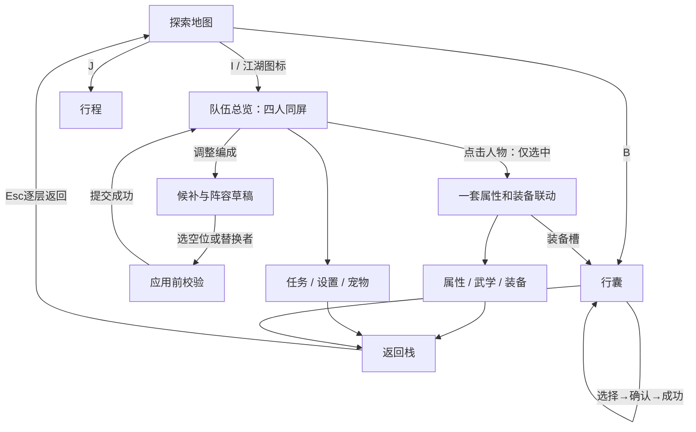

# 江湖界面开发流程包

状态：现行　最后核对：2026-10-19

2026-10-05 · 以用户认可的四人同屏、图像交互方向为基准。**本包是设计合同；当前接入范围、测试与未验收项见[开发记录](implementation.md)。**

[打开可点击流程演示](preview.html) · [机器可读流程](flows.json) · [返回设计目录](../README.md)

最新交互规则：[V7 各页交互整改](interaction-v7.md)。与早期流程演示冲突时以 V7 为准。

武学当前接入：[V9 功法目录与当前修习](martial-preview-v9.md)。用户已要求将 V9 目录接入正式游戏；采用真实存档数据。V8 武学右侧构图已退出本轮实施。

新增机制与预览：[V10 绝式与战意](ultimate-v10.md)。用户要求增加满足条件释放的大招；具体规则待评审，战斗尚未接入。

任务最新方向：[V10 文字任务日志](quest-journal-v10.md)。用户明确任务以记录前因后果与指引为主，取代 V8 大幅地点插画，待审阅具体版式和文案。

## 开发阅读顺序

1. [入口、页面与输入](navigation.md)：七页职责、共享选人、悬停/点击、返回栈。
2. [人物与四人编成](party.md)：同屏选人、候补、替换、剧情锁、应用。
3. [装备与行囊](inventory.md)：换装、药食、秘籍、材料、大库存。
4. [属性与武学](growth.md)：加点、主动技能、BP详情、心法和被动。
5. [宠物、任务、行程与设置](other-pages.md)：其余菜单的完整入口与返回；[存档管理与返回首页](settings.md)为设置最新规则。
6. [状态与接口合同](contracts.md)：读写边界、事务、存档迁移和代码接点。
7. [素材、开发顺序与验收](delivery.md)：素材拆分、实现依赖、测试矩阵。
8. [V6 细线与留白](art-v6.md)：当前分区规范；取消纸框与角饰，以细黑线划分内容。图标沿用 V5 绘制资源。

## 已认可与仍属方案

- 已认可视觉方向：四人立绘同屏，淡雅场景，图像为主，具体信息悬停展示。
- 已确认规则：最多四人出战，玩家需要主动编成；名单与出战不能混为一谈。
- 本包沿用的实施提案：四个人类含主角，独立自动宠物位；主动招式取消六格准备，按施展条件调用。它们来自V3机制方案，**本次认可视觉不等于所有机制已经确认或完成**。
- 主角在当前剧情必需时锁定；后期是否可换下由剧情规则配置，不在UI写死永久锁，也不只改按钮就改变实际战斗。
- 编成示例中苏芷、岑霜属于容量演示，不代表开始部分能同时招募。生产界面只读有效存档。

## 主流程

完整情境按流程ID F01—F14查阅演示；每步都有触发动作、画面反馈、写入范围、失败分支和验收点。

## 视觉依据

[四人同屏](../../../../../art_sources/qihe-ui-preview-v4/four-person/preview.png) · [人物悬停](../../../../../art_sources/qihe-ui-preview-v4/character.png) · [行囊悬停](../../../../../art_sources/qihe-ui-preview-v4/inventory.png)

流程演示复用这些已生成的美术参考，其他页面用流程说明表达，**没有伪造尚未制作的运行截图**。提示词及来源见[V4](../jianghu-ui-v4.md)；机制证据见[V3](../jianghu-ui-v3.md)。
