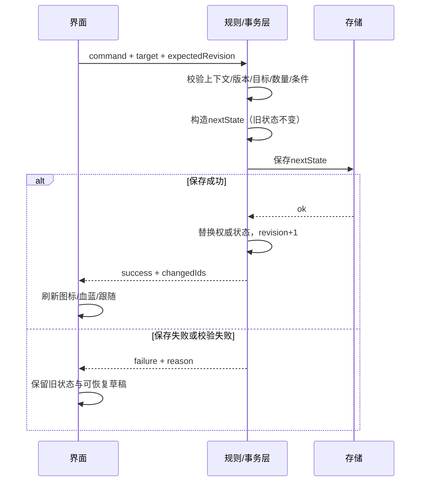

# 状态与接口合同

状态：现行　最后核对：2026-10-19

[流程包](README.md) · 以下接口名是开发提案，不是现有API。

## 状态分层

| 层 | 示例 | 持久化 |
| --- | --- | --- |
| 游戏权威状态 | 招募名单、active阵容、成长、装备、共享包、宠物、任务、章节 | 存档 |
| 菜单会话 | page、selectedActorId、filter、sort、scrollByPage、focusId、returnStack | 会话内 |
| 临时展示 | hoverTarget、tooltipRect、pinnedDetail | 不持久化 |
| 操作草稿 | formationDraft、statDraft、selectedItem、quantity、expectedRevision | 成功提交前不入存档 |

选中人物≠出战成员变更；已结伴≠在场可操作；人物外观阶段≠装备栏物品。草稿引用ID，不复制第二套角色属性。物品继续按itemId堆叠，不引入未定义随机词条实例。

## 读写接口

| 接口提案 | 输入/输出 | 现有接点 |
| --- | --- | --- |
| getRoster/getFormation | 名册、已提交阵容、可用性 | S.party、S.mates、临时剧情名单需适配 |
| getActorView | id→五维/血蓝/外观/三槽/状态 | mnD、mnHP、mnEq、QiheMenu.portraitKey |
| getInventory | query→稳定ID列表/数量/分类 | ITEMS、S.bag、mnCat；补材料显式分类 |
| inspectItem | actorId,itemId→差值、条件、动作 | mnCan、mnCmp、mnUse规则抽取 |
| inspectSkill | actorId,skillId,bp→效果/条件/消耗 | mnSkMp、战斗检查、BSK需统一 |
| commitCommand | type,target,payload,expectedRevision→result | 新事务层，包装现有规则，不能直接透传旧副作用 |
| resolvePortrait | actorId,stage,usage→assetRef/anchor | 当前素材清单；缺图使用本人已验收备用，不能换成别人的脸 |

写命令枚举：applyFormation、equip、unequip、useItem、learnFromItem、allocateStats、setMainInner、setSubInner、feedPet、equipPet、beginActivity、save。只读接口不得顺手扣资源或自动变更阵容。

## 事务顺序

执行期间互斥同一写通道，自动存档也使用同一序列，避免旧快照覆盖新事务。连击/重复提交用commandId去重。expectedRevision变化则重读校验，不能应用过期预览。存储失败保持原状态；页面不伪报“未扣除”却已被旧函数提前改写。

旧mnEquip/mnUse等会直接修改S；必须抽出规则或在隔离快照运行纯适配后再提交，禁止修改全局S后假装原子。save目前吞异常，先提供可判断成功/失败的存储封装，再接操作反馈。

## 迁移与输入接入

- 栖河档位继续使用saveKey，不改其他入口存档。迁移版本化、幂等，保留未知ID原始数据与恢复副本。
- S.party拆成名册和阵容后，招募、跟随、战斗预载、参战、结算、菜单成员读取同步迁移；不只slice前三人。
- 序章临时阵容不写正式名册；合法四人限制在人类层校验，宠物不混入人类列表。
- 注册单个菜单控制器；打开绑定、关闭释放，重复开关不叠keydown监听。屏蔽原B资源面板重复处理。
- 菜单暂停/恢复探索输入通过现有mode和busy边界，不能重置剧情busy绕过对话。
- 旧load字段保留迁移来源；主动无槽规则完整上线前不删除玩家已学武学。章节、叶蘅分支和培养熟练的适配依V3清单完成。
