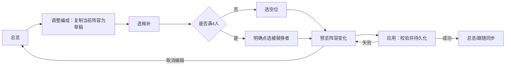

# 人物与四人编成

状态：现行　最后核对：2026-10-19

[流程包](README.md) · 对应 F02、F03 · [数据方案依据](../party-ui-v3.md)

## 四人同屏

最多四个人类按编成顺序展示，四人全身可辨、脚不裁切；取消右侧重复装备栏，将左侧属性以外的空间作为人物展示区；1—4人按实际人数和立绘有效宽高重新计算组宽，整体始终居中，保持一致展示高度，不随人数减少而缩小。空白不占隐形人物格，空位在头像条显示＋，不画未知人物轮廓冒充已招募。

点击身体非透明区域或头像选中人物，左侧属性仅跟随此人；装备通过独立装备页处理，队伍和属性页不再重复展示装备栏。背景不接收换人操作。可点击区域最小44×44 CSS像素，相邻人物命中区不重叠；被遮挡部位不成为唯一选中入口。长衣摆采用角色元数据定义范围，不能让最大透明画布抢走邻人点击。

## 编成完整流程

- 候补列表按在场可用、驻地、暂离区分；驻地/暂离可看资料，不能远程换人或用药。
- 换下仅退回候补，不解除招募、不卸装备、不治疗。排序只变编成顺序，不直接更改战斗先后手。
- 未满员允许1—4人应用；空草稿可编辑，但0人不能应用或开战。
- 必需剧情人物有锁和短原因，选锁定者替换时阻止该步。剧情结束解除本段锁。
- 使用“应用编成”一次提交；取消全部草稿。离开时有变更则提供应用/放弃/继续编辑，选择继续须保持原焦点。
- 入战、对话、转场、结算期间禁止提交编成；编辑时角色状态改变，应用前重新校验并指出哪个角色不可用。
- 临时剧情战斗显示本场阵容，不把临时同伴永久塞入名册，结束恢复常设阵容。

## 无效与边缘状态

| 场景 | 表现 |
| --- | --- |
| 无候补 | 只显示当前人，候补区短空态，不虚填NPC |
| 候补超过一屏 | 肖像带滚动，四个出战位固定可见 |
| 选中人突然暂离 | 清除未提交动作，回退有效可查看人，提示变化 |
| 五人以上旧档 | 名册全部保留；按迁移规则取有效四人，其余候补 |
| 保存失败 | 阵容、跟随、血蓝均保持旧值；保留草稿供重试 |
| 主角换下 | 只有允许该剧情且战斗/宠物适配均完成才开放，不能仅放开按钮 |

生产数据不使用演示中四人名单作为默认值。宠物独立卡，不参与人类换位。正式战斗必须读取已提交阵容快照，不能重新遍历全部已结伴名册。

当前页面布局与详情展示位置以 [V7](interaction-v7.md) 为准。
