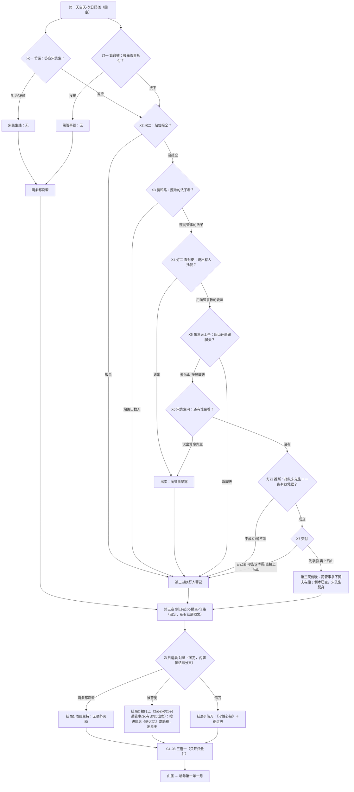

# 栖河·玄烛会暗中观察者支线（设计稿·第二版）

状态：草稿　最后核对：2026-10-23

> **第十三轮（2026-10-23）已拍板主体**：人设选蔺晦之（57 岁，归烬堂货路管事，就是第 5 项的游方算命先生）、心法用《守烛心经》（他私藏的那本）、F-0037 加化名、新设定清单全部认可；“事态爆发”的定义、推断环节、结局 3 的 CG 由本稿按需写定（第四、五、八节）。已写进 `bible/人物/蔺晦之.md`、`story-atlas.json`（`lin-huizhi`）和定稿事实 F-0063～F-0069、F-0037。**F-0027 放宽用户已同意，但锁定条目要等用户与红绳第 5 条一起确认后由主会话改**，本稿只写拟文（第五节末）。拍板记录见第十二节，仍待答的见第十一节。
>
> 本页仍是设计稿：不写台词、不改 ink／JS／回扣登记表、不生成正式 CG。工作区：设计在 `xiaojianghu`，以后实现在 `xiaojianghu-legacy-prologue`（R-工作区-01）。
>
> 第一版（谭默、四结局）已归档：[archive/design/qihe-mojiao-observer-sideline-v1.md](../archive/design/qihe-mojiao-observer-sideline-v1.md)。本版按用户 2026-10-22 的新构思整页重写。
>
> **变更说明**
> - 第二轮：按用户 2026-10-22 新构思整页重写（两条线、三结局）。
> - 第三轮：新人物改为与岑霜同级（用户 2026-10-22）。推荐人设由“玄烛会总堂司灯、位在堂主之上”改为**归烬堂货路管事**蔺晦之（简称蔺管事），备选卫阑由“总堂执簿”改为**归烬堂文书管事**；随之改了察觉不妥的来由、不出手的理由、与岑霜和乌魁的关系、结局 3 的口令与赏书来源、甲级心法的来源。第二轮“比裴嵩更加高级”的说法按第三轮作废。步骤名“灯一～灯四”、存档字段 `lamp`、铜灯牌照旧（“灯”取自他摊上那盏小铜灯和他船队的灯号牌）。
> - 第十三轮：按用户答复落实（见页首与第十二节）；推断改成“先指人、再拿一条凭据”的两步对话选择；结局 3 只出一张 CG（CG-三乙）；结局 2 路费按第十一轮货币统一改为“两”。

**用户原话**（整改清单第 6 项，2026-10-21）：「新增一个魔教的正面人物的支线，他隐隐感觉到不对劲，所以暗中观察，同时也给主角一些支线任务（和另外一条支线（帮助监督三派人士）形成冲突），需要有多条路线，如果处理完美则获得巨大收益（甲等心法），然后根据选择的不同有不同结局（需要重新设计cg和对应剧情）和路线，最终还是归并到三选一培养模式」

**用户新构思**（2026-10-22，本稿的纲）：「归烬堂的支线我想的是有一个比裴嵩更加高级的魔教人员察觉到有一丝不妥后在暗中观察，避免事态进一步爆发（因为他地位比较高，如果直接出手会带来更多的问题而且对方在暗处暴露了会危险），所以经主角的处理后成功识破背后是裴在拨弄局势，直接在事态爆发前就出手处理了，但裴没有暴露身份就逃走了，所以整个路线是要设计好玩家同时需要接取两条支线，然后都做了最好的选择路线才可以获得最好的奖励，同时也指向了三个结局——1，两个人的支线都没帮，但是最后周出来主持局面解决了矛盾，这个路线奖励最少；2，只做了某一个人的支线或者没有做完美的抉择，然后主角的行动被三派的执行人警觉了（现有版本，只是台词稍微调整一下）；3，主角不仅意识到搅局者就是裴，还是让魔教的人出手处理了，借刀杀人了，这让魔教的人不仅没生气还什么欣赏，所以给了奖励，这其中有很多细节需要补充，所以需要你设计好；」

**用户第三轮**（2026-10-22，位阶以此为准）：「魔教新人物作为和岑同级吧，岑地位高只是因为身份和背景问题，后面会提及的」

路线图：[qihe-mojiao-observer-sideline-routes.png](qihe-mojiao-observer-sideline-routes.png)（Mermaid 原稿见第九节）。

---

## 〇、先核对的事实（以 bible 与设计文档为准）

| 问题 | 结论 | 依据 |
| --- | --- | --- |
| 裴嵩在哪个体系、什么地位 | **裴嵩不是魔教的人**。他是**正道盟本部执事**（办事者、文职；47 岁；人物等级 72；伪装时不展示真实等级），借正道名号索《归元诀》。开始部分乔装成账房“宋先生” | `cast-visuals.md`「裴嵩 · 旧案责任人」、`story.md` 第 18 行、`character-levels-100.md`、F-0004 |
| 新人物放在什么位阶 | **与岑霜同级**（用户第三轮定；第二轮“比裴嵩更加高级”作废）。现有层级：玄烛会会主（阎望山）＞ 总堂（统合使庄照尘等）＞ 分堂堂主（归烬堂·韩烬川，76 级）＞ **管事**（岑霜：对外交涉的管事、本次栖河索匣主事，开篇中层，乌魁的上司；同一档还有刑务管事邢守夜，58 级）＞ 头目（乌魁，12 级）＞ 帮众。新人物取**归烬堂另一名管事**，管另一条线（推荐：货路，管烬渡、芦花渡一带的船户、调船与船递；备选：文书，管印信与传讯底簿），向堂主韩烬川回事，与岑霜互不统属。不新造高层职衔。等级建议 50 上下（管事一档；低于裴嵩 72，打不过也不知道对方深浅；第 1a 条未单独作答，按稿暂用）。**第十三轮第 23 项选定蔺晦之·货路管事（F-0063）**。**岑霜位阶与其身份背景有关，后文另述（用户 2026-10-22 定，不在本稿展开）** | `bible/人物/岑霜.md`（身份行）、`factions/guijintang.md`（核心人员、“岑霜保留开篇中层身份”）、`story-atlas.json`（cen-shuang、guijintang-npc-0／1）、`character-levels-100.md` |
| “帮助监督三派人士”是哪条线 | **主解释：宋先生托萧白记下进村的人**（C1-00B 竹匾→C1-S1 后山回话一→装卸路“在路口数人”→C1-S2 后山回话二；可答应、问过再答应或拒绝）。依据：① 用户这次说“两个人的支线”，宋先生线是**一个人**托付的，三方跑腿／「三张附页」是三个人或一条链；② 用户说结局 2 是“现有版本”、“被三派的执行人警觉”——现有剧本里萧白被三家疑为眼线，**只发生在答应过宋先生的路线**（装卸路 `watched`、对证“路口那个人是谁的”，F-0039）；③ 用户要“识破背后是裴”，识破的线索（红绳、侧口、青玉算珠等）全在宋先生线里。**备选解释**：第 2 项方案甲-1 的「三张附页」小链（见第十节末“备选”）。| F-0026、F-0027、F-0039；`风起-竹匾.ink`、`风起-后山回话一/二.ink`、`三方-装卸路.ink`、`三方-对证.ink`；`opening-errands-rework.md` 第六节 |
| “周”是谁 | **推荐：周砚**（归云谷掌门，88 级，温行舟旧友，开始部分不是正道盟的人；第三夜在侧口救人，撤到邻村后在院中）。依据：“出来主持局面”要有分量、对三家都中立，只有他够格；他的写法是“善于把复杂事拆成眼前能做的一步”“不替别人做主”，正好是主持而不裁决。**另一种可能：周婶**——但她在现有对证里本来就替陈伯取出底单（F-0034），若“周”指她，结局 1 与现状没有区别。列入待拍板第 2 条 | `bible/人物/周砚.md`、F-0010、F-0034；`三方-侧口对峙.ink` R3-R2；`风起-守路.ink` C1-06-11 |
| 现有“被警觉”的剧本在哪 | 答应过宋先生（`stranger_deal` 为 accepted／asked_first）时：装卸路 R2-W1～W5（岑霜、沈雁回各自把萧白当成别家眼线）；后山回话二 C1-S2-03（萧白说“她们都在猜我是谁的人”）；对证 R4-O1～O6 与说不说出宋先生的选择（R4-T01～T13c／R4-S1～S4） | `三方-装卸路.ink`、`风起-后山回话二.ink`、`三方-对证.ink`；`js/qihe-representatives.js` 的 `watched` |
| 失火能不能被支线避免 | **不能。** 第三夜三家撞到侧口、交锋、起火、撤离、守路、次日对证都是固定剧情（F-0029、F-0033、F-0035、F-0037 锁定；失火因果链“乌魁抢箱→护院拔剑→随从堵路→撞灯台→油棚着火”写在 `opening-state.md` 第 4 节）；R-剧情-07 也规定固定剧情的触发不得依赖可选剧情 | `opening-state.md`、`js/qihe-chapter.js` fireBody() |
| 那么“事态爆发前就出手”指什么 | 本稿把“事态”分两层：**固定的那一层**（侧口相撞与失火）照常发生；**“进一步爆发”**是宋先生的后手——他雇的黑衣脚夫第三夜在东埠停船处等着“乱起来就去侧口外接箱子”，船上备着归烬堂样式的铜扣好栽赃。结局 3 里，蔺管事在第三夜之前拿下脚夫和那条船，后手没了。其他结局里后手也没得手（火起后周砚让大家往西田埂撤，箱子没往东埠走），但没人知道它存在。**第十三轮第 26 项由本稿写定（F-0067）**：用户原话的“事态进一步爆发”＝这个后手；“在事态爆发前就出手处理”＝第三天傍晚在东埠拿下脚夫与那条船。不扩大到失火（失火改不了，见上一行） | 本稿第五节；`风起-后山回话二.ink` C1-S2-12「真要乱起来，会有人来收拾的」 |
| 三选一培养 | C1-08《先说清楚，再找去处》：① 随周砚去归云谷（唯一开放）② 岑霜（暂未开放，只回一句）③ 沈雁回（暂未开放）。之后进山居、培养第一年一月 | `opening-routes.md`、`风起-商量去处.ink`、`js/qihe-cultivation-bridge.js` |
| 甲等心法的规矩 | 外派途径：甲级要“人物篇或深交”；学甲级要前一门七重、主属性 12／副属性 9／根骨 8；开始部分心法不开放，开局五维都是 3；开始部分常规奖励只放丁、丙 | `manual-placement.md` 第 8、11 行，`martial-lineage.md` 3.2、第 96、102 行，`qihe-hidden-rewards.md` 第 2 节 |

---

## 一、新人物卡（第十三轮第 23 项选定候选甲）

两位都满足：**归烬堂管事，与岑霜同级**，各管一条线、互不统属，都向堂主韩烬川回事；是正面人物但不是圣人（“魔教”的人，讲兑现、护自己人，也会用人）；“不妥”有具体来由，而且来自**他自己那条线上的簿册**——同级管事够得着、别人不会去翻；不知道宋先生是谁，从头到尾没见过宋先生的脸（保 F-0004）。岑霜位阶与其身份背景有关，后文另述（用户 2026-10-22 定，不在本稿展开）。

### 候选甲（**已选定**，第十三轮第 23 项）：蔺晦之 · 归烬堂货路管事

人物页：[bible/人物/蔺晦之.md](../../bible/人物/蔺晦之.md)；atlas `lin-huizhi`；定稿事实 F-0063～F-0069。

| 项 | 内容 |
| --- | --- |
| 姓名／性别／年龄 | 蔺晦之（第十三轮定名），男，57；堂里叫他“蔺管事” |
| 位阶 | 归烬堂**货路管事**：管烬渡、芦花渡一带的船户、调船和船递（`factions/guijintang.md`：本堂以货路、护卫谋生，驻烬渡，经芦花渡、合川护运）。与岑霜（对外交涉管事）、邢守夜（刑务管事）同一档，向堂主回事；不能调动岑霜手下的人，也不能替她的差事做主。手边只有自己船上的人。人物等级建议 50 上下（第 1a 条，按稿暂用） |
| 和岑霜、乌魁、裴嵩 | **岑霜**：同级同堂，各管一线，常在堂里碰面，一眼就能认出他。两人不坏也不亲：她把对外交涉当自己的地盘，他管船不过问交涉——这是他必须躲着她、也不能直接去拦她的原因。**乌魁**：认得他的脸（帮众调船都要找他画押），嘴快，见了必嚷出来，所以他也要躲乌魁。**裴嵩**：只知道“正道盟有个执事叫裴嵩”这种江湖人都知道的名字，从没见过；也不知道宋先生是谁 |
| 一丝不妥（来由） | 堂里调船都要在他那里登记由头。岑霜带乌魁和几名帮众去栖河，调船单上写的是“奉堂里传讯，往栖河取回旧物玉匣”。堂里发给自家人的传讯向来随自家船递走，**他的船递簿上这些天没有一封往岑霜那边递的讯**；岑霜手上那封是从汉皋那头递到她手里的。印是真印（F-0032 不改）。岑霜管对外交涉、常在汉皋收讯，这在她看来不稀奇；在管船递的人看来不对——**能看出这一点的，只有管船递簿的人** |
| 为什么不直接出手 | ① **越线**：栖河是岑霜的差事。他一个同级管事越过她去拦人、拿人，在堂里就是夺功、拆同级的台；刑务那边（邢守夜“按权势执行规矩”）正好拿来做文章，先乱的是堂里自己；② **不能先告状**：讯上压的是真印，可能是堂主或别的管事私下发过什么、在路上被人动了。没凭据就去堂主那里说，是告同级、疑上头；他得先拿到实在的东西；③ **暴露在明处危险**：他没有堂主的令，带不了堂众，身边只有一名押船伙计；在正道盟护院、巡江司差役中间被认出来，就成了“归烬堂又派人来了”——三家之争立刻添一把火，他自己也成了任人拿捏的把柄；④ **打草惊蛇**：搅局的人在暗处，他一露面，对方收手藏起来，下一回换个地方再来，线就断了 |
| 外形要点 | 外罩游方算命先生的旧灰布道袍、斗笠、布幡写“测字”；袍底露一截墨紫暗红的里衫衣缘（归烬堂配色，按 `faction-attire.md`）；左手缺半截小指（早年拉缆绳绞的）；腰上挂一盏不点的小铜灯当招牌——那是他船队的灯号灯。瘦高、背直、说话慢，笑起来眼角不动 |
| 口吻（示例，非台词） | 先看人再说话，爱用测字打比方；夸人不说“好”，说“准”。“我看不准命，看得准人。” |
| 何时何地以何身份观察 | 第一天白天到第三天下午，以**游方算命先生**身份在中央北路西侧草地摆摊（第 5 项设计稿的算命摊 C3，坐标 905,470）；能看见北路、叶家方向和往来的人。岑霜、乌魁在南村口、东埠一带，他不往那边去。第三天下午收摊“离村”（与第 5 项写的“第三天傍晚前离村、不参与起火夜”一致），其实去东埠收网。押船伙计是他船上的人、不是堂众，乌魁不认得；扮成挑夫，住河埠船家那边 |
| 和第 5 项的关系 | 第 5 项设计稿第 5.5 节已预留：算命先生可与魔教人物合并为一人，Q5 测字让位。本稿采用这个合并，**改成同级后仍成立且更必要**：岑霜和乌魁都认得他的脸，他必须乔装；算命摊离东埠、南村口远，又能看人。测字照样是他摆摊的明面生意（给小吉兆），“看得准人”就是他在挑能托付的人 |
| 甲级心法的来由 | 一个管事**不能**把归烬堂的甲级功法授给外人（`manual-placement.md`：归烬堂甲级要堂主传授）。所以给的是**他个人私藏、不属归烬堂传承的一本**：早年押船时，一位付不出船钱的老客商拿它抵了船钱，他自己练了几十年，抄过一份。以个人名义酬谢，不经堂里。归类与平衡见第五节“甲等心法”。**第十三轮第 24 项「用」：定为《守烛心经》，当场以个人名义给（第 8a 条甲）；来历进 F-0069** |
| 新设定（第十三轮第 28 项「认」，已进定稿事实） | 蔺晦之本人与“货路管事”这一分工（职衔沿用现有“管事”）、左手缺指、乔装算命先生（F-0063）；调船单与船递簿、“船递簿上没有这封讯”（F-0064）；私藏心法的来历（F-0069） |

### 候选乙（未选，留作记录）：卫阑 · 归烬堂文书管事

| 项 | 内容 |
| --- | --- |
| 姓名／性别／年龄 | 卫阑（名字占位），女，46 |
| 位阶 | 归烬堂**文书管事**：管本堂印信的使用登记和传讯底簿，堂里的印哪天用过、盖在什么上，都在她那里留底。与岑霜同级，向堂主回事，不能对同级问责。人物等级建议 45 上下（待拍板） |
| 和岑霜、乌魁、裴嵩 | **岑霜**：同级同堂，天天在堂里照面，一眼就能认出——所以她只能躲在客栈里间。**乌魁**：认得她（领路费要在她那里画押）。**裴嵩**：同甲，不认识 |
| 一丝不妥（来由） | 归烬堂的印，那几天的底簿上没有登记盖过这封讯——印是真的，用印却没留底。不是堂里有人私用，就是盖过印的别的讯在路上被人拆改过 |
| 为什么不直接出手 | 同甲①～④；她的②更重：用印没留底，最先要问的是堂主和管印的人，她一个同级去问就是查上头 |
| 外形要点 | 外扮过路的绣线货娘：青灰布衣、发髻插一支铜簪，随身一只装满绣线的扁箱（箱底压着底簿抄页）；右手中指有常年按印的茧 |
| 何时何地以何身份观察 | 第一天白天到第三天下午，住客栈（第 5 项设计稿的客栈室内 I3 位置或后门门帘 O2），在客栈里向往来的人卖绣线、听闲话 |
| 甲级心法的来由 | 同甲的问题：管事不能授堂里的甲级；只能是私藏。她管文书，私藏的来历要另编，比甲牵强 |
| 弱点 | 只能待在客栈，看不到村中北路和后山方向，托付里需要更多“替她跑腿”的步骤；她的“不妥”比甲更抽象（底簿），玩家较难体会；她的船、人都少，结局 3 在东埠拿船要另借人手 |

### 不推荐（未选，留作记录）：复用邢守夜

已有人物（归烬堂刑务管事，58 级，与岑霜同级）。好处是现成、同级；问题是他的写法是“维护规矩，却倾向按权势执行”“细节提前露出差别对待”（`factions/guijintang.md`、`story-atlas.json` guijintang-npc-1），在开始部分当“正面人物”会和后面打架；刑务管事在栖河暗查同级，也更像“查办”而不是“观察”。原先列的“复用韩烬川”是堂主、在岑霜之上，按第三轮不再考虑。

**第十三轮选定甲**：他的“不妥”最具体（船递簿上没有这封讯），是货路管事本职里看得见的东西；他有船、有船上的人，结局 3 在东埠拿船顺理成章；算命摊的身份正好与第 5 项合并，也和宋先生“扮账房”形成两个乔装观察者的对照——一个想压住事，一个想挑起事。下文以蔺晦之（简称“蔺管事”）写；换成乙时只改人物、落脚处和“不妥”的来由，步骤结构不变。

---

## 二、戏眼卡与“谁知道什么”

### 整条支线

- **一句话戏眼**：两个乔装的外来人都在借萧白的眼睛——一个想让村里乱起来，一个想在乱之前把手伸进去；萧白能不能看清哪只手在推，再借另一只手把它按住。
- **谁想要什么**：蔺管事想在三家撞上之前，找出那封没走船递的讯是在哪一站被动了手、谁动的，又不越过同级的岑霜、不让归烬堂在栖河再多露一个人；宋先生想知道三家何时动手，好让乱子按他的时辰发生。
- **什么挡着他们**：蔺管事是岑霜的同级，不能越线插手她的差事、不能露面，手下只有一名押船伙计；宋先生不能进村、只能坐在后山等人回话。两人都只能托一个刚到村的外乡人。
- **散场时什么变了**：按萧白的选择——三家靠周砚压住了火气（结局 1）；萧白被三家的人盯上（结局 2）；或者蔺管事在第三夜前拿下送信的人、宋先生连夜消失，蔺管事把一函书交到萧白手里（结局 3）。

### 谁知道什么（按时间推进，截至对证之后）

| 人物 | 知道 | 不知道 |
| --- | --- | --- |
| **萧白** | 按实际经历：两边各托了什么；船家说的脚夫来路；岑霜那封讯的封皮；宋先生的言行疑点；结局 3 里还知道“搅局的是宋先生”和蔺管事拿下了脚夫 | **宋先生就是裴嵩**（F-0004，任何结局都不知道）；附页是怎么改的；补来的附页写了什么（第三夜侧口才知道） |
| **蔺管事** | 船递簿上没有那封讯、岑霜调船单上写的由头；船家打听到的、萧白告诉他的；结局 3：脚夫供出“雇主是后山倒木一个姓宋的账房”“今夜在东埠等着接箱子”；倒木已经空了 | 宋先生的长相（**从没见过他的脸**）、真名、属于哪一家；补来的附页写了什么（脚夫不识字，信是封着的）；叶家实际有什么 |
| **宋先生（裴嵩，作者层）** | 自己的全部算盘；萧白告诉他的一切 | 蔺管事的存在（除非萧白在 C1-S2 说出）；萧白是不是另替人做事（结局 3 他到最后也不知道是谁拿了船） |
| **岑霜** | 自己那封传讯；乌魁的做派；结局 3：第三天傍晚收到蔺管事凭灯号牌递来的一句话（同级之间的提醒，不是命令）“送附页的是外人雇的脚夫；箱子出了侧口，东埠有船等着往你身上栽——今夜管住你的人”，次日清晨蔺管事把脚夫的口供交给她、由她在对证上说，雇主是后山的“宋账房” | 蔺管事乔装在村里摆摊（除非萧白告诉她；结局 3 她知道递话的是蔺管事，但不知道他这几天就在北路）；宋账房是谁；结局 1、2 里不知道传讯是在路上被动的手 |
| **三派执行人**（正道盟护院、乌魁与帮众、采办随从） | 结局 2：路口那个数人的／跟着送信人转的，就是借住的外乡人萧白（各自以为是别家的眼线） | 蔺管事；宋先生；结局 1、3 里没注意到萧白 |
| **徐令仪、沈雁回** | 自己那张附页；结局 3 的对证上知道“三张补附页是同一个受雇的人送的，雇主自称姓宋的账房，已经跑了” | 蔺管事（岑霜只说“我们堂里的人”）；宋账房是谁 |
| **周砚** | 结局 1：他主持对证时听到的一切。所有结局：自己是温行舟旧友 | 蔺管事、宋先生（宋先生听到“周砚”会停手，周砚却不知道有这个人，见 C1-S1） |
| **叶蘅** | 萧白肯告诉她的部分；对证里听到的 | 蔺管事的托付（萧白不说就不知道）。蔺管事**不要求**萧白瞒着叶蘅（“那是她家的事”），和宋先生“先别惊动她”恰好相反 |
| **河埠船家**（第 5 项 E1 上图的普通 NPC） | 黑衣脚夫坐下水船从汉皋方向来、付汉皋银票、每天天亮往后山去 | 雇主是谁 |

每场的戏眼三行见第七节场次清单。

---

## 三、两条支线的步骤与交叉

### 宋先生线（“帮助监督三派人士”，已有，可选）

| 步 | 何时 | 场次 | 萧白做什么 | 已有／要改 |
| --- | --- | --- | --- | --- |
| 宋一 接托付 | 第一天白天（半日 0） | C1-00B 竹匾 | 答应／问过再答应／不掺和 | 已有，不改 |
| 宋二 回话一 | 第二天白天（半日 2） | C1-S1 后山回话一 | 报正道盟的站位：“我都看清了”（报全）／“没太看清” | 已有；**认识蔺管事时**萧白心里多一句“站位谁问都别给”（小分支） |
| 宋三 在路口数人 | 第二天傍晚（半日 3） | 装卸路 | 现状：数人被看见（`watched`）。**新增**：接过蔺管事托付一的，进装卸路前多一问——照宋先生说的站路口数／照蔺管事教的法子，在药车边替叶蘅搬药时看 | 要改（中分支） |
| 宋四 回话二 | 第三天上午（半日 4） | C1-S2 后山回话二 | 报两家、被问侧口、收算珠。**新增**：认识蔺管事并听了他“天一亮就去”的，开场多一句心里话——下山小路上那个黑衣脚夫正往下走，怀里揣着一个油纸包；认识蔺管事的，宋先生多问一句“村里除了你，还有谁在看？”（不说／说出算命先生） | 要改（中分支） |

### 蔺管事线（新，可选）

| 步 | 何时 | 地点 | 萧白做什么 | 得到的线索 |
| --- | --- | --- | --- | --- |
| 灯一 测字·托付 | 半日 0～1 | 算命摊 | 测字时蔺管事看出萧白“替人数人”（萧白答应过宋先生的，他看见萧白从后山下来）或“想替叶家做点事”（没答应的）。托付：去河埠问船家，那个给药商递字条的黑衣人（F-0025）坐哪条船、从哪来、平时去哪。同时叮嘱“你在路口看见的站位，谁问都别给” | ① 脚夫坐下水船从汉皋来，付汉皋银票，**每天天亮往后山去一趟** |
| 灯二 看封皮 | 半日 3～4（岑霜在装卸路正式登场之后） | 南村口或东埠找岑霜 | 设法看一眼岑霜那封传讯的封皮。三种问法：用蔺管事教的说法（“替叶姑娘看看传讯上写的旧物是哪年的”）／随口一问／说出有人托我看 | ② 外封是汉皋代转行的纸，火漆压过两回——**讯在汉皋被拆开又封上**，不是堂里出的事 |
| 灯三 天亮的脚夫 | 半日 4（第三天上午） | 后山或一路跟着脚夫 | 蔺管事托：“明早跟着那脚夫，看他见谁、拿了什么。”两种做法：去后山赴宋先生的约（答应过宋先生才有这个由头），在倒木旁撞见脚夫刚走；或者从河埠一路跟着脚夫 | ③ 脚夫天亮在倒木旁见的是宋先生，带走一个油纸包 |
| 灯四 回话与交付 | 半日 4（同一上午，活动不耗时） | 算命摊 | 推断“谁在牵线”（第四节），再决定怎么交给蔺管事 | 结局分流（第五节） |

### 交叉点

| 编号 | 何时 | 两条线怎么碰 | 是“互证”还是“只能选一边” | 后果 |
| --- | --- | --- | --- | --- |
| X1 | 灯一（半日 0～1） | 蔺管事看出萧白在替人数人 | 互证：只有答应过宋先生的，蔺管事才会说“你从后山下来，手里揣着金疮药——谁托你看人？” | 萧白可以说出宋先生（不影响结局，蔺管事只记“后山有个托人的账房”），也可以不说 |
| X2 | 宋二（半日 2） | 宋先生要站位，蔺管事说站位谁问都别给 | **只能选一边** | 报全：进不了完美（结局 2） |
| X3 | 宋三（半日 3） | 照宋先生的站法数人，还是照蔺管事的法子看 | **只能选一边** | 站路口：被执行人看见（现有 `watched` 版本，结局 2）。照蔺管事的法子：照样看清了，没人注意到萧白 |
| X4 | 灯二（半日 3～4） | 看封皮 | 互证：封皮说明“讯在汉皋被动过”；宋先生自称“替人跑账，常过栖河” | 说出“有人托我看”：岑霜追问出北路的算命先生，一听左手缺指、挂小铜灯，就知道是同堂的蔺管事在背后查她的差事——蔺管事暴露，两个同级管事在栖河闹僵，结局 2（出卖变体） |
| X5 | 宋四／灯三（半日 4） | 去后山，还是跟脚夫 | **只能选一边**，但答应过宋先生的人有第三种聪明做法：去后山，就是“跟着脚夫”的终点 | 去后山（且听了“天一亮就去”）：撞见脚夫，又听到“侧口”——线索③到手且没人察觉。跟脚夫：午后他去三家送信时，萧白在三处营地都被看见，结局 2 |
| X6 | 宋四（半日 4） | 宋先生问“还有谁在看？” | **出卖点** | 说出算命先生：宋先生让脚夫递话给乌魁“你们堂里另来了人，扮成北路算命的，在背后盯你们岑管事”，乌魁去北路一看认出蔺管事、当街嚷出来，蔺管事被迫当天撤走，宋先生也提前脱身，结局 2（出卖变体） |
| X7 | 灯四（半日 4） | 推断与交付 | **只能选一边** | 见第四、五节 |

### 完美路线的判定条件（结局 3）

**全部满足**才算完美：

1. 宋先生线：答应了（`stranger_deal` 为 accepted 或 asked_first）。
2. 蔺管事线：做了灯一，并在半日 3 之前（装卸路之前）做完。
3. X2：宋二没报全站位（`stranger_report ≠ full`）。
4. X3：装卸路照蔺管事的法子看（新记 `lamp.hidden_watch = true`）。
5. X4：看到了封皮，而且没说出有人托付（`lamp.seal = 'seen'`）。
6. X5：第三天上午去后山，并在宋四里撞见脚夫（`lamp.porter_seen = true`）。
7. X6：没向宋先生说出算命先生（`lamp.sold ≠ 'song'`）；整个过程中也没向岑霜说出（`lamp.sold ≠ 'cen'`）。
8. 推断：指认宋先生，并且拿出一条“有效凭据”（第四节；第十三轮由“两条”改为“一条”，让玩家少读）。
9. 交付：把宋先生交给蔺管事，并说清“先拿船上的脚夫，再上后山”（`lamp.handoff = 'blade_order'`）。

**结局 1**：两条线都没做——宋先生线拒绝或从没碰到（`stranger_deal` 为 declined 或空），并且没做灯一。
**结局 2**：其余一切情况（做了任意一条线的任意一步，但不满足完美）。

一个存档同时满足多条时的判定顺序：结局 3 ＞ 结局 2 ＞ 结局 1（只要碰过一条线，就不是结局 1）。

---

## 四、识破搅局者的线索链与推断

### 线索分两类

萧白要分清“**他不是普通账房**”和“**他在牵线**”这两件事。前一类是宋先生的身份疑点，按 F-0027 剧本里谁也不解释、不点破，留到以后揭开裴嵩身份那场（F-0004：揭开时点见第三部分）；后一类是行为证据，只有它们能定案。

| 线索 | 从哪来 | 类别 | 推断里算不算“有效” |
| --- | --- | --- | --- |
| 衣领下的红绳 | 宋一（已有） | 身份疑点 | 不算。蔺管事：“这只说明他不是账房，说明不了他在牵线。” |
| 叫得出“徐令仪”、听到“周砚”就停手 | 宋二（已有） | 身份疑点 | 不算（同上） |
| 衣襟里的回纹针脚 | 宋二（已有） | 身份疑点 | 不算 |
| 青玉算珠 | 宋四（已有） | 身份疑点 | 不算 |
| **他问“是不是从装卸侧口走”——侧口萧白从没跟他提过** | 宋四（已有） | 行为证据 | **算**：他知道不该知道的地方 |
| **脚夫每天天亮往后山去** | 灯一（新） | 行为证据 | 不单列选项（它是“脚夫天亮去见他”的前半截） |
| **讯在汉皋被拆开又封上；他自称替人跑账、常过栖河** | 灯二（新）＋宋一（已有） | 行为证据 | 单独不算：只证他的手够得着汉皋的转信路，不证“就是他”（第十三轮改；交付后蔺管事回堂里一站一站对，用的就是这条） |
| **脚夫天亮在倒木旁见的就是他，带走一个油纸包** | 灯三／宋四（新） | 行为证据 | **算**：他就是雇脚夫的人 |

### 推断怎么让玩家做（第十三轮第 27 项「按需设计」，写定）

按“剧情要简单、不让玩家读大段细节”（用户第四轮第 14 项）：**两步对话选择，每个选项一句短话，不做线索面板、不新做系统**。

1. **先指人**：蔺管事问“这几天在三家中间牵线的，是什么人？”四个选项：乌魁／药商／后山的宋先生／我说不准。
   - 选乌魁、药商：蔺管事用一句已知的事驳回（乌魁只会压价拿定钱；药商只卖过罐子，F-0041），可以再选一次。
   - 选“我说不准”：直接进交付，只能选“我说不准”那一支（结局 2）。
2. **再拿凭据**：蔺管事问“凭什么？”。选项**只列萧白真拿到的**，每项不超过十个字：
   - 有效：“他问起装卸侧口”（宋四必有）、“脚夫天亮去见他”（宋四撞见脚夫才有）。
   - 不够：“封皮在汉皋拆过”（蔺管事：“这只说明讯在汉皋被动过，说明不了是他。”）；身份疑点如“他领下的红绳”“那颗青玉珠”（只在萧白看到过时出现；蔺管事：“这只说明他不是账房，说明不了他在牵线。”）。
   - 选到有效的一条就成立。选了不够的，可以再挑一次；第二次还不够，算“没说服他”，进结局 2。
3. 成立后，萧白心里只落到“**是宋先生在牵线**”这一步，不往下想他是谁（F-0004；F-0027 拟文见第五节末）。

为什么一条就够：完美路线本来就要求宋四撞见脚夫（条件 6），走到这里的玩家手里两条有效凭据都有；推断只是让玩家亲口说出“是他”，不是考记性。

### 交付（X7，四选一）

| 选项 | 发生什么 | 结局 |
| --- | --- | --- |
| **“他今早让脚夫带走一包东西。脚夫天黑会回东埠的船——先拿船，再上后山。”**（借刀，顺序对） | 蔺管事在第三天傍晚、脚夫午后在三家送完信回船之后，让押船伙计在东埠停船处拿下脚夫和那条船（四下没人，不惊动任何一家）；再上后山——倒木已经空了。脚夫供出“今夜乱起来就去侧口外接一只箱子”，蔺管事凭灯号牌给岑霜递一句话（同级提醒，不是命令）“箱子出了侧口，东埠有船等着往你身上栽——今夜管住你的人” | 3（其余条件也满足时）；否则 2 |
| “他就在后山倒木，您现在就去。”（借刀，顺序错） | 蔺管事白天上后山，宋先生在山上看得见下面的路，先走了；脚夫还在外头，替宋先生在三家各递一句“借住的外乡人在替别家盯你们” | 2 |
| “我自己去问宋先生。” | 宋先生听完只笑一句就进了林子（第三天下午他不在约好的时辰，萧白扑空）；同样让脚夫递话 | 2 |
| “这事该告诉岑姑娘。” | 岑霜问清是谁让他查的，知道同级的蔺管事背着她插手自己的差事，当场不认这份情；她派乌魁的人上后山，倒木已空；乌魁回头盯上萧白：“你一个借住的，怎么知道后山有人？”护院、随从都看见帮众跟着萧白跑 | 2（并且蔺管事暴露给岑霜） |
| “我说不准。” | 蔺管事只凭“后山有个账房”自己去查，晚了一步 | 2 |

为什么脚夫照样送了信：蔺管事知道“脚夫揣着一包东西”，不知道是给三家的信、更不知道写了什么；脚夫午后在三家营地送信时人多眼杂，一个归烬堂管事在岑霜的地头当众拿人，就是越过同级、在三家眼前替归烬堂添乱，他只能等脚夫回到没人的船上再动手——拿自家货路上的一条船，是他本职够得着的事。所以三张补附页照样送到（F-0033 不变），第三夜照样撞到一处、照样起火——他拦下的是“火后接箱子、栽赃归烬堂”的那一步。

---

## 五、三个结局

> 表里引号中的话只是“这一句要表达什么”，不是台词；正式台词按剧情三道关另写（R-剧情-01）。三个结局都在 **C1-08 确认去向之前**结束，之后一律进 C1-08 三选一。

### 结局 1「周砚主持」（两条线都没帮；基线）

| 项 | 内容 |
| --- | --- |
| 触发 | 宋先生线拒绝或没碰过，且没做灯一（蔺管事只是摆摊算命的，测字照常给小吉兆） |
| 关键场面 | 对证（次日清晨，邻村）。三家都没有别的凭据，只剩互相指认：护院说是帮众先抢箱，帮众说护院先拔刀，随从说两家都想趁火劫箱。护院和帮众在院门口又要动手。**周砚从院里出来**：先叫两边把刀收了，让三家坐下，“一家一家说，纸都摊在桌上”；请陈伯把底单拿出来（周婶取）。底单一摊，三张附页引的是一张卖罐子的单子，三家各自认下自己的错（F-0037 不变）。周砚只主持、不裁决：“谁改的纸，你们自己去查；昨夜的伤和烧掉的东西，各家认下的，现在就说清楚。” |
| 蔺管事与宋先生 | 蔺管事第三天下午收摊离村，火后不再出现；宋先生第三夜后不再出现（C1-10 红绳照旧）。后手那条船在东埠白等一夜，没人知道 |
| 对主线的影响 | 只改对证的**内容**（中分支：主持人由“沈雁回先开口”换成周砚开场与收尾）；触发不变 |
| 奖励 | **最少**：不额外给物品、钱、心法。只记事实 `lamp.ending = 'zhou'` |
| 汇入培养 | C1-08 原样；培养开局只多一条事实（周砚在第一年头一回点评萧白时，可回扣一句“对证那天你一句没插——看得住自己，也是本事”，小分支） |

### 结局 2「被盯上」（只做了一条线，或两条都做但没做出完美抉择；现有版本稍调）

| 变体 | 触发 | 谁先警觉、怎么警觉 | 蔺管事与宋先生 | 奖励 |
| --- | --- | --- | --- | --- |
| 2a 只帮宋先生 | 答应了宋先生，没做灯一 | **现有版本**：装卸路上萧白在路口数人被看见，岑霜、沈雁回各把他当成别家的眼线；对证上三家问“路口那个人是谁的” | 蔺管事与萧白无交集；宋先生照旧在第三夜后消失 | 宋先生给过的金疮药、青绫行衣、乌木算珠（已有，不另给） |
| 2b 只帮蔺管事 | 做了灯一，没答应宋先生 | 第三天跟着脚夫转了三家营地：护院、帮众、采办随从各自看见这个外乡人在自家营地外头转 | 蔺管事只拿到“后山有个账房”，傍晚上山倒木已空；脚夫没拿到，后手照旧落空（火起往西撤） | 做到灯二以上：蔺管事以个人名义留下《薪火功》（丙级内功秘籍，堂内基础练习，`manual-placement.md`“外人需个人师友许可”，管事给得起）；只做了灯一：路费 10 两（第十一轮货币统一为“两”，数值不变） |
| 2c 两条都做，抉择有误 | 两条线都碰了，但第三节完美条件 3～9 有一条不满足 | 按失误：报全站位或站路口数人→装卸路被看见（同 2a）；跟脚夫→同 2b；交付顺序错、自己去问、说不准→宋先生让脚夫在三家递话，执行人一齐盯上萧白；告诉岑霜→乌魁先盯上 | 蔺管事晚一步，倒木已空；宋先生脱身 | 同 2b 的档位，按蔺管事线做到哪一步给 |
| 2d 出卖 | 向宋先生（X6）或岑霜（X4、交付）说出了算命先生 | 宋先生让脚夫给乌魁递话“你们堂里另来了人，在背后盯你们岑管事”，乌魁认出蔺管事；又在三家递话盯萧白 | 蔺管事当天收摊撤走（同级插手的事被摆上台面，他回堂里要先向堂主交代自己为什么在栖河），只托挑夫留一句“我只跟你一个人说过”；宋先生提前脱身 | 无（宋先生的赠物照旧） |

- **关键场面**：现有装卸路 `watched` 段与对证“路口那个人”段照用，只按第七节调整台词点，让“警觉”由**执行人**先发现、再由主事人接话。2b、2c、2d 另有一段很短的“蔺管事留话”（对证后、C1-08 前，在邻村渡口，他扮回算命先生只说两三句就走；2d 换成挑夫传话）。
- **对主线的影响**：装卸路、后山回话二、对证改内容（中分支），触发不变；C1-08 原样。
- **汇入培养**：开局物品按上表；事实 `lamp.ending = 'noticed'`、`lamp.variant`、`lamp.noticed_by`（护院／帮众／随从）。培养里再遇到这些执行人时可以回扣一句“你就是那个盯梢的”（小分支，登记计划，不在本轮排期）。

### 结局 3「借刀」（完美）

| 项 | 内容 |
| --- | --- |
| 触发 | 第三节完美条件 1～9 全部满足 |
| 第三天傍晚（不演，事后由蔺管事交代） | 蔺管事的押船伙计在东埠停船处拿下回船的脚夫和船上两个船手，船舱里搜出一小袋归烬堂样式的铜扣；蔺管事上后山，倒木已空，只在木缝里看见一截打了结的红绳，他没动（C1-10 照旧由萧白第二天看见）。宋先生是因为脚夫没按约回后山回话（或在山上望见东埠的动静，取哪个由地图朝向定）才走的——**他没见到蔺管事的脸，蔺管事也没见到他的脸**。蔺管事随后让伙计凭灯号牌给岑霜递一句话：送附页的是外人雇的脚夫，箱子出了侧口东埠有船等着往你身上栽——今夜管住你的人。他是同级，只能提醒、不能下令；岑霜听不听是她的事（她照样让乌魁只看不动） |
| 第三夜 | 照固定剧情：三家撞到侧口、乌魁照样抢箱（他本来就不听，现有 R4-O3 已写“让乌魁只看不动……结果乌魁还是动了手”）、起火、撤离、守路。**唯一的不同是东埠没有那条船** |
| 对证（中分支） | 三张纸摊开之后，岑霜多说一段：今早“我们堂里的人”把口供送到她手上——补附页是同一个受雇的脚夫送的，人已经拿下了，雇他的是后山倒木一个自称姓宋的账房，已经跑了。徐令仪、沈雁回追问是谁拿的人，岑霜只说“堂里管船的”，不说名字。**蔺管事把口供交给岑霜、由她在对证上说**：功记在她的差事上，他不出面、不夺功，这也是同级之间把事办成的唯一办法。答应过宋先生的萧白照旧有“要不要说出宋先生”的选择（F-0038 的说法照用；因为三家没注意到他，这里没有“路口那个人是谁的”的追问，改成岑霜看他一眼：“你认得这个账房？”）。结论仍是“谁编的附页不知道”：只知道一个化名（`mastermindKnown` 仍为 false；F-0037 已按第十三轮第 25 项写进这一句） |
| 赏书（对证后、C1-08 前） | 邻村渡口，晨雾。蔺管事还穿着算命先生的道袍，袍底那截墨紫衣缘露了出来。他把这一手说破：“你拿我当刀使——先拿船、再上山，顺序比我想得还准。”他不恼：一个外乡人两头都没得罪、两头都没出卖，还让他一个管船的、不越岑霜的线就把事办了——他最难的那一步（怎么不越线），萧白替他想好了。他交出锦缎函套里的手抄心法（他个人私藏的那本，以个人名义酬谢，不经堂里），和一块铜灯牌（他船队的灯号牌：凭它在烬渡、芦花渡、汉皋找他手下的船户，搭一次船或求一次援手）。他说三句要紧的：那人的脸你见过，我没见过——记住他；能把手同时伸进三家转信路的，不是江湖散客，我回去一站一站对；这件事我不会跟任何人说，对你最好 |
| 宋先生怎么脱身而不暴露 | ① 宋先生只在后山（`opening-pei-disguise.md`：他不进村），蔺管事从不上后山，直到傍晚倒木已空；② 脚夫只认得“宋账房”这个化名，不识字，不知道信里写什么；③ 宋先生等不到脚夫回话就走，没人见到他离开；④ 蔺管事手里没有他的任何东西（账簿、包袱都带走了，C1-10“账簿、包袱都不见了”照旧）；⑤ 三家在对证上只听到一个化名，F-0038 原样成立。**开始部分仍然没有任何角色知道宋先生是裴嵩** |
| 对主线的影响 | 对证（中分支）；C1-08 岑霜那一项只回一句的话换说法：“传讯的事，堂里管船的已经在查了”（小分支，该项仍是“暂未开放”）；C1-10 红绳（小分支：萧白心里多一句“他是等不到那个脚夫才走的吧”） |
| 奖励 | **《守烛心经》（甲级内功秘籍，开始部分学不了）**＋铜灯牌（信物，无数值）＋经验；事实 `lamp.ending = 'blade'`（F-0069） |
| 汇入培养 | 开局行囊里有秘籍（显示还差哪些条件）与灯牌；培养第一年某月一封蔺管事的短信（通知，不占体力），说查到了汉皋哪一站、已连同口供交堂主（功仍记在岑霜名下）；以后揭开宋先生身份那场（F-0004，第三部分），结局 3 的萧白多一个选项“后山那天，是我让人去拿他的船”（中分支，登记计划）；归烬堂去向开放时，蔺管事可以是引荐人（大分支，等开放时在事件排期里建情景） |

### 甲等心法：《守烛心经》（第十三轮第 24 项「用」：定名，用他私藏的那本；数值与门槛仍是提案）

| 项 | 提案 |
| --- | --- |
| 名称／品阶／门派 | 《守烛心经》，甲级内功，**江湖散学（蔺晦之私藏抄本），不属归烬堂传承**（名字第十三轮用；来历进 F-0069；命名审定表待功法数据登记时补一行） |
| 为什么同级拿得出 | 归烬堂自家的甲级（《焚契刀法》《焚砂手》）要堂主传授、走岑霜或戚铮个人篇，一个管事授不了，也不该授。所以这本是他个人的：早年押船时一位付不出船钱的老客商拿它抵船钱，他练了几十年。私人之物、私人酬谢，不动堂里的规矩，也不让归烬堂的甲级外流 |
| 奖励形式（第十三轮按甲定） | **甲（采用）**：如上，私藏甲级，结局 3 当场给。以下两种不用，留作记录——乙：仍是甲级，但改为“引荐”——结局 3 只给铜灯牌与一封引荐信，培养中段凭它去烬渡，由堂主按规矩授出归烬堂甲级（要另排事件，奖励延后）。丙：降为乙级，当场给（不满足用户“甲等心法”的原意，不推荐） |
| 主动「守烛」（内力 6／冷却 3） | 解除自身暴露，卸力一次（30%），下一次主动攻击伤害 +20% |
| 被动 | 气血上限每层 +2%；自身未带暴露时所受伤害每层 −2%（五层 −10%）；五层：每战第一次解除暴露时回复 8% 内力 |
| 定位 | 防守转反击；机制上能和归烬两门（《薪火功》丙“暴露换攻击”、《余烬息》乙“收身留路”）搭成“火收得住”（他在堂里练了几十年，所以合得上），但书本身不是归烬堂的；和归云谷的守势不重叠 |
| 备选 | 《续焰诀》（纯进攻：3 次行动内攻击 +30% 不附暴露；攻击每层 +1.5%）。风险是培养中后期强度跳得太高，不推荐 |
| 学习门槛 | 甲级通例：主属性 12、副属性 9、根骨 8（内功取定力／悟性，待拍板）。**前一门七重**：江湖散学没有同路前一门，提案定为“**任一乙级内功七重**”（写进这本书的特例说明）。开局五维 3，心法要进培养才开放 |
| 平衡验收 | 用 `xiaojianghu-legacy-prologue/tools_balance/progression_sim.cjs` 算最早可学月份，**目标不早于培养第二年**；早了就抬门槛。接入前跑 `tools_balance/combat_sim.cjs` 与 `tests/martial-manuals.test.cjs` |
| 防刷 | 一周目只此一本，只在结局 3 给；书不消失、同伴可借读是现行规则（`secret-manuals.md`），要不要破例“只许本人学”待拍板 |
| 接入清单 | `martial-review/catalog.json`；`hearts-numbers.md` 由 `tools_docs/build_hearts_numbers.py` 生成；运行时 `XINFA`；秘籍道具 `mj_xf_<id>`；`manual-placement.md` 来源说明（“开始部分·蔺管事支线完美结局，以书酬功”，外派途径属“深交”，江湖散学甲级、私人所赠）；甲级图标用锦缎函套样式；招式特效走 R-特效-01、02 |
| 结局 2 的《薪火功》 | 现有丙级内功，归烬堂的丁、丙本来就可从堂众处取得（`manual-placement.md` 门派特例），不破平衡 |

### F-0027 改文（2026-10-23 用户确认：“F-0027 按拟改文改，红绳燎头死结和第 25 条的放宽一起改”，已写入 bible）

只在 F-0027 现文（或红绳稿第四节的拟改文）**末尾加一句**，其余一字不动，两份拟文可以直接拼在一起：

| 列 | 加的内容 |
| --- | --- |
| 事实（末尾追加） | 唯一例外：归烬堂支线结局 3（借刀）里，萧白在灯四对蔺晦之指认“是后山的宋先生在牵线”，凭的是行为证据（他问起萧白没说过的“装卸侧口”、脚夫天亮在倒木见他）；这只点破“侧口”一条、只说到“在牵线”，不说他是谁；红绳、回纹针脚、青玉算珠等身份疑点仍谁都不解释（F-0004 不变） |
| 时间 | 不改（C1-00B～C1-10；例外一句在灯四，第三天上午） |
| 知情人 | 不改；例外一句的知情人：萧白、蔺晦之（结局 3） |
| 来源（追加） | “；qihe-mojiao-observer-sideline.md 第四节（2026-10-23 用户第十三轮第 25 项同意）” |
| 锁定 | 是 |

### 对固定剧情的影响汇总（R-剧情-07）

- **触发一个都不读本支线**：徐令仪上门、装卸路、收拾药箱、侧口、起火、守路、对证、C1-08、红绳、山居的触发条件不变。
- **只改内容，每处都有基线**：

| 固定场 | 分支大小 | 基线（结局 1） | 结局 2 | 结局 3 |
| --- | --- | --- | --- | --- |
| 装卸路 | 中 | 无 `watched` 段 | 现有 `watched` 段（台词点微调） | 无 `watched` 段（照蔺管事的法子看，没人注意） |
| 后山回话二 | 中 | 不出现（没答应宋先生） | 2a 原样；2c/2d 多“还有谁在看”一问 | 开场多撞见脚夫的心里话；“还有谁在看”答“没有” |
| 对证 | 中 | **周砚主持**（新） | 现有“路口那个人”段 | 岑霜带来脚夫的口供（新） |
| C1-08 | 小 | 原样 | 原样 | 岑霜那一句换说法 |
| C1-10 红绳 | 小 | 不出现（没答应） | 原样 | 多一句心里话 |
| 培养开局 | 中 | 一条事实 | 物品与事实 | 秘籍、灯牌、来信计划 |

**注意**：结局 1 是基线，它让对证的“没答应宋先生”版本从“沈雁回开场”改为“周砚主持”。这等于**改了已批准剧本《三方-对证》的基线**，需要用户确认（第十一节第 3 条）。

### 回扣登记计划（只写计划，不改 `registry/story-hooks.json`）

| 登记 | 内容 |
| --- | --- |
| 新 hook `qh_lamp_meet` | name「算命摊的蔺管事（开始部分）」；kind「闲逛」；plants：认识蔺管事、托付一、“站位别给”的叮嘱；关键词只挑独有说法（例：「蔺管事」「灯牌」「看得准人」「汉皋代转」） |
| consumers | `qh_lamp_t2`、`qh_lamp_t3`、`qh_lamp_report`：gate（以认识蔺管事为前置，互不为前置）；`qihe_reps_medicine`（装卸路）：medium；`fq_song_report`（C1-S1）：small；`fq_song_departure`（C1-S2）：medium；`qihe_reps_evidence`（对证）：medium；`fq_routes`（C1-08）：small；`fq_rope`（C1-10）：small；培养开局迁移：medium；揭开宋先生身份那场：medium；归烬堂去向：large |
| 既有 hook `c1-00b` 增补 | consumers 加 `qh_lamp_meet`（测字时“谁托你看人”，small）、装卸路（`hidden_watch`，medium）、结局判定（medium） |
| 结局 1 的对证 | 不挂任何 hook（它是基线），但改动要在对证剧本头的参数说明里写清 |
| 检查 | 实施后在 `xiaojianghu-legacy-prologue` 跑 `node tools_scene/qihe/check_story_hooks.cjs`（错误 0）；用 `tools_scene/qihe/dump_route.cjs` 导出“只看固定”（结局 1）“全看”（结局 3）“部分看”（2a、2b、2c 跟脚夫、2d）路线冷读 |

---

## 六、时间线

开始部分不走培养的 `mountain-events.json` 日历，用风起栖河的半日（`halfDay`）；活动不耗时、主线由玩家确认推进（R-时间-01、R-主线-01、`opening-state.md` 2a）。两条线都是**可选**的，有时限，过时关闭，任务栏标“错过”。

| 半日 | 主线（固定） | 宋先生线 | 蔺管事线 | 蔺管事在哪 | 宋先生在哪 |
| --- | --- | --- | --- | --- | --- |
| 第一夜 | 周婶托付、收药箱、过夜 | — | — | 未进村 | 未出现 |
| 0 第一天白天 | 次日药摊（药商说递字条的是黑衣人） | 宋一 竹匾（时限本半日） | **灯一**（时限半日 0～1） | 算命摊 | 后山倒木（上午） |
| 1 第一天傍晚 | 徐令仪上门 | （看站位，为宋二准备） | 灯一可做；船家在东埠 | 算命摊 | 不在村 |
| 2 第二天白天 | 陪叶蘅去东埠 | 宋二 回话一（只上午） | — | 算命摊 | 后山倒木（上午） |
| 3 第二天傍晚 | 装卸路（岑霜、沈雁回登场） | 宋三 数人（X3） | **灯二**开放（时限半日 3～4） | 算命摊 | 不在村 |
| 4 第三天上午 | 回叶家收拾药箱 | 宋四 回话二（只上午） | **灯三**（只上午，X5）、**灯四**（同上午） | 算命摊 | 后山倒木（上午），之后不再出现在任何场景 |
| 5 第三天下午 | 傍晚随药车离村 | — | （结局 3：蔺管事傍晚在东埠收网，不演） | 收摊离村 | — |
| 第三夜 | 侧口、起火、撤离、守路 | — | — | 不出场 | 不出场 |
| 次日清晨 | 邻村对证 | （“路口那个人”段，结局 2） | 结局 1 周砚主持／结局 3 岑霜带来口供 | 邻村渡口（结局 2、3 的留话与赏书） | — |
| 对证后 | C1-08 三选一 | — | 结局场在确认去向之前 | 同上 | — |
| 上山路上 | C1-10 红绳（答应过宋先生的） | 同左 | — | 已离开 | 倒木空，只剩红绳 |

**与事件排期、行动预算的关系**（按 `event-scheduling-system.md` 的口径：在场、前置、互斥、预算）：

- **在场**：蔺管事每个半日只登记一个所在地，不进任何固定场，固定场的出场人物一个不加（结局 1 的周砚本来就在邻村院中，F-0030、C1-06-11）。宋先生只在三个上午在后山；周砚在两个上午在西田埂（`opening-pei-disguise.md`）；三人不会同场。岑霜第二天傍晚起在东埠、南村口（`qihe-outsiders.js` 的 `location`），灯二按这个去找她。
- **前置**：蔺管事线只以“认识蔺管事”为门槛（R-剧情-07，不一断全断）：灯二、灯三互不为前置，错过一步后面照常可做，只是线索不齐。宋先生线保持现状（宋二、宋四只看是否答应）。
- **互斥**：X2、X3、X5 是“只能选一边”；选之前明说“这件事只能选一边”，不剧透奖励（同 `qihe-hidden-rewards.md` 规则 6）。
- **预算**：开始部分没有体力账；占用的只有半日 4 这一个上午（宋四、灯三、灯四、收拾药箱都在这里）。活动不耗时，所以可以先去后山、再回算命摊、再回叶家收拾药箱；收拾药箱确认后，半日 4 的可选事一律关闭。

**与第 2 项“第一夜三方不露面”的兼容**：本支线第一步在第一天白天（半日 0），第一夜不用；灯二要找岑霜，开放时间放在半日 3（岑霜在装卸路正式登场之后），与第 2 项“托付人固定登场后才开放”的规则一致。第 2 项若选**甲-1「三张附页」**，灯二与「三张附页」第 3 步（去看岑霜、沈雁回的附页）合并成一次交谈，问法里多一支“替叶家看附页时顺手看封皮”；选**甲-3 取消**，灯二只走《找人交谈》。第 2 项里查出的穿帮（徐令仪上门认错人等）与本支线无关，不在这里改。

---

## 七、现有剧本受影响清单

以下都是**已批准的 ink 剧本**（`xiaojianghu-legacy-prologue/story/01-开始/`），改动后构建会停下，须用户确认后才能 `--approve`；子代理不得 approve（R-剧情-04）。本轮**只列改什么点，不写新台词**。

| 剧本（knot） | 结局 | 改什么点 |
| --- | --- | --- |
| `三方-装卸路.ink`（`qihe_reps_medicine`） | 2 | ① 参数 `watched` 的条件由“答应过宋先生”改为“答应过宋先生且没照蔺管事的法子看”（结局 3 走无 `watched` 版）。② R2-W1 现在是岑霜自己点破“路口数人的是你吧”——改为**先由乌魁（执行人）指出**“这小子这两天一直在路口数咱们”，岑霜再接；R2-W3 沈雁回那句改为“我的随从也说……”，让“警觉”出自执行人。③ R2-W5“这双眼睛是谁家的，先弄清楚再说”保留，作为执行人往后盯他的由头 |
| `风起-后山回话一.ink`（`fq_song_report`） | 2、3 | 认识蔺管事的，在“我都看清了／没太看清”选项前加一句心里话想起“站位谁问都别给”（小分支，不加选项） |
| `风起-后山回话二.ink`（`fq_song_departure`） | 2、3 | ① 开场：听了蔺管事“天一亮就去”的，加撞见脚夫的心里话（字幕卡或心里话，不做动画）。② C1-S2-03 现在是“她们都在猜我是谁的人”——结局 3 走“没人注意到我”的版本，宋先生那句“她们疑你？……”跟着换（他的反应仍不点破身份）。③ 认识蔺管事的，宋先生多问“村里除了你，还有谁在看？”（不说／说出算命先生）。疑点（侧口、青玉珠、进林子）原样保留 |
| `三方-对证.ink`（`qihe_reps_evidence`） | 1、2、3 | ① **结局 1（基线）**：开头加“护院与帮众在院门口又要动手”的两三句，周砚出来主持；R4-02 由“沈雁回让大家掏附页”改为周砚请三家坐下；R4-Z 段末加周砚收尾一句（只主持不裁决）。出场名单加周砚。② **结局 2**：R4-O1“这两天在路口数人的那个”保留；R4-O2、R4-O3 改为说明是“我手下的人看见的”（执行人发现）；2b 变体把“在路口数人”换成“跟着送信人转”；2c、2d 变体加“有人来递话说他是别家的眼线”。③ **结局 3**：R4-18 之后加岑霜带来口供的一段（不说出蔺管事）；“路口那个人”段换成岑霜一句“你认得这个账房？”后接现有的说／不说宋先生选择 |
| `三方-找人交谈.ink` | 2、3 | 岑霜一支加“看封皮”的三种问法（灯二）；若第 2 项选甲-1，改挂到新的「三张附页」剧本 |
| `风起-商量去处.ink`（`fq_routes`） | 3 | C1-08-cen 岑霜那句按结局 3 换说法（该项仍是“暂未开放”） |
| `风起-红绳.ink`（`fq_rope`） | 3 | 加一句心里话（他是等不到脚夫才走的吧）；“账簿、包袱都不见了”保留 |
| `风起-起火.ink`、`三方-侧口对峙.ink` | — | **不改**。失火因果链与三方下令救人照旧 |

新写的剧本（新文件前缀“蔺管事-”，走剧情三道关）：

| 场次（暂名 knot） | 文件 | 戏眼三行（谁想要什么／什么挡着他／散场时什么变了） |
| --- | --- | --- |
| `qh_lamp_meet` | 蔺管事-测字.ink | 蔺管事想找一双能在村里走动的眼睛；萧白是生人，可能已经是别人的眼睛；散场时萧白接下“黑衣来路”，听到“站位谁问都别给” |
| `qh_lamp_boatman` | 蔺管事-问船家.ink | 萧白想问出黑衣人的来路；船家怕惹事；散场时知道他从汉皋来、天亮往后山去 |
| `qh_lamp_report1` | 蔺管事-回话一.ink | 蔺管事要来路，也要试萧白可靠不可靠；萧白可能已替宋先生报过站位；散场时托付二交出去，教萧白在装卸路怎么看不被看见 |
| `qh_lamp_report2` | 蔺管事-回话二.ink（灯四） | 蔺管事要知道是谁在牵线、在哪；萧白手里的线索真假混在一起；散场时推断成立或不成立，交付方式定下 |
| `qh_lamp_tail` | 蔺管事-跟脚夫.ink | 萧白想看脚夫见谁；脚夫走的都是有人的地方；散场时看见后山账房，但三家营地都看见了他（2b／2c） |
| `qh_lamp_end_blade` | 蔺管事-赏书.ink | 蔺管事想把账结清；他也想知道这个外乡人是怎么想到先拿船的；散场时萧白拿到书和灯牌，记住“那人的脸你见过” |
| `qh_lamp_end_note` | 蔺管事-留话.ink | 2b、2c、2d 的短场：蔺管事（或挑夫）留话、给或不给东西 |

---

## 八、CG 需求（只列需求，不生成）

**第十三轮第 27 项「按需设计」，写定**：结局 3 **只出一张 CG-三乙「以书酬功」**；CG-三甲「倒木已空」不出，倒木那一幕由蔺管事在赏书时一句话交代（“我上山时，倒木已经空了”），省一张图、也少一段要玩家读的画面。结局 1、2 的 CG-一、CG-二照下表。每张都先出构图草图交用户确认，确认后才生成（用户硬性要求；R-特效-01 同理）。

按 `story-presentation.md` 第 5 节与 `xiaojianghu-legacy-prologue/docs/design/qihe-map/cg-direction.md`：一张 CG 只冻结一个瞬间，出场 2～3 人为主，手部与物件关系画清，字幕安全区留在下方；写清进入句与结束句，结束句一到就收图。新图先进 `art_sources/<批次>/`，经用户确认才采用（R-素材-01）；人设拍板后再出构图草图。

| 编号 | 结局 | 冻结瞬间与构图 | 人物（预算） | 情绪 | 进入／结束 |
| --- | --- | --- | --- | --- | --- |
| CG-一「周砚主持」 | 1 | 邻村院中清晨。中景：周砚站在院中磨盘旁，左手平按住一名护院半出鞘的刀柄，右手把陈伯的底单摊在磨盘上；画面左侧帮众（乌魁的人）攥着拳、右侧采办随从往后缩；远处虚化的徐令仪、岑霜、沈雁回三人各站一角 | 周砚＋护院＋帮众（3 个清楚的人，其余虚化） | 周砚沉稳、不怒；执行人火气刚被压下 | 进入：周砚说“刀先收了”；结束：底单摊开、周婶念出“旧药罐六只”之前 |
| CG-二「众目所指」 | 2（各变体共用） | 邻村院子，萧白前景偏左、半侧身；中景三名执行人（护院、乌魁、采办随从）的目光从三个方向落在他身上；叶蘅在画面边缘刚转过头。不拍三位主事，压住人数 | 萧白＋三名执行人＋叶蘅侧影（主体 4，叶蘅作边缘） | 被看穿的局促；执行人各怀戒心 | 进入：“路口那个人，到底是谁的人？”；结束：萧白作出说／不说宋先生的选择前 |
| ~~CG-三甲「倒木已空」~~（第十三轮定：不出） | 3 | 第三天傍晚后山，从蔺管事身后看过去：倒木上空无一人，木缝里一截打结的红绳；远处山脚东埠停船处一盏灯亮着（护卫在船上）。蔺管事只露背影与斗笠 | 蔺管事背影（1） | 晚了一步，却也拦下了一步 | 进入：蔺管事在赏书时说“我上山时，倒木已经空了”；结束：下一句回到渡口 |
| CG-三乙「以书酬功」 | 3 | 邻村渡口晨雾。蔺管事半解算命道袍，袍底墨紫衣缘露出；他单手把锦缎函套递过来，另一手捏着铜灯牌；萧白双手刚接住函套边。背景一条小船，押船伙计在船尾撑篙 | 蔺管事、萧白（2，护卫远景） | 蔺管事欣赏、带笑；萧白意外又松一口气 | 进入：“你拿我当刀使”那句之后；结束：萧白收下灯牌 |
| — | 2b／2c／2d 留话 | 不出 CG，用对白与站位交代 | — | — | — |

道具图（不是 CG）：重封两回的封皮特写、铜灯牌、《守烛心经》锦缎函套封面、东埠船舱里那袋铜扣（仅结局 3 对白提到，可不出图）。
人物素材：蔺管事按 important_npc 配置——对话立绘 960×1280 透明（R-画风-03），表情 calm／smile／firm 三种；探索精灵（算命摊坐姿、站姿）、小头像；押船伙计是他船上的船户，用普通船户／脚夫 NPC 模板（不用 atlas 里“总堂传令护卫”的占位，那是总堂的人）；河埠船家由第 5 项出图。

---

## 九、路线流程图

导出图：[qihe-mojiao-observer-sideline-routes.png](qihe-mojiao-observer-sideline-routes.png)（本机没有 Mermaid 渲染器，按下面的原稿用 matplotlib 画出，节点与连线一致）。

说明：只帮一条线时，在对应的第一处分岔就落到“被警觉”（2a 在 X3 站路口数人；2b 没有宋先生的由头，只能在 X5 跟脚夫）。

---

## 十、开发拆分（实施时）

### JS 与存档

- 新文件 `js/qihe-lamp-watcher.js`（仿 `qihe-outsiders.js`）：托付定义、时限（`halfDay` 0～1／3～4／4）、半日 4 的“后山／跟脚夫”互斥锁、任务栏条目、推断与交付、结局判定与优先次序。
- 存档字段 `S.qiheChapter.records.lamp`：`{met, t1, t2:'seen'|'asked_openly'|null, t3:'hill'|'tail'|null, porter_seen, hidden_watch, sold:'none'|'song'|'cen', deduce:{who, clues:[], ok}, handoff:'blade_order'|'blade_direct'|'confront'|'cen'|'unsure'|null, ending:'zhou'|'noticed'|'blade', variant, noticed_by:[]}`；`qihe-cultivation-bridge.js` 的 `migrate()` 抄进 `qhOrigin.lamp`。旧存档没有这个字段：答应过宋先生的按 2a，否则按结局 1。
- `js/qihe-representatives.js`：`watched` 改为读 `lamp.hidden_watch`；`evidence()` 加 `ending` 参数（`zhou`／`noticed`／`blade`）与 2b～2d 的变体参数。
- `js/qihe-chapter.js`：C1-08 确认前插结局场（2b～2d 的留话、结局 3 的赏书）；没去渡口就确认去向的，先插一段很短的“他追上来”版本，奖励照发（实物奖励不因漏一步就丢，`qihe-hidden-rewards.md` 规则 3）。
- 地图：算命摊（第 5 项 C3）、东埠船家（第 5 项 E1）、后山小路上的脚夫（只在半日 4 的心里话里出现，不上图）。共享文件 `js/qihe-map-data.js`／`qihe-expansion-data.js` 与第 5 项协调。
- 测试：结局 1（全不碰）、2a、2b、2c（每种失误各一条）、2d、结局 3；半日 4 互斥；推断重挑；旧存档迁移；刷新恢复不重发奖；`verify_chapter.cjs`、`check_story_hooks.cjs`、`story_lint.py`。

### 后续流程

1. **用户拍板**第十一节。
2. ~~定下的新设定写进 `bible/定稿事实.md`、人物卡与 `story-atlas.json`~~ 第十三轮已写：F-0063～F-0069、F-0037、`bible/人物/蔺晦之.md`、atlas `lin-huizhi`；F-0027 待确认后由主会话改。
3. 按三道关写台词：戏眼卡 json → 演员法起草 → `story_lint` → 冷读（另开子代理，只看路线全文）。
4. 用户批准剧本（`--approve`）。
5. 开发：ink、JS、存档、地图落点；登记回扣；跑测试与路线导出。
6. CG 与立绘：出构图草图 → 用户确认 → 生成 → 评审页对照 → 采用。
7. 心法数值：战斗模拟与成长模拟通过后再接入。

### 备选：若“监督三派”指的是「三张附页」

第 2 项方案甲-1 把三方跑腿合成一条「三张附页」小链（徐令仪起头→陈伯底单→看岑霜、沈雁回的附页→选择告诉谁）。若用户说的“另一个人的支线”是这条：

- “两个人”变成徐令仪（托付人）与蔺管事；
- 交叉点改为：灯二与附页链第 3 步合并（看附页时顺手看封皮）；附页链第 4 步“告诉谁”加一项“告诉算命先生”；
- **识破宋先生要另找来源**：附页链本身碰不到宋先生，结局 3 的推断只能靠“脚夫天亮往后山去”＋“脚夫在倒木见的是一个账房”（萧白须在第一天碰到过宋先生，哪怕拒绝了），说服力比主解释弱；
- 结局 2“现有版本”的警觉段（`watched`）就挂不上了，要另写执行人发现萧白的由头。

所以本稿推荐主解释。

---

## 十一、待用户拍板（第十三轮后）

第十三轮答了原第 1、5、6、7、8（定名与来源）、10、11、12 条（见第十二节）；原第 14 条（岑霜位阶的身份背景）用户第三轮已说“后面会提及”，本稿不展开。下面是**还没有明确答复**的，按稿暂用推荐项，实施前请主会话向用户确认：

1. **等级**（原 1a）：蔺晦之 50 上下（管事一档，低于裴嵩 72）。按稿暂用。
2. **“周”是周砚还是周婶**（原 2）：按稿暂用周砚（主持而不裁决）。
3. **改对证的基线**（原 3）：结局 1 让没答应宋先生的玩家看到“周砚主持”版对证，这会改已批准的《三方-对证》基线。要用户点头才能改剧本。
4. **“监督三派”是哪条线**（原 4）：按稿暂用宋先生托付（备选「三张附页」见第十节末）。
5. **《守烛心经》的数值与门槛**（原 8 的其余部分）：主动、被动、“任一乙级内功七重”的特例、主副属性、要不要破例“只许本人学”。这些是功法数据，按稿暂用，实现前跑平衡模拟。
6. **结局 2 的奖励档位**（原 9）：只做灯一给路费 10 两、做到灯二以上给《薪火功》。
7. **与第 2、4、5 项的依赖**（原 13）：灯二入口随第 2 项、算命摊与船家落点随第 5 项（由地图稿定）、NPC 交互菜单里“查看算命先生”只显示算命先生身份、几乎看不到东西。
8. **F-0027**：用户已同意放宽（第 25 项），拟文见第五节末；要和红绳稿 F-0027 拟改文一起，等用户确认后由主会话改。

## 十二、拍板记录

### 第十三轮（2026-10-23）

用户回答主会话“汇总清单”第 21、23～28 项（编号是用户按清单顺序编的）。下面的原话是主会话转来的记录（笔记 `32-第十三轮落实分工.md`），原清单逐字见主会话。

| 编号 | 题目 | 结果 | 用户原话 | 落在 |
| --- | --- | --- | --- | --- |
| 21 | 算命先生和蔺管事合成一人 | **合成一人**：第 5 项的游方算命先生就是蔺晦之乔装，名条写“算命先生” | 「可以」 | 第一节；F-0063；`bible/人物/蔺晦之.md` |
| 23 | 人设（原第 1 条） | **选蔺晦之**·归烬堂货路管事，与岑霜同级；卫阑、复用邢守夜不用 | 「选」 | 第一节；F-0063；atlas `lin-huizhi` |
| 24 | 甲等心法（原第 8 条名称、8a 来源） | **用《守烛心经》**，他私藏的那本，结局 3 当场以个人名义给 | 「用」 | 第五节“甲等心法”；F-0069 |
| 25 | F-0027 放宽、F-0037 加化名（原第 6、7 条） | **同意**。F-0037 已改；F-0027 是锁定条目，要和红绳第 5 条一起再确认，确认后主会话改，本稿只写拟文 | 「同意」 | 第五节末“F-0027 拟文”；F-0037 |
| 26 | “事态进一步爆发”的定义（原第 5 条） | **由我们定**：写定为宋先生的后手（东埠接箱船＋铜扣栽赃），失火照旧 | 「我们看着来」（主会话转述） | 第〇节；F-0067 |
| 27 | 推断环节、结局 3 CG（原第 11、12 条） | **按需设计**：推断改成两步对话选择（先指人、再拿一条凭据，每项一句短话）；结局 3 只出 CG-三乙，先出构图草图 | 「按需设计」（主会话转述） | 第三节条件 8、第四节、第八节 |
| 28 | 新设定清单（原第 10 条） | **全部认可**，写进定稿事实 F-0063～F-0069 | 「认」 | 定稿事实 |

## 检查记录

见本页写成后的检查：`consistency_check.py` 与 `check_docs.py` 的结果记在笔记 `09-归烬堂支线第二版.md`；第三轮（同级改写）的结果记在 `11-新人物改同级.md`；第十三轮落实的结果记在 `35-丙.md`（子代理笔记，主会话汇总登记）。

与定稿事实逐条核对（第十三轮：新增 F-0063～F-0069、改 F-0037；F-0027 只写拟文）：

| 条目 | 本稿是否改动 | 说明 |
| --- | --- | --- |
| F-0004（宋先生是裴嵩，开始部分无人知道） | 不改 | 任何结局里没有角色说出或推出“裴嵩”；蔺管事没见过宋先生的脸；三家只知化名 |
| F-0025（递字条的是黑衣人） | 不改，接上 | 灯一以此为起点；黑衣人的来历进 F-0066 |
| F-0026、F-0027（宋先生托付与疑点） | F-0026 不改；F-0027 用户已同意为结局 3 开口子，拟文见第五节末，待确认后主会话改 | 身份疑点一律不解释 |
| F-0029、F-0033、F-0035（起火、补附页、对证地点） | 不改 | 所有结局照常 |
| F-0032（岑霜的附页是堂里传讯） | 不改，接上 | 蔺管事的“不妥”来自这封讯：真印，却没走他的船递 |
| F-0034（底单由周婶取出） | 不改 | 结局 1 里仍是周婶取出，周砚请的 |
| F-0037、F-0038（对证结论、说出宋先生） | F-0038 不改；F-0037 已加结局 3 的化名一句（第十三轮第 25 项） | `mastermindKnown` 仍为 false |
| F-0039（数人被疑为眼线） | 改条件（未锁定） | 结局 3 照蔺管事的法子看，不被疑 |
| F-0010、F-0030（周砚身份与收留） | 不改 | 结局 1 他只主持 |
