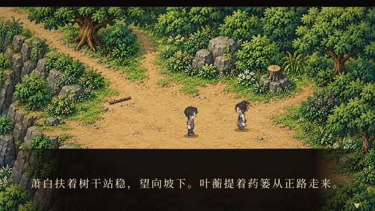

# 恢复序章开场展示

## 需求与核对

用户要求确认序章、第一章、第二章赴襄阳前的内容，并优先处理普通入口没有序章展示。工作区为xiaojianghu-legacy-prologue/8792，当前地图及人物继续按正式素材清单使用。

已阅读AGENTS.md、docs/update-workflow.md、设计目录、栖河序章与开场脚本、扩展剧情/实施/培养文档、素材目录与正式清单。核对实际prologue-arrival、qihe-chapter、培养桥接及已采用培养快照：序章、第一章和第二章赴襄阳前事件运行入口均存在；第二章旧“仅首期”记录对应早期实现与当时验收，本次已补当前快照说明。未以入口核对声称整个三年/所有分支全面验收。

## 原因与修复

原启动函数自动读取xjh.qihe-prologue.v2；玩家存档已记录arrival.stage=done、处于南村口，因此程序跳过已完成开场，直接显示探索地图。

先写[启动设计](../design/qihe-map/startup.md)，再实现：

- 普通首页/#qihe-map/#prologue显示启动页，提供从序章开始、继续进度，必要时保留继续原有进度；显示对应章节和场景。
- 开始新旅程写独立run存档和最近旅程指针，保留旧存档；评审存档不加入游玩记录。
- 显式开始/继续后play=1恢复当前旅程；刷新按既有检查点续播，不自动创建新进度。无法解析的记录原样保留。
- 新旅程首个场景改为后山，底图预载，避免村落闪帧。后山人物脚点移至对白框上方，固定开场隐藏探索HUD，人物完整可见。
- 更新首页标题、相关脚本缓存参数与当前实现文档。

没有新增/替换图片、地图或人物资源；没有采用其它工作区素材。原件和正式登记保持原采用版本。

## 验证

- node tools_scene/qihe/verify_startup.cjs：10项通过。实际启动/读写存档逻辑验证新旅程初遇、现代装、后山首帧、旧档字节不变、继续原场景、检查点刷新、4类评审隔离、损坏档保留、正常首页与襄阳隔离。结果art_sources/qihe-startup-20261006/tests.json。
- 浏览器：原普通URL刷新显示启动页；点击从序章开始，进入独立旅程并出现P-01-01后山初遇对白；刷新仍为开场检查点，人物不被对白框遮住。另从启动页继续原有进度，恢复南村口旧存档；测试标签关闭，交付标签停留在新旅程序章第一句。页面错误/警告为空。
- python3 tools_assets/check_production.py：398项通过、0错误。
- 本次没有重复整章剧情/战斗测试，相关历史测试仍按原范围记录。

[启动页](evidence/2026-10-06-prologue-startup/launcher.png) · [继续原有进度](evidence/2026-10-06-prologue-startup/resumed-original.png)

状态：本地完成；未Git提交；未线上发布。
