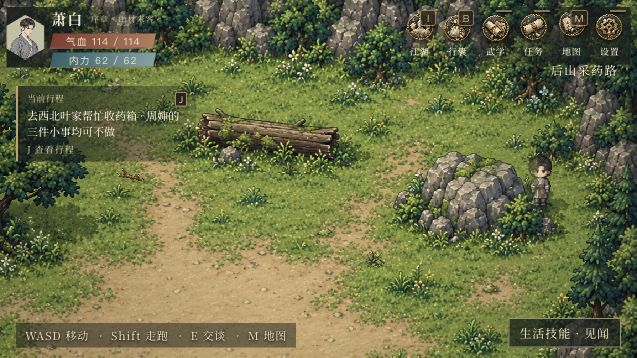

# 纠正两工作区游戏入口混淆

- 用户反馈：8766序章又显示旧地图和旧人物。
- 核对：本工作区AGENTS.md、docs/update-workflow.md、docs/design/qihe-map/README.md、expansion/characters.md、docs/assets/README.md和production-assets.md；查阅「整体测试」已确认的8792四向栖河试玩及人物整改记录。
- 原因：另一工作区xiaojianghu把自身opening-v4开篇原型当作当前栖河，并于8766启动；当前已确认版本实际在本工作区8792。没有证据表明本工作区正式图片被回滚。
- 修复：启动本工作区8792本地服务；另一目录8766的默认#prologue/#chapter1增加仅限本地的跳转，浏览器通过原8766页面刷新已实际到达8792#qihe-map。本工作区游戏代码及正式素材没有替换。
- 采用/弃用：保持m_qh_central正式高清四向图、qh_hero_initial初始便衣角色和现有NPC登记。opening-v4和另一目录已否定的4K村落均未采用。本轮没有生成新图片。
- 实机检查：恢复既有序章进度，看到栖河村中央与南村口场景、短发便衣主角及场景NPC；页面错误/警告日志为空。证据见下图。未清档、未将另一目录的坐标/章节数据迁移到本工作区。
- 命令：python3 tools_assets/check_production.py → 398项通过、0错误。另一目录本地路由6项检查通过，覆盖8792及已发布站点不跳转、培养入口不跳转和显式原型评审旁路。不是整章剧情复测。
- 待办：另一目录20261006批次的7张CG和三位代表新稿尚未整合至本工作区；其此前“正常游戏已接入”声明已更正，不以入口跳转声称内容整合完成。
- 状态：本地入口修复完成；未Git提交，未线上发布。

